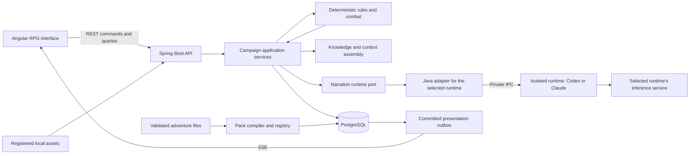

# Technical Architecture

## 1. Architectural style

Use an Angular frontend and a **modular Spring Boot application**. PostgreSQL is the canonical store. The backend owns command processing, rules, persistence, knowledge filtering, and the narration runtime integration. Start with one deployable backend rather than separate gameplay, memory, and orchestration services.

The primary project's stack is retained. The AI adapters are specific: Codex (default) and, as a selectable alternative, Claude Code ([ADR 0020](adr/0020-selectable-narration-runtime.md)). An internal runtime-neutral boundary keeps protocol details out of the domain; it does not imply a generic multi-provider product, and exactly one default runtime is active at a time. Owner-assigned model slots, free local backends and API-key backends are specified in [ADR 0021](adr/0021-inference-backends-and-model-selection.md).

The diagram describes dependencies and data exchange. It does not grant the runtime process database access.

## 2. Stack baseline

| Area | Decision | Version policy |
| --- | --- | --- |
| Frontend | Angular, TypeScript, standalone components, signals, SCSS, zoneless style | Angular 22.2.3, TypeScript 6.0.3, Node.js 24.22.1 LTS, and npm 11.19.1 pinned by [ADR 0009](adr/0009-toolchain-baseline.md); committed lockfile, no `latest` resolution |
| Async UI | Angular HTTP client; RxJS for streams and cancellation; signals for view state | RxJS 7.8.2 within Angular's supported peer range ([ADR 0009](adr/0009-toolchain-baseline.md)) |
| Backend | Spring Boot on Java 21 LTS | Spring Boot 4.1.2 compiled with `release 21` and run on a JDK 21 ([ADR 0009](adr/0009-toolchain-baseline.md)); libraries take their versions from the Boot BOM; Eclipse Temurin 21 JDK build and JRE runtime images on Ubuntu 26.04 LTS, pinned by digest |
| Build | Maven Wrapper | Committed `only-script` Maven Wrapper 3.3.4 running Maven 3.10.0, verified by SHA-256; no version ranges or snapshots; Maven Central only with strict checksums ([ADR 0009](adr/0009-toolchain-baseline.md)) |
| Data access | Spring Data JPA for aggregate persistence; explicit queries for projections | Keep domain calculations independent of entities |
| Database | PostgreSQL 18 | `postgres:18.6-trixie` pinned by digest; `pg_dump`/`pg_restore` 18.6 from the same image; major upgrades are explicit migrations with a verified backup ([ADR 0009](adr/0009-toolchain-baseline.md)) |
| Migrations | Flyway (open-source edition with the PostgreSQL module) | Flyway 12.4.0 managed by Spring Boot 4.1.2; forward migrations; backup and restore for destructive upgrades |
| JSON | Jackson with explicit DTOs and strict bounds | Reject unknown operation types and unsafe polymorphic input |
| Streaming | Server-Sent Events with durable cursor | Polling fallback; no dependency on browser access to Codex |
| AI | Selected narration runtime managed by a Java adapter: Codex app-server (default; packaged private IPC and local stdio probe profiles) or Claude Code in print mode behind an engine-owned supervisor (planned, P20) | Versioned adapter/container compatibility matrix per runtime; no assumed official Java SDK |
| Environment | Complete Docker Compose installation with root `start.sh`; backend serves compiled Angular assets | Digest-pinned Linux images with a refresh policy. Docker Engine 29.0+, Compose 5.0+, and Buildx; GNU Bash 4.4+. Windows 11 with Docker Desktop on WSL 2 and Git Bash is the first target ([ADR 0009](adr/0009-toolchain-baseline.md)). Verify the isolated runtime, durable volumes, health checks, and the supported shell/host matrix |

Do not select library versions merely by copying an old README or resolving “latest” during a build. Reproducible build versions and actual compatibility tests are required.

P02.2 provides neutral `frontend/` and `backend/` development shells with the pinned
toolchains and no adventure constants. The backend has JDBC/Flyway wiring and minimal
status-only health; runtime integration, packaged assets and full readiness
contracts were later P02 tasks. P03.1 adds Spring Data JPA, the first Flyway
migration and the canonical foundation entities in the `identity`, `adventure`,
`content`, `campaign`, `commands`, `characters`, `progression`, `memory`,
`presentation` and `persistence` packages. P03.3 adds an internal canonical commit service with a durable reference-only outbox; command APIs, semantic rules, runtime orchestration and outbox delivery remain later work. See the
[frontend](../frontend/README.md) and [backend](../backend/README.md) build/test commands.

## 3. Backend modules

P06.1 exposes atomic campaign creation through an opt-in local HTTP adapter.
`identity.LocalHttpAdmission` supplies server-configured owner context;
`campaign.CampaignCreationController` strictly decodes bounded JSON and delegates
to the transactional service. Durable creation receipts survive process restart,
while ephemeral browser sessions do not. See [ADR 0019](adr/0019-local-campaign-admission.md)
for the local trust boundary and explicit future-route admission requirement.

P06.5 adds `adventure.AdventureLibraryService` and its GET controller for
persisted owner-scoped library metadata. It reuses the local admission boundary,
which now protects all adventure routes, and independent read-only snapshots.
No process-global active adventure is stored; campaign reads continue to require
their explicit selected scope. `content.WorkspaceProjection` optionally consumes
committed-registration notifications and reconciles startup into private revision
folders through `RevisionFolders`. Files are derived from sealed PostgreSQL bytes,
never another mutable authority; publication is an atomic directory rename. I/O
failure after import cannot undo the database commit and is repaired by an identical
retry after storage repair. Frontend binding and generated-media storage remain open.

P04.1 adds a data-only manifest/parsing/hash stage in `content`, using fixed
classpath schemas and no I/O ports. Its immutable `ParsedPack` is distinct from
an admitted `ContentRevision`. P04.2–P04.3 add the pure `PackCompiler` semantic stage
(IDs, dependencies through a local catalog, cross-references, creation, items,
skills, abilities and world definitions) producing a `CompiledPack`. See the [pack contract](09-adventure-packs.md).

P04.4 adds a bounded `PackStaging` filesystem/ZIP boundary and `PackRegistry`, a
transactional JDBC service. Only staged inventories can enter registration; pure
parser/compiler results alone cannot bypass staging and media checks. V7 stores
original pack bytes and a sealed import report with the adventure-owned revision.
Dependencies resolve only within that adventure. No controller, activation or
media-serving route is exposed. See [ADR 0018](adr/0018-protected-pack-registration.md).

| Module | Responsibility | Main dependencies |
| --- | --- | --- |
| `identity` | Local owner identity and administrative privileges | Configuration and storage |
| `adventure` | Adventure workspaces that own content revisions and campaigns ([docs/25](25-adventure-workspaces.md)) | Identity, persistence |
| `content` | Parse, validate, compile, register, and version packs | Rules catalog, asset registry |
| `campaign` | Campaign creation, activation, state revision, lifecycle | Content, persistence |
| `commands` | Command taxonomy, idempotency, leases, operation state machine | Campaign, rules, orchestration |
| `rules` | Prerequisites, expressions, legal operations, effects, random-draw protocol | Pinned ruleset definitions |
| `characters` | Attributes, skills, resources, conditions, ability availability | Rules |
| `inventory` | Item identity, ownership, stacks, slots, durability, trade | Characters, rules |
| `quests` | Objective predicates, state transitions, rewards | Domain events, rules |
| `world` | Locations, clocks, factions, schedules, causal triggers | Rules and domain events |
| `social` | Relationships, commitments, NPC beliefs and goals | Knowledge and events |
| `combat` | Encounters, initiative, legal turns, reactions, resolution, settlement | Rules, characters, inventory |
| `progression` | XP, milestones, purchases, stat caps, reward ledger | Rules and events |
| `knowledge` | Fact scopes, provenance, public projections, disclosure. Implemented as `org.rpgengine.knowledge` (P09.1): typed claims with privileged truth, beliefs, last known locations, commitments, the commit-time ledger and audience/privileged views ([docs/08 section 4](08-memory-and-continuity.md#p091-typed-knowledge)) | Campaign and events; the canonical commit is its only writer |
| `memory` | Checkpoints, summaries, retrieval, context budgets | Knowledge, events |
| `ai` | Task profiles, prompt contracts, proposal parsing, model routing. The intent and narration contracts, their validators and the single-repair runner are implemented as `org.rpgengine.inference.contract` (P08.2, [docs/21](21-ai-task-contracts-and-prompts.md#14-implemented-intent-and-narration-contracts-p082)); session scoping by campaign, role, audience and policy as `org.rpgengine.inference.session` (P08.3) | Context, typed commands, the neutral task port; never an adapter package or repository |
| `codex`, `claude` | One adapter per runtime: transport/lifecycle, protocol framing, events, cancellation. The Codex adapter is implemented as the package-private `org.rpgengine.inference.codex` (P08.1, [docs/06](06-codex-integration.md#p081-production-adapter)); `claude` is planned (P20) | Private IPC or local process API according to deployment profile; only the neutral `org.rpgengine.inference` types; no domain repositories |
| `inference` | Runtime-neutral narration task port, logical `light`/`standard`/`deliberate` slots and configuration-backed slot assignment (P08.1, implemented). Planned: backend catalog and hardware advisor, readiness probes, class and budget rules, GPU and RAM admission coordinator ([ADR 0021](adr/0021-inference-backends-and-model-selection.md)) | Settings, `ai` and the adapters; no domain repositories |
| `presentation` | Narrative records, scene references, safe media cues; post-commit presentation jobs and the narration port (P07.5) | Committed events and projections |
| `operations` | Backups, imports/exports, diagnostics, recovery | All modules through administrative services |
| `persistence` | Shared entity base, engine-assigned identifiers and canonical value checks | JPA only; no domain rules |

These are logical packages initially, not separate Maven artifacts or services. Split further only when actual complexity warrants it.

## 4. Dependency rules

- The domain rules layer must not depend on HTTP, Angular, prompt templates, or the Codex transport.
- Controllers validate transport shape and invoke application services; they do not calculate damage or manipulate entity repositories directly.
- AI returns typed proposals. Only command services can request canonical transitions.
- Query services return purpose-built projections; serializing JPA entities into player responses is prohibited.
- Modules communicate using narrow services and typed domain events. A presentation listener cannot award loot.
- One application transaction coordinates changes spanning a resolved action. Avoid distributed transactions.
- JSONB is appropriate for namespaced extension values and immutable compiled definitions. Core ownership and balances need constraints and queryable fields.

## 5. Ports

The narration task port (drafted earlier as `CodexGameMasterPort`; runtime-neutral, with one adapter per runtime) exposes task-oriented generation: interpret intent, propose content, choose a legal tactic, narrate resolved events, and summarize an event range. Domain services never send raw arbitrary protocol methods. Since P08.1 its transport layer exists as `org.rpgengine.inference.NarrationTaskPort`: bounded tasks with a logical slot, logical session, instructions and output schema, returning untrusted results with fixed error codes and provenance. Since P08.2 the intent and narration contracts above it exist in `org.rpgengine.inference.contract`: versioned schemas, English templates, independent validators and `ContractRunner` with one bounded repair. P08.7 adds the privileged quest-plan contract there. Since P08.3 `org.rpgengine.inference.session` sits between them: `ScopedSessions` is the port's only submitter and gives each campaign/generation/role/audience/content/policy scope its own logical session, and player-facing roles can never be scoped to the privileged audience ([docs/06 section 7](06-codex-integration.md#p083-session-scoping)). Tactics and summary contracts are later work. No Codex type may appear outside the adapter package; `InferenceBoundaryTest` enforces this.

`RulesetPort` resolves legal actions and effects from a pinned ruleset. `CampaignRepository` loads canonical state and commits revisions. `KnowledgeQueryPort` provides permitted facts for an audience. `PresentationPublisher` emits committed output through an outbox. `RandomSource` produces and records server-owned draws. Tests can replace these boundaries independently.

## 6. Runtime separation

| Boundary | Data allowed across it |
| --- | --- |
| Browser → backend | Validated commands, preferences, content imports selected by owner |
| Backend → browser | Authorized projections, public narration, legal choices, operation status |
| Backend → runtime | Minimal task instructions, authorized context, supported structured output contract |
| Runtime → backend | Untrusted structured proposals or narrative, never canonical records |
| Pack → runtime | Compiled, validated content and bounded expressions |
| Canonical store → summaries | Provenance-linked facts/events; no replacement of the original records |

The player should not see RPC logs, chain-of-thought, command output, unfiltered model commentary, private relationship metrics, or hidden creature tactics. Developer diagnostics must be separately permissioned and redacted.

## 7. Local deployment

The packaged installation runs the modular backend with compiled Angular assets, PostgreSQL, and an isolated narration runtime (Codex by default, or Claude when selected) through Docker Compose. A root `start.sh` validates prerequisites, builds or reuses images, starts services, waits for readiness, and reports the loopback URL. It preserves campaign/content/asset volumes and does not require host build toolchains. A frontend development server and host stdio probe are optional development workflows. This replaces the earlier database-only Compose baseline under [ADR 0008](adr/0008-containerized-startup.md).

The proposed packaged transport is a private Unix socket in a Linux IPC volume shared only by engine and runtime. Compose owns the runtime service; the backend owns its RPC connections and turns. P01 must prove the selected container, client, permissions, and authentication profile. See [container deployment and startup](22-container-deployment-and-startup.md) for the launcher contract, storage boundaries, and delivery gates.

AI conversations have isolated runtime workspaces outside the source checkout and pack directories. The bridge exposes neither database credentials nor database network access to tools. Authentication needed by the selected runtime remains managed by that runtime's own supported mechanisms; the engine never reads or provisions credentials. Log and credential handling are detailed in [security and operations](14-security-and-operations.md).

The app binds to loopback by default. GitHub publication distributes source; it does not expose a public gameplay server. A public-hosting design needs a separate authentication, tenant isolation, credential, abuse, and deployment review.

The root Compose file packages the neutral shell as `engine`, `postgres` and
`codex`. The digest-pinned multi-stage engine build embeds Angular assets/notices
in the jar; a JRE-only non-root service serves them on loopback. P05.6 packages
`/en/` and `/it/` with a root browser selector reading the saved device locale or
defaulting to English. Finite preview GET routes serve compiled indexes; APIs and
missing files keep their own HTTP semantics. Shared artwork/notices retain stable
root URLs. Only engine and
postgres join internal `data`; only runtime joins `inference`; engine alone joins
`web` for published HTTP. The optional `models` service (P21.2-A) runs only under
its Compose profile and shares only the internal `models` network with the engine.
The one-off `models-fetch` service (P21.2-B) is the only container that writes its model directory and the only path by which the engine downloads catalog weights; the owner may still add files by hand.
Engine and runtime share UID 10001 for private socket
access, but never account/data mounts. Engine mounts socket IPC read-only and
owns separate content/assets volumes. Its Spring `packaged` profile consumes
the database file secret; the host profile remains loopback-only. Account-free
HTTP, IPC, secret and neutral storage recreation checks pass. The application
adapter, launcher, gameplay readiness and campaign recovery remain later work.
See the [backend build instructions](../backend/README.md). ADR 0009's subsequent development-only revision permits continued local image work on the verified existing Java pins; the newest published Java update remains a release gate.

## 8. Concurrency and background work

One campaign admits one state-changing operation at a time using a database-backed lease and fencing token. Queries remain available against the last committed revision. No database transaction stays open while waiting for the narration runtime. At commit time the service verifies the state revision, lease token, current actor, and ruleset hash.

Summary generation and media work occur after canonical commit. The outbox retries publication without replaying gameplay. All background jobs have stable identity, source revision, retry policy, and stale-result handling. Bounded image jobs use the verified image capability, public appearance projections and durable entity/asset associations described in [ADR 0011](adr/0011-visual-novel-and-persistent-artwork.md) and [presentation assets](23-presentation-assets.md); an image job cannot mutate canonical item rarity, ownership or mechanics. Media failure cannot prevent a valid purchase, save or combat action.

## 9. Architectural evolution

Add full-text retrieval before semantic indexing. Add an authoring editor after the pack format stabilizes. Add a separate AI service only when profiling or required libraries make it necessary. Add alternate rules schedulers through explicit versioned extensions. A future generic provider is a separate product decision, not hidden v1 scope.

## 10. Research revision: planning, language and optional media

Retain the Angular/Spring/Java/PostgreSQL modular monolith. Extend existing
background work with one PostgreSQL durable priority queue and distinct logical
intent/narration, quest-planning and occasional world-direction tasks. Begin with
one active inference turn; qualified concurrency is an opt-in capability, not a
claim that threads create independent provider capacity. The [planning contract](28-asynchronous-narrative-planning.md)
owns snapshots, dependency-sensitive admission, lifecycle, fairness and budgets;
ADR 0014 preserves ADR 0013's verified tool-free runtime isolation. No broker,
autonomous-agent framework, runtime pool or vector database is required. P08.6
implements that queue as `InferenceScheduler` over V14 `inference_task` in front of the
session registry, with one active turn installation-wide
([docs/06 section 12](06-codex-integration.md#p086-durable-fair-scheduling)). P08.7 adds the
optional `org.rpgengine.planning` package (snapshot assembler, planning service, worker; off
by default). No command, commit, narration or presentation code depends on it, so the
playable loop is identical with planning disabled
([docs/28 section 4](28-asynchronous-narrative-planning.md#4-player-experience-and-work-selection)).

Interactive work has reserved admission and bounded waiting. No transaction or
campaign mutation lease is held while a deep background plan runs. Planning
artifacts are durable noncanonical preparation; completion never advances the
world clock, awards a reward or forces the next player action. Typed command
services revalidate dependencies and activation: since P07.6 a canonical commit that
cites admitted plan branches rechecks them against current rows under the campaign
lock and records each use once, while the plan supplies no effect. Hidden planner context never
enters a public narrator thread, media cue or loading diagnostic.

The [bilingual contract](29-localization.md) adds locale variants/preferences and
direct selected-language narrative output without replacing canonical IDs.
An optional [local speech worker](30-local-speech-synthesis.md) is a justified
media process for Python/ONNX libraries, not a second game backend or text-AI
provider. It receives only validated public lines and admitted voice references,
has no database/account mount, and shares bounded media/GPU admission with image
jobs. SSE delivers metadata/asset IDs; complete audio segments use authorized
asset serving, not raw model tokens or executable frontend directives.

Verified status remains the existing shell/probe/partial packaging evidence.
These architectural additions are design only; their EN/IT, concurrency, narrative
quality and GPU checks are scheduled separately and have not run.
