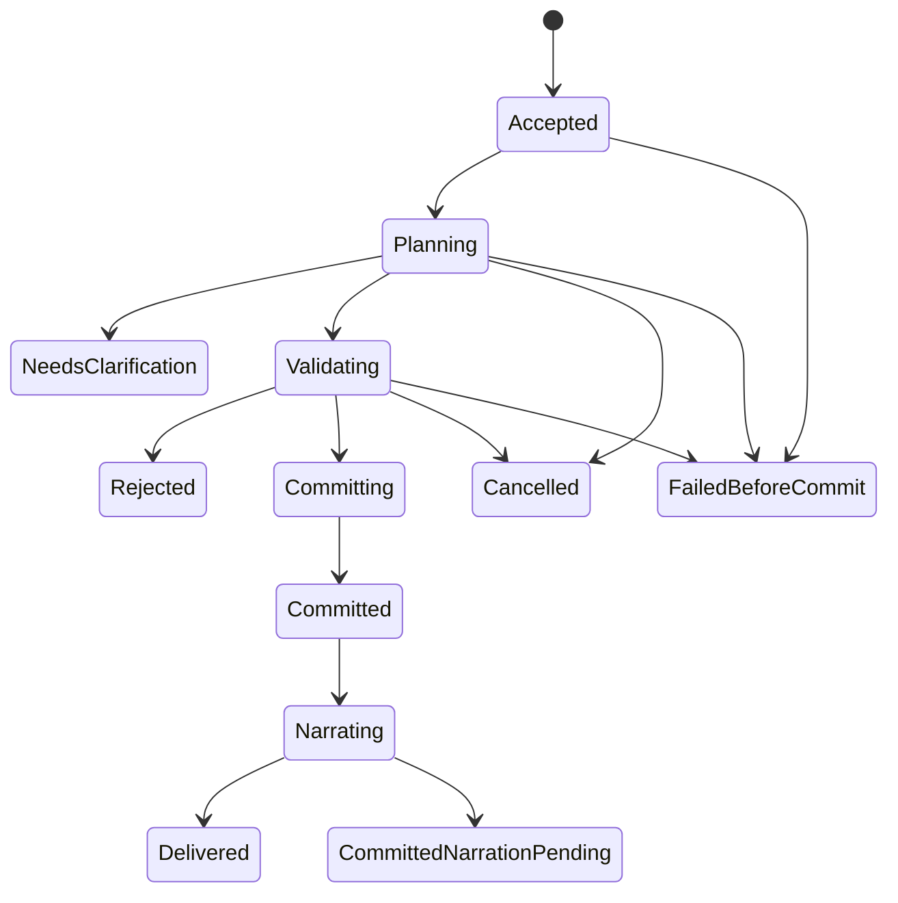

# Command and Turn Protocol

## 1. Command classes

| Class | Examples | Canonical effects |
| --- | --- | --- |
| Deterministic consultation | Sheet, inventory, legal abilities, known quests, current combat options | None; no Codex required |
| AI consultation | Ask a guide to explain a discovered clue | Read-only response; no world/turn/time/RNG changes |
| Narrative action | Speak, travel, investigate, use an item, attempt an uncertain action | One validated canonical operation if resolved |
| Combat action | Move, strike, guard, use ability, react, end turn | Validated encounter transition and recorded consequences |
| Administrative operation | Export, restore preview, migrate pack, apply explicit correction | Separate permissions and audit rules |
| Presentation preference | Text size, theme, audio enabled | Preference store; no world effects |

Typing “inventory” inside a sentence must not accidentally become a command. Prefer explicit UI modes and structured command types, with a small documented exact-command parser as convenience.

## 2. Operation lifecycle

`NeedsClarification` is terminal for that proposed action and consumes nothing. The clarified response is a new command referencing the clarification. An operation is never reported as cancelled after its effects committed. `CommittedNarrationPending` is a successful game action with recoverable presentation work.

## 3. Acceptance

1. Validate local owner access, campaign ID, payload size, command type, and mode.
2. Normalize the command for hashing while preserving meaningful text and choices.
3. Insert an operation journal row using campaign-scoped idempotency key and payload hash. A duplicate with identical hash returns its current or final result; a changed payload using the same key returns a conflict.
4. Acquire the campaign mutation lease for actions, with a fencing token and base revision. A competing action is rejected as busy or stale, not silently queued behind an unseen future state.
5. Resolve deterministic consultations immediately from the last committed public projection. Record transcript delivery separately if desired.

The acceptance response identifies the durable operation. A dropped HTTP response does not mean the action failed.

P03.2 persistence guards now give each mutable journal row a storage `row_version`
separate from `operationVersion` and the canonical revision. JPA rejects a stale
copy; raw SQL must compare the expected row version and check the affected-row
count. PostgreSQL permits multiple uncommitted NULL revisions, but only one
operation per `(campaign_id, committed_revision)`. Committed statuses carry both
receipt and revision; other statuses carry neither. Once recorded, neither commit
field can change, and terminal statuses cannot reopen. These are database bounds;
the atomic acceptance/commit service, revision checks, leases and outbox are still
pending P03.3/P03.5. See [domain constraints](05-domain-model.md#3-database-organization).

## 4. Planning and validation

Capture a consistent state revision and assemble authorized context. Known structured actions bypass AI interpretation. Free text may need a Codex intent proposal. An ambiguous action that could spend a rare item, make a binding commitment, or affect several targets requires clarification before spending anything.

The proposal identifies intent, existing content IDs, targets, requested effects, a bounded content-creation proposal when necessary, and referenced facts. It does not contain authoritative dice results, resource deltas, or a claim that a reward has been granted.

Validate shape, operation allowlist, actor ownership, turn eligibility, target scope, prerequisites, known abilities, equipped items, current resources, range, knowledge, generation bounds, and causal dependencies. Reject unknown fields that imply hidden side effects. A multi-effect action is atomic as a whole unless the selected rule explicitly defines staged outcomes. Never apply the valid half of a potion or trade transaction.

The rules service produces a resolved mechanical plan. Random draws are allocated by the backend in a short durable planning transaction, keyed by operation and draw ordinal, before final resolution. Their values are private until relevant output is committed. A same-operation retry reuses them. A new deliberate attempt is a new action only if allowed by the game state. Cancelling after allocation does not permit reroll fishing: the reserved draw remains bound to the attempt and the attempt policy must prevent recreating an equivalent unresolved action solely to reroll.

## 5. Canonical commit

Open a short PostgreSQL transaction and re-check the revision, lease/fencing token, current encounter actor, selected ruleset, and affected resources. If stale, do not reuse the proposal against new state; fail or explicitly replan before committing.

Commit together:

- All domain changes and generated canonical definitions.
- World-time changes and scheduled consequences due within this action.
- Domain events and their provenance.
- Reward settlements due at this boundary.
- New state revision, game-turn increment where applicable, and pending decision.
- Operation receipt including calculation and random-draw references.
- Outbox messages for public state and required narration.

If this transaction fails, no canonical effects are visible. Durable operation and draw records may remain for diagnosis/retry, but are not world state. The save acknowledgment includes operation ID and committed revision; it is produced by the backend, never accepted from model prose.

## 6. Narration after authority

Codex narrates the **resolved event bundle**, receiving only the intended audience's permitted view. Do not stream unvalidated outcome prose to the player. During planning, show application-generated progress such as “Resolving your action.” Provider commentary, tool output, and intermediate JSON stay private.

The MVP publishes final narrative after validation against the resolved bundle. Checks include schema, actor/target references, forbidden secret markers, inconsistent numeric claims, and unsupported state assertions. These checks cannot prove every implication in natural language. Adversarial evaluations and a correction mechanism remain necessary. Use structured narrative sections and bounded length to make review tractable.

If prose is invalid, allow one narration-only repair. If repair fails or Codex is unavailable, publish a deterministic mechanical receipt and keep a narration-pending flag. Retrying narration cannot re-run the original action or roll new dice. Text generation is outside the canonical transaction.

No second AI request is needed for local consultations. A structured action may need only a narration request. Free-text actions may need interpretation followed by narration. The engine must measure this cost rather than claim every turn is a single call.

## 7. Counters and time

Canonical state-changing player actions increment `gameTurn` once. Their rules determine world duration. Speaking a meaningful line may consume narrative time and create a fact, but editing a draft or viewing history does not. Administrative corrections can increment state revision and append events without advancing the game turn.

Combat player and NPC operations update initiative and encounter state according to the scheduler. World time advances once per completed combat round by the ruleset's round duration, not once per actor. Partial rounds persist their progress without prematurely advancing the round clock. If combat ends mid-round, apply one configured partial-round duration once at settlement; AI RPG Skirmish rounds this to one round. Time-triggered effects must use the encounter timing rules, not duplicate both world-time and round-time ticks.

## 8. Interrupt and recovery matrix

| Interruption point | Required behavior |
| --- | --- |
| Before planning completes | Cancel generation, release lease, no canonical changes |
| During validation | Cancel before commit if cancellation wins the commit lock |
| At commit boundary | Transaction decides; inspect receipt before reporting outcome |
| After canonical commit | Preserve effects; stop optional narration; mark presentation pending |
| After delivery but before HTTP acknowledgment | Same idempotency key returns committed result |
| Backend restart during generation | Reconcile journal; expire old lease; rotate affected AI context; no speculative commit |
| Codex dies or emits invalid output | No commit from incomplete proposal; retain committed results and pending narration |
| SSE connection drops | Reconnect from cursor or query operation; do not resubmit blindly |

Process cancellation is not database rollback. Killing Codex never undoes a committed turn. The UI must distinguish “cancelled before resolution” from “action saved; narration interrupted.”

## 9. Retry limits

Protocol reconnect may retry safe discovery/read requests. Proposal repair is limited to one bounded retry with the same canonical context. A valid but disallowed action is a gameplay rejection, not a reason to ask AI repeatedly until it passes. State-changing transport retries always use the original operation key. AI service errors have capped backoff; no infinite automatic loop or silent provider switch.

## 10. Player agency and narrative facts

An action resolves only the player's declared intent and unavoidable consequences. Suggested actions fill the composer or open a confirmation preview; they never submit themselves. A narrative answer must stop where another meaningful choice is needed.

Generated details that change future possibilities must be registered through the content/fact proposal path before their narration is published as canon. A final narrator can choose atmosphere and wording but cannot introduce a usable potion, secret passage, binding promise, new attacker, or extra player action after commit. If such a proposal is desirable, it belongs in a subsequent planned operation.

## 11. Background preparation and presentation

Quest acceptance commits its known terms and current pending decision through
this pipeline; it does not wait for a deep quest outline. A background job may
prepare compatible future possibilities from that snapshot. Until admission,
immediate narration uses only known/committed facts and the playable baseline,
never promises that an undiscovered clue or particular ending exists.

On completion, validate the versioned plan's scope, author constraints and
declared/read/query dependencies, then repeat the affected checks transactionally
with fencing and idempotency. Unrelated world revisions alone need not discard
independent content. New deaths, discoveries, removals or query phantoms do
invalidate affected assumptions. Reject or selectively replan with bounded
retries; never resurrect a required NPC or reopen a completed quest merely to
preserve a plan. The canonical [plan admission contract](28-asynchronous-narrative-planning.md)
defines the state machine and dependency rules.

Only ordinary validated commands activate facts, consequences or scheduled
events, with the existing receipts and source settlement keys. Accepting a
noncanonical artifact, changing locale, reading a passage or playing audio has
no world effect. Typed public presentation events are derived after accepted
narration; replay/cancel/skip cannot resubmit a game command. Locale mismatch or
optional media failure preserves the original canonical receipt.
