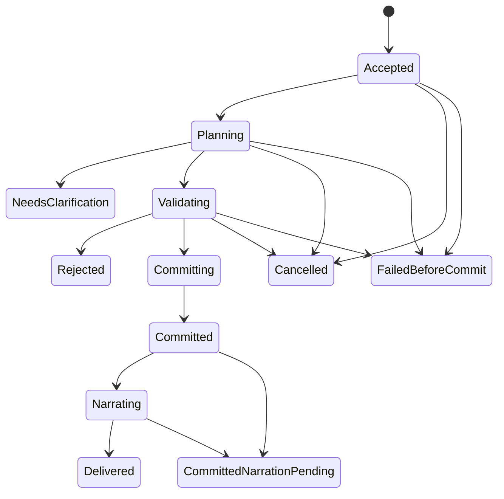

# Command and Turn Protocol

## 1. Command classes

| Class | Examples | Canonical effects |
| --- | --- | --- |
| Deterministic consultation | Sheet, inventory, legal abilities, known quests, current combat options | None; no Codex required |
| AI consultation | Ask a guide to explain a discovered clue | Read-only response; no world/turn/time/RNG changes |
| Narrative action | Speak, travel, investigate, use an item, attempt an uncertain action | One validated canonical operation if resolved |
| Combat action | Move, strike, guard, use ability, speak, negotiate, interact with the scene, react, end turn | Validated encounter transition and recorded consequences; chat uses the same turn/cost checks |
| Administrative operation | Export, restore preview, migrate pack, apply explicit correction | Separate permissions and audit rules |
| Presentation preference | Text size, theme, audio enabled | Preference store; no world effects |

Typing “inventory” inside a sentence must not accidentally become a command. Prefer explicit UI modes and structured command types, with a small documented exact-command parser as convenience.

Speaking to an in-world participant during a fight is a combat command, not a read-only guide consultation. The [combat dialogue policy](11-combat-system.md#71-dialogue-and-scene-changing-intent-during-combat) distinguishes bounded speech from a negotiation or other consequential action. Free text supplies the player's attempted words/action and intended recipient; it never directly rewrites a past event or the encounter. Identify the supported action, current actor, encounter and revision before resolution. Clarify unknown costs, ambiguous recipients or a combined speech/action request before spending anything. Outside an eligible player decision, keep an editable draft without submitting or silently queuing it for a future activation. A rejected, busy or stale submission leaves the fight unchanged and requires explicit review/resubmission; reconnect cannot send the draft.

## 2. Operation lifecycle

Optional [speech input](35-speech-input-and-hands-free-play.md) changes only the
input modality: recognition and voice preview/correction are draft work, with no
world operation. Explicit confirmation binds one current payload/decision to the
same command acceptance and durable request identity below. Microphone silence,
audio retries, playback, stale results and reconnect never submit. Out-of-turn
spoken input cannot queue a later action or spend any combat resource. STT is
unimplemented/disabled; its qualification is separate from TTS output.

P06.2 HTTP state/continue and known-state/inventory/quest/ability reads use a
consistent committed player snapshot with explicit scope/revision tokens. They
create no operation, transcript, event, random draw or narration job. Continue
only reloads the save; it cannot choose the pending decision. P06.3 creation
persists a version-1 starting marker at revision/turn/time/event zero. State/continue
expose its pinned localized public situation and `STARTING_SITUATION`/`FREE_TEXT`
metadata without an operation, transcript delivery or automatic player choice.
Clearing/replacing a marker belongs to a later canonical command; reading or
retrying creation never restores it. Exact text command
consultations use the P06.4 exact read adapter described below.

`NeedsClarification` is terminal for that proposed action and consumes nothing. The clarified response is a new command referencing the clarification. An operation is never reported as cancelled after its effects committed. `CommittedNarrationPending` is a successful game action with recoverable presentation work.

P07.5 adds two edges: `Accepted → Cancelled` (cancellation can win before the prepare
step starts) and `Committed → CommittedNarrationPending` (a presentation job can be
stopped or retired before narration starts). Neither can undo or skip a committed effect.

## 3. Acceptance

1. Validate local owner access, campaign ID, payload size, command type, and mode.
2. Normalize the command for hashing while preserving meaningful text and choices.
3. Insert an operation journal row using campaign-scoped idempotency key and payload hash. A duplicate with identical hash returns its current or final result; a changed payload using the same key returns a conflict.
4. Acquire the campaign mutation lease for actions, with a fencing token and base revision. A competing action is rejected as busy or stale, not silently queued behind an unseen future state.
5. Resolve deterministic consultations immediately from the last committed public projection. Record transcript delivery separately if desired.

The acceptance response identifies the durable operation. A dropped HTTP response does not mean the action failed.

P03.2 persistence guards now give each mutable journal row a storage `row_version`
separate from `operationVersion` and the canonical revision. JPA rejects a stale
copy; raw SQL must compare the expected row version and check the affected-row
count. PostgreSQL permits multiple uncommitted NULL revisions, but only one
operation per `(campaign_id, committed_revision)`. Committed statuses carry both
receipt and revision; other statuses carry neither. Once recorded, neither commit
field can change, and terminal statuses cannot reopen. These are database bounds;
P03.3 now adds the internal commit service, exact revision checks and durable outbox.
P03.5 supplies leases/fencing and P07.1 supplies owner-scoped admission/status;
typed/common gameplay authorization is supplied by P07.2, current-state rule validation by P07.3
and local calculation and execution by P07.4 below.
See [domain constraints](05-domain-model.md#3-database-organization).

### P07.1 durable admission

`OperationAdmissionService.submit` now authorizes the owner/adventure/campaign,
canonicalizes the envelope before opening a transaction, and serializes by owner
then campaign. It checks the stored campaign/request identity before freshness or
capacity: equal hashes return the existing status without a new lease; changed
hashes conflict. A new request requires the exact current revision, a free campaign
permit and fewer than two live mutation permits across all of the owner's adventures.
Busy, stale, conflicting or limited requests create no row and queue no future action.
Every rejection rolls back any attempted cleanup as well as insertion/grant.

The version-1 canonical UTF-8 JSON contains `commandType`, `expectedRevision`,
`payload` and `version`, hashed with SHA-256. Keys sort in Java UTF-16 order, array
order and exact text remain meaningful, and mandatory JSON escaping preserves
Unicode scalar values without normalization. Integers use plain decimal; decimals
use trailing-zero-stripped unscaled value plus exponent (`1.50` and `1.5` match,
but integer `10` differs from decimal `10.0`). Unsupported Java values, unpaired
surrogates, cycles, more than 64 nested containers including the envelope, decimal
scale overflow and canonical output beyond 32,768 bytes are rejected. Incremental
output budgets bound copying, sorting, numeric conversion and recursion for direct
callers as well as HTTP. A normalization change requires a new format version;
stored hashes must not be silently reinterpreted.

Admission journals `ACCEPTED` and grants a fresh holder/fence with a 180-second
PostgreSQL-clock deadline in one commit. The existing lease high-water row survives
release/expiry. Cleanup retires expired permits and fails orphaned pre-commit work
before granting a successor. Cleanup and the busy check use one captured database
timestamp: a permit that lapses during these checks conservatively returns busy;
a later request can retire it. Otherwise, differing clock reads could overwrite
a just-expired permit while leaving its old journal incorrectly active.

All internal `MutationLeaseService.acquire` paths share the same owner lock/cap,
including reacquisition after expiry. Matching live retries and renewals reuse one
slot. Renewals lock the owner before campaign/journal and must still be live at the
update; an expired permit cannot be revived by renewal after capacity was reused.
Commit/release/recovery only remove permits and never acquire the owner lock after
a campaign lock. Lock/statement/transaction bounds remain 2/5/10 seconds. These are
mutation limits, independent of runtime inference/job permits; background planners
obtain no campaign mutation permit through this change.

The owner lock serializes admission with renewal, but does not extend a lease's
lifetime. A renewal must still satisfy the database-time expiry predicate after
obtaining that lock, even if the request began while its permit was live. The
PostgreSQL acceptance corpus forces expiry during actual lock contention in both
acquisition orders: the late renewal fails and another campaign can consume the
expired slot without exceeding the owner cap. See the
[acceptance evidence](15-quality-and-acceptance.md) for the injected boundary and
remaining gameplay/delivery scope.

Status and identical retries return detached journal progress, base/committed
revision, operation version and timestamps. They perform no recovery or world write,
and reveal no payload, payload hash, internal receipt, draw, holder or fence. An
expired journal can still report its stored pre-commit status until a new admission
or startup reconciliation retires it; polling is not a heartbeat. Matching stored
commit receipts and draw reservations remain replayable internally before freshness
checks, with no repeated effects. The [HTTP contract](13-api-and-ui.md#p071-admission-and-status)
defines the bounded envelope, scope and stable error codes.

P07.1 installs admission/status only: there is no gameplay execution worker or
payload persistence for resuming unfinished intent. A lost permit eventually fails
before commit; an identical retry never recreates it. P07.2 adds the typed/common
semantic boundary below. Detailed rule resolution, public mechanical receipt
projection, browser submission, streaming and cancellation remain subsequent work.
Admission alone never claims an executed game action or a runtime request.

### P07.2 typed intentions and atomic common semantics

`TypedCommand` is a sealed, immutable vocabulary. A proposal contains an intention,
never a resource delta, field assignment, receipt, reward, dice result, executable
callback or arbitrary effect list. The initial exploration registry is deliberately
small; each new action must add an explicit type, closed payload and current-state
validator. Unsupported actions, including item/ability/trade/combat actions, fail
closed until their contracts and rule services are implemented.

| Type | Exact payload | Structural bounds |
| --- | --- | --- |
| `MOVE` | `destinationId` | Nonblank stable content reference, at most 256 UTF-16 units |
| `WAIT` | `seconds` | Exact JSON integer, 1..86,400 |
| `SPEAK` | `recipientActorId`, `text` | Canonical UUID and nonblank text, at most 4,000 UTF-16 units |

Text remains exact: no trimming, Unicode normalization or decimal/string coercion.
The wait cap is an input ceiling, not permission to advance a day. P07.3 below adds
`USE_ABILITY` plus reachability, recipient knowledge/range, ownership, prerequisite,
resource and causal rules; legal wait duration remains P10.4. P07.4 below executes an
admitted intention locally in the same request; `ACCEPTED` on its own means only durable
admission after the checks implemented here.

Admission hashes a bounded canonical byte snapshot before locking. Under the
existing owner → campaign order it authorizes scope, replays/conflicts an existing
request, checks the exact revision, then decodes **those same bytes** and runs
`CommandSemantics` before cleanup, journal insertion or permit grant. A direct Java
caller mutating its input map during lock contention cannot change the validated
intention without changing its hash. Fresh unknown types, missing/extra fields,
nested patches, batches and client-selected actor/effect/cost fields are rejected
as a whole. Matching pre-registry requests still replay their stored progress,
without executing or authorizing their old payload; changed duplicates conflict
before current registry checks.

Common semantic validation requires `EXPLORATION`, either a null decision or the
exact supported version-1 starting marker, and the `CHARACTER` actor bound by the
immutable campaign-creation receipt. The server selects this player; a request
cannot nominate a different actor. Legacy campaigns without that binding and
unknown/future pending decisions fail closed. Addressed speech additionally requires
a recipient in the same campaign. All encounter intentions are rejected until the
encounter scheduler can validate decision ownership and costs; speech gains no
special bypass. Rejections roll back the whole admission transaction, including
any cleanup, and consume no request identity or permit.

Trusted resolution carries `CommandIntent` with owner, request, revision and a sealed
typed intention into `ResolvedCommit`. For registered player operations the canonical
transaction requires that evidence to match the journal's type/request/hash and
rechecks owner scope and current common semantics under its campaign lock, after
revision/operation/fence checks and before changing entities. An earlier valid
admission is not a reusable authorization stamp. Omitting or changing the evidence
cannot use the compatibility constructor to bypass validation. The legacy internal
resolved-plan constructors remain for trusted non-player operations; neither those
constructors nor resolved effects are exposed over HTTP or to narrative planners.
Local resolution, not the intention, remains responsible for choosing all effects.

All effects still share one canonical transaction. A later invalid resource effect
rolls back an earlier valid cost, counters, events, settlements, receipt, outbox and
lease release. Prior durable draw reservations remain independent and unchanged.
Matching committed receipt replay precedes current eligibility checks, since replay
cannot perform new effects. Background artifacts never enter this path as world
facts: their activation must construct an ordinary typed command and pass the same
current-state gate ([planning admission](28-asynchronous-narrative-planning.md#7-dependency-sensitive-staleness-and-admission)).

### P07.3 current-state rule validation

`CommandRules` runs immediately after `CommandSemantics`, in the same transaction and
under the same campaign row lock, at admission (before cleanup, journal insertion or
permit grant) and again at canonical commit (after replay, revision, operation and
fence checks, before any entity changes). Every premise is read from committed rows
at that moment; an earlier admission, a planning snapshot or a cached catalog never
counts as permission. Rejections use sanitized categories, roll back the whole
transaction and consume no request identity, permit, draw or world state. Matching
admission retries and committed receipts still replay before these rules.

P07.3 registers one more exploration intention. Costs, magnitudes, draws, outcomes
and actor overrides are never part of it; the server derives them during resolution.

| Type | Exact payload | Structural bounds |
| --- | --- | --- |
| `USE_ABILITY` | `abilityId`, `targetActorIds` | Nonblank stable content reference of at most 256 UTF-16 units; array of at most eight distinct canonical UUIDs in submitted order (order is hashed); empty means no explicit target |

| Intention | Rules, in order; the first failure wins | Category |
| --- | --- | --- |
| `MOVE` | The player has a current location; the destination differs from it, exists in the pinned closure, is not `knowledge: secret`, and an `accessible: true` authored link leads there from the current location | `DESTINATION_UNAVAILABLE` |
| `SPEAK` | The recipient is another actor of this campaign, shares the player's non-null current location and is perceivable (below) | `ACTOR_UNAVAILABLE` |
| `USE_ABILITY` | Ownership: a pinned ability the player has a `learned_ability` row for | `ABILITY_UNAVAILABLE` |
| | Prerequisites: every prerequisite ability learned and every skill at or above its rank in `character_state.skills` (missing means rank 0) | `PREREQUISITE_UNMET` |
| | Target policy: `self` takes no explicit target, `single` exactly one, `multiple` one to `maxTargets`; `area` needs encounter zones (P11) and every unknown policy fails closed | `TARGET_ILLEGAL` |
| | Every explicit target is perceivable and co-present; a single-target ability may name the player itself | `ACTOR_UNAVAILABLE` |
| | Resources: each nonzero declared cost is at most the player's current value above its minimum, in the vocabulary of the ability's declaring pack | `RESOURCE_INSUFFICIENT` |
| `WAIT` | No rule beyond P07.2; legal duration belongs to the world clock (P10.4) | — |

**Knowledge.** An actor is perceivable when it has no authored origin, or its origin
resolves in the pinned closure and is not `knowledge: secret`. A creation profile is
the player's own origin and is never concealed. Secret locations and actors stay
undiscoverable and fail closed until a typed reveal discloses them to the player. Since P09.1
that means a current `TRUE` `EXISTS` claim about the location or actor that is `COMMON`, or
that the player currently `KNOWS` or `BELIEVES`
([docs/08 section 4](08-memory-and-continuity.md#p091-typed-knowledge)). Rumors, doubts,
false or undetermined claims, other actors' knowledge and the free-text `campaign_known_fact`
are not rule sources. Unknown,
concealed, unlinked, blocked or current destinations share one category, and missing,
foreign, self, absent and concealed recipients share another, so a rejection never
confirms that a hidden location, route or actor exists.

**Resource vocabulary.** Resource keys are unqualified. Campaign creation stores the
resource IDs declared by the creation profile's own pack, while ability costs name
resources of the ability's declaring pack. A nonzero cost from a different pack is
therefore never charged to a same-named player resource; it is unaffordable. Cost-free
dependency abilities remain usable. A player without a resolvable creation origin, or
without the resource row, cannot pay any cost.

**Causal attribution.** At canonical commit the rule result is the set of
participants: the player plus the speech recipient or explicit ability targets.
Every resolved resource change must belong to a participant and every event actor
must be absent or a participant; otherwise the trusted plan is rejected as a resolver
defect (`IllegalStateException`) before any write. Premises are re-derived after the
lock, so an effect cannot depend on a target that left, a cost already spent or a
link that closed after admission. Event causation references must name events of the
same campaign (database key), and the exact-revision check makes every such event
causally earlier than this operation. P07.3 checks only that the premises hold and that
effects are attributable; P07.4 below spends the cost and applies the effects.

**Pinned rule facts.** `CommandRuleCatalogs` loads a compact catalog before the lock:
it authorizes owner/adventure/campaign scope in a short read-only transaction, then
reparses and recompiles the campaign's sealed revision closure through `PackRegistry`.
It keeps only location links/disclosure, actor-origin disclosure, creation-profile
vocabularies, ability contracts and (P10.2) item valuations and use contracts plus the P10.1 character rule projection (stack bounds, equipment facts and slot vocabularies) under canonical IDs (root IDs unqualified,
dependency IDs `pack#id`); no prose, secret text, effect tree or localization is
retained. At most 16 revisions are cached (least recently used evicted); pinned
revisions are frozen by trigger and sealed bytes are immutable, so a cached catalog
equals the locked state, and the locked validator still compares the revision ID.
Load failures never throw from preload: a fresh command whose rules need definitions
then fails with `CONTENT_UNAVAILABLE`, while `WAIT` and speech to an actor without an
authored origin need no catalog. Recompilation therefore never extends lock hold time.

Encounter intentions (`ATTACK` and similar) remain unregistered and fail closed. Since P10.2 the
item intentions below are registered; an unknown item type, a forged instance or an attempted generic
field patch still cannot reach canonical state through any route.

### P10.2 item intentions

Five more exploration intentions name item instances, never effects. Prices, slots, magnitudes and
resulting quantities are never payload fields; the server derives them from pinned definitions and the
current rows.

| Type | Exact payload | Structural bounds |
| --- | --- | --- |
| `USE_ITEM` | `itemInstanceId`, `targetActorIds` | Canonical UUID; at most eight distinct canonical UUIDs in submitted order (hashed; the equivalent-attempt identity sorts them) |
| `EQUIP_ITEM`, `UNEQUIP_ITEM` | `itemInstanceId` | Canonical UUID |
| `TRANSFER_ITEM` | `itemInstanceId`, `recipientActorId`, `quantity` | Canonical UUIDs; exact integer 1..9999 |
| `TRADE_ITEMS` | `counterpartyActorId`, `offered`, `requested` | Canonical UUID; each side one to eight `{itemInstanceId, quantity}` lines (order hashed), no instance named twice across both sides |

| Intention | Rules, in order; the first failure wins | Category |
| --- | --- | --- |
| `USE_ITEM` | The instance is held by the player and its pinned definition has a `use` contract; a contract that consumes needs the instance unworn | `ITEM_UNAVAILABLE` |
| | Target policy and perceivable targets, exactly as for abilities | `TARGET_ILLEGAL`, `ACTOR_UNAVAILABLE` |
| | The effect program is executable (no damage, heal, move, condition or reveal node), fits the 128-draw budget, reads actor values only in the player's vocabulary and creates at most 64 units across all recipients | `EFFECT_UNSUPPORTED` |
| `EQUIP_ITEM` | The instance is held by the player | `ITEM_UNAVAILABLE` |
| | The definition names a slot of the player's vocabulary whose tags accept it, the slot has room, the hands suffice and the instance is not worn | `EQUIPMENT_ILLEGAL` |
| `UNEQUIP_ITEM` | The player wears the instance | `EQUIPMENT_ILLEGAL` |
| `TRANSFER_ITEM` | The recipient is another perceivable actor | `ACTOR_UNAVAILABLE` |
| | The instance is held by the player and unworn | `ITEM_UNAVAILABLE` |
| | The quantity does not exceed the units held | `QUANTITY_ILLEGAL` |
| `TRADE_ITEMS` | The counterparty is another perceivable actor | `ACTOR_UNAVAILABLE` |
| | Offered instances are held unworn by the player, requested instances unworn by the counterparty | `ITEM_UNAVAILABLE` |
| | Every quantity is within the units held | `QUANTITY_ILLEGAL` |
| | Every item has a declared `value`, and the value the counterparty receives is at least the value it gives | `TRADE_REFUSED` |

An instance that does not exist and an instance held by someone else share `ITEM_UNAVAILABLE`, so
probing identities reveals nothing. The commit repeats every rule under the campaign lock, re-binds the
plan's owners to the intention's participants and applies the plan with compare-and-set guards
([ADR 0024](adr/0024-atomic-item-commands-and-source-linked-creation.md)).

### P07.4 local action execution

`CommandExecutionService` turns one registered intention into one canonical commit in the
caller's thread. There is no inference, network client or background worker on this path,
and no payload is stored: a matching retry replays the stored status and receipt and never
resumes or re-executes an earlier attempt. Every step is its own bounded transaction:

1. **Admission** (P07.1–P07.3) journals `ACCEPTED` and grants the mutation lease atomically.
2. **Prepare** locks campaign then journal, moves the operation `ACCEPTED → PLANNING →
   VALIDATING`, re-runs `CommandSemantics` and `CommandRules` on current rows and reads a
   detached snapshot (player location and row version, attributes, skills, every
   participant's pools and origin vocabulary). A rule failure commits `REJECTED` and
   releases the lease.
3. **Calculate** with `LocalActionResolver`, a pure function of intention, snapshot, pinned
   catalog and draws. Each die reserves one durable draw (`RandomDrawService`, one
   committed transaction per ordinal) in evaluation order starting at ordinal 0.
4. **Commit** through `CanonicalCommitService`, which rechecks revision, lease, typed
   evidence, semantics, rules and attribution, then writes every effect, events, receipt,
   outbox intents and query-epoch bumps, and releases the lease.

After durable admission a failure is never reported as "nothing happened": a rule failure at
commit records `REJECTED`, any other failure `FAILED_BEFORE_COMMIT`, and the lease is
released; if even that bookkeeping fails, lease expiry plus admission cleanup or startup
reconciliation fail the operation. Draws reserved before a failure remain bound to that
operation, never reused by another one and never re-rolled for it.

| Intention | Effects | World time | Events (all v1) |
| --- | --- | --- | --- |
| `MOVE` | Typed `Placement` of the player at the destination, guarded by its actor row version | 0 s | `ACTOR_MOVED` {actorId, from, to} |
| `WAIT` | None | Exactly the requested seconds | `TIME_PASSED` {seconds} |
| `SPEAK` | None | 0 s | `SPEECH_DELIVERED` {speakerActorId, recipientActorId, text} |
| `USE_ABILITY` | Exact cost payment, then the effect program | 0 s | `ABILITY_USED`, one `RESOURCE_SPENT` per nonzero cost, one `EFFECT_RESOLVED` per executed resource node, one `ITEM_CREATED` per recipient of a `createItem` node |
| `USE_ITEM` | One unit used up when the contract consumes, then the effect program | 0 s | `ITEM_USED`, then `EFFECT_RESOLVED` / `ITEM_CREATED` as above |
| `EQUIP_ITEM`, `UNEQUIP_ITEM` | Worn-state change through the P10.1 constraints | 0 s | `ITEM_EQUIPPED` / `ITEM_UNEQUIPPED` {actorId, itemInstanceId, definitionId, slot, hands} |
| `TRANSFER_ITEM` | Units move to the recipient (reassign, merge or split) | 0 s | `ITEM_TRANSFERRED` {fromActorId, toActorId, itemInstanceId, definitionId, quantity} |
| `TRADE_ITEMS` | Both legs move in one commit, offered first | 0 s | `ITEM_TRADED` {actorId, counterpartyActorId, offered, requested, givenValue, receivedValue} |

Every action advances the game turn once and resolves to **no pending decision** (`null`),
which also clears the creation `STARTING_SITUATION` marker: the player may then submit any
registered exploration intention. Typed clarification, choice and encounter decisions arrive
with P08.2, P10.3 and P11. The durations are provisional: pinned links and abilities declare
no duration yet, and P10.4 adds movement duration, rest and a tighter legal wait. Every
commit requires narration (`NARRATION_REQUIRED` outbox intent); narration itself is P08.

**Effect programs.** The rule catalog compiles each ability's validated effect tree into
prose-free values (`EffectProgram`). Locally executable nodes are `modifyResource` and
`conditional`; since P10.2 also `createItem`; `damage`, `heal`, `move`, condition changes and `reveal` need
armor, conditions, forced movement or a resolver for `reveal` over the P09.1 knowledge records (P10.4, P11). `CommandRules` therefore adds a last ability rule, `EFFECT_UNSUPPORTED` (HTTP 422
`COMMAND_EFFECT_UNSUPPORTED`), refused before any journal row, permit or draw when the program
contains such a node, could need more than 128 draws (every die of every expression in every
branch, the per-operation draw ordinal limit) or reads `attribute`/`resource` atoms although
the ability's pack is not the player's creation vocabulary.

**Calculation rules.**

- Costs are paid exactly, in sorted key order, before effects. Top-level `pre` nodes run
  before `post` nodes, each group in authored order; nested nodes share their conditional's
  timing, and only the chosen branch runs.
- Expressions use exact `long` arithmetic with the compiler's semantics: truncating `div`,
  `clamp(v, lo, hi) = min(max(v, lo), hi)`, and `all`/`any` stop at the deciding operand (dice
  in skipped operands reserve nothing; the order is fixed, so this stays deterministic).
  Atoms read the acting player's running state: attributes, current resource values after
  earlier payments/effects, and skill ranks (missing rank is 0). A missing attribute or
  resource is a resolver failure, never a silent zero.
- A resource node's amount is evaluated **once** and applied to each affected actor:
  `self` is the player; `target`/`targets` are the explicit targets, or the player for an
  ability without explicit targets. The result is clamped to the pool's bounds (`APPLIED` or
  `CLAMPED`). An actor whose origin is not from the ability's pack, or who lacks the pool, is
  recorded as `NO_RESOURCE`; no pool is invented and no same-named key is charged.
- Net deltas merge per pool into one `ResourceChange` read at its row version; pools whose
  net change is zero are not written.
- `EFFECT_RESOLVED` is `INTERNAL` whenever it records another actor's pool values; all other
  events are `PUBLIC`. Event actor is always the player; payloads carry the effect path,
  calculated amount, draw ordinals and before/after values (docs/05 section 6).
- Query epochs `actor:<uuid>` are bumped for every actor whose placement or pools changed,
  invalidating plans that read them (docs/28 section 7).

**Receipts.** The stored receipt keeps `details` from the resolver (`resolver: local-v1`,
command type, acting player, elapsed seconds, turn advancement, cleared decision, move origin
and destination, ability, targets, calculations with draw ordinals, net per-pool changes)
plus the backend-owned `randomDraws`. `CommandReceipts` projects only an allowlist to the
owner: committed revision, event sequence range, command type, elapsed seconds, turn
advancement, move destination, the player's **own** net resource changes, ability
calculations (they read only the player's own state and draws) and committed draw
ordinals/sides/values. Other actors' values, actor/request identities, draw IDs, seeds,
algorithm names and unknown detail fields never leave the backend. Receipts not written by
this resolver project only their counters and draws.

**HTTP.** `POST /api/v1/campaigns/{id}/commands` now executes a fresh command and answers
202 with its final status (`COMMITTED` with `receipt`, or `REJECTED`/`FAILED_BEFORE_COMMIT`
with `receipt: null`); a replay answers 200 with the stored status and receipt, and the
status query returns the same projection. Admission failures keep their earlier codes and
journal nothing. Streaming, cancellation and post-commit presentation are added by P07.5
below; a fresh request can therefore also end `CANCELLED`.

### P07.5 public stream, cancellation and presentation jobs

**Cancellation races.** `POST /api/v1/campaigns/{id}/operations/{operationId}/cancel`
(`OperationCancellationService`) takes the campaign lock, then the journal lock, exactly
like admission, prepare, draws, commit and recovery, so the race has one arbiter:

| Cancellation finds | Result | Effects |
| --- | --- | --- |
| `ACCEPTED`, `PLANNING`, `VALIDATING` | `CANCELLED`; the mutation permit is retired with a fence step | None. The executing thread's next prepare, draw or commit fails its status, operation-version and lease checks; draws already reserved stay bound to the cancelled attempt |
| `COMMITTED`, `NARRATING` (commit won) | `ALREADY_COMMITTED` with the receipt; a queued presentation job ends pending at once, a running one finishes pending and discards its narration | All committed effects preserved |
| `DELIVERED`, `COMMITTED_NARRATION_PENDING` | `ALREADY_COMMITTED` | Unchanged |
| `CANCELLED` | `CANCELLED` again (idempotent) | Unchanged |
| `REJECTED`, `FAILED_BEFORE_COMMIT`, `NEEDS_CLARIFICATION` | `ALREADY_FINISHED` | Unchanged |

`COMMITTING` exists only inside the commit transaction, which holds the campaign lock, so a
cancellation can never observe it. Lock contention beyond the 2-second bound answers 409
`COMMAND_CAMPAIGN_BUSY` without writing; retrying the cancellation is safe. The executing
request reports whichever outcome won (`CANCELLED` or its commit).

**Equivalent-attempt policy.** Admission records an `attempt_key`: SHA-256 of the
version-1 canonical form of the command type, base revision and the intention's
*attempt payload*, which is the hashed payload except that `USE_ABILITY` targets are
sorted (target order cannot change resolution because each effect amount is evaluated
once). A fresh admission inherits the `draw_stream_id` of the earliest operation in the
campaign with the same key, else it is its own stream. Draw values are
`HMAC-SHA-256(seed, stream, ordinal, sides)` instead of using the operation identity, so
an equivalent new request after a cancelled, failed or rejected attempt reproduces the
already reserved values: cancelling or failing cannot fish for a better roll. A committed
attempt moves the revision, so the same intention afterwards is a new deliberate action
with its own stream; spending a turn (for example `WAIT`) is an in-world cost, and P10/P11
may add retry or cooldown rules. Legacy rows keep null columns and draw from their own
identity, so stored draws and receipts are unchanged.

**Resumable public stream.** The V11 trigger on `operation_journal` appends one
`campaign_stream_message` for the insert and for every status change, inside the
transaction that made the change, so no writer can omit, duplicate or pre-announce one.
Types: `operation.accepted` (`ACCEPTED`), `operation.progress` (`PLANNING`, `VALIDATING`,
`COMMITTING`, `NARRATING`), `operation.clarification`, `operation.rejected`,
`operation.cancelled`, `operation.failed`, `state.committed` (`COMMITTED`),
`narrative.ready` (`DELIVERED`) and `narrative.pending` (`COMMITTED_NARRATION_PENDING`).
A per-campaign head row allocates sequences and never decreases; the newest 1000 messages
are retained. Message identity is `<recoveryGeneration>:<sequence>`. Rows hold references
only; the adapter renders campaign/operation identity, command type, status, operation
version and state revision, plus the player-safe receipt for `state.committed` and a fixed
reason for `narrative.pending`, from the immutable journal outcome, so one identity always
renders the same content. A cursor from another generation (a restored save), beyond the
head or older than the retained window receives `stream.reset` with the head identity and
current revision; the client reloads its projection. A connection without a cursor starts
with `stream.ready`. Reconnect never submits anything. See the
[HTTP contract](13-api-and-ui.md#p075-stream-and-cancellation).

**Post-commit presentation jobs.** A commit that requires narration inserts exactly one
`presentation_job` (`NARRATION`, `QUEUED`, three attempts) in the canonical transaction; a
deferred foreign key proves the operation committed at that revision. The single
background worker (`PresentationWorker`, 1-second poll) claims a due job under campaign,
journal and job locks with one more attempt, a fresh fence and a database-clock lease
(30 seconds in P07.5; 120 seconds since P08.5, covering the 90-second narration budget),
moving the journal `COMMITTED → NARRATING`. It calls the runtime-neutral `NarrationPort`
outside any transaction (since P08.5 the grounded narration publisher, see
[section 6](#p085-publication-receipt-fallback-and-narration-only-retry)), then settles under
the same locks only if it still holds the exact live lease:

| Port outcome / state at settle | Job | Journal |
| --- | --- | --- |
| Cancellation requested meanwhile | `PENDING` `NARRATION_CANCELLED` (narration discarded) | `COMMITTED_NARRATION_PENDING` |
| `DELIVERED`, binding still current (P08.5) | `DELIVERED`; the validated narration is stored | `DELIVERED` |
| `DELIVERED`, locale or glossary changed meanwhile (P08.5) | narration discarded; as `FAILED` below | as `FAILED` below |
| `UNAVAILABLE` | `PENDING` `NARRATION_UNAVAILABLE` | `COMMITTED_NARRATION_PENDING` |
| `REJECTED` (P08.5: invalid after the single repair, declined or unnarratable) | `PENDING` `NARRATION_FAILED` | `COMMITTED_NARRATION_PENDING` |
| `FAILED` or exception, attempts left | `QUEUED`, backoff 2/4 s, fence step | stays `NARRATING` |
| `FAILED`, third attempt | `PENDING` `NARRATION_FAILED` | `COMMITTED_NARRATION_PENDING` |
| Lease expired, newer fence or job settled | nothing written (late result discarded) | unchanged |

An expired lease is an interrupted attempt: the next pass requeues it while attempts remain.
A job from an older recovery generation is retired `PENDING` `GENERATION_RETIRED`. Startup
reconciliation runs before the server and worker start; queued jobs stay queued, so owed
narration resumes after a restart without repeating the action (QA-18), and live leases
are preserved. Journal recovery leaves committed operations that have a job to this pass;
legacy commits with only an outbox intent still become `COMMITTED_NARRATION_PENDING`. Jobs
never write world rows, receipts or draws and never call the canonical commit service.
`COMMITTED_NARRATION_PENDING` remains terminal for the journal; a later narration-only
retry (P08.5) is presentation state, never a second game action: it adds a job round and,
when delivered, a publication, but never changes the journal.

### P07.6 plan admission and activation

A plan is preparation, never a second world-state store. P07.6 completes the second,
transactional admission check of [docs/28 section 7](28-asynchronous-narrative-planning.md#7-dependency-sensitive-staleness-and-admission)
and the check "at actual use". Both run under the campaign lock that every canonical
writer takes, so no world change can slip between a check and its write.

**Admission gate** (`PlanAdmissionService`, gate version `plan-gate-v1`). The pinned content
catalog (`PlanContentCatalogs`, 16 revisions cached, prose-free) is loaded before the lock.
Under the lock, after the P03.6 fencing and idempotency checks (holder, fence, live lease,
current generation, recorded result digest, one receipt per attempt), the gate returns the
first failing reason in this fixed order and writes the rejection (with at most one
regeneration within the attempt budget) or the immutable artifact:

| Order | Check | Reason |
| --- | --- | --- |
| 1 | Public snapshot locale/glossary tokens are current | `STALE_PRESENTATION` |
| 2 | Snapshot recovery generation is current | `STALE_GENERATION` |
| 3 | A public snapshot records no planner-private dependency | `AUDIENCE_SCOPE` |
| 4 | The campaign's pinned content can be reloaded from sealed bytes | `CONTENT_UNAVAILABLE` |
| 5 | Snapshot revision, pack hash and ruleset hash are the campaign's own | `STALE_CONTENT` |
| 6 | Every cited content reference is a pinned definition (`id` or `pack#id`) | `UNKNOWN_CONTENT` |
| 7 | A public snapshot cites no secret definition | `AUDIENCE_SCOPE` |
| 8 | The snapshot's author-constraint digest equals the pinned root policy's | `STALE_AUTHOR_CONSTRAINTS` |
| 9 | Every cited author constraint is a required or fixed authored entity | `UNKNOWN_AUTHOR_CONSTRAINT` |
| 10 | Every dependency has an evaluator (QUERY, or an exact version of a typed reference) | `UNSUPPORTED_DEPENDENCY` |
| 11 | Every cited campaign entity is covered by a recorded dependency | `UNRECORDED_DEPENDENCY` |
| 12 | Every QUERY epoch is current; every typed version is exact | `STALE_QUERY_EPOCH`, `STALE_DEPENDENCY` |
| 13 | Every cited campaign entity still exists in this campaign | `UNKNOWN_REFERENCE` |
| 14 | The version is new and builds on an admitted predecessor | `PLAN_VERSION_CONFLICT`, `STALE_PREDECESSOR` |

Typed version references are `actor:`, `resource:`, `item:` or `character:` (ENTITY_FIELD)
and `known-fact:` or `known-quest:` (FACT) followed by a lowercase UUID; they record the
row's storage `row_version`, which every canonical writer steps. A foreign reference is
indistinguishable from an absent one. Raw predicates and CONSTRAINT rows have no evaluator;
since P08.7 plan predicates are evaluated by the provisional validator and compiled onto the
typed reads they cite. The gate also refuses a proposal whose dependencies drop or alter a
recorded observation, weaken a captured branch guard or leave a cited entity observed only
(P08.7 narrowing). The cited references (`entityRefs`, `contentRefs`, `authorConstraintRefs`)
come from the provisional validator, never from body wording, and the receipt stores
them sorted. Snapshot capture applies checks 3 and 8 too, so an assembler cannot record
private reads in public input or claim author constraints the pin does not have.

**Invalidation.** Every canonical commit, after writing its effects, re-evaluates admitted
artifacts with `plan_dependency_fresh`: a moved epoch or a changed, removed or foreign row
appends `INVALIDATED` (ARTIFACT severity) or `PARTIALLY_INVALIDATED` (BRANCH severity only)
with `DEPENDENCY_CHANGED` or `QUERY_EPOCH_CHANGED`. Unrelated revisions change nothing, and
an observed-only row (BRANCH severity without branches, P08.7) changes no disposition.

**Activation.** Only an ordinary canonical command uses a plan. A trusted resolver that
built a command from an admitted branch cites it in `ResolvedCommit.Preparation.activations`
(at most four artifacts, one to eight branches each). The commit, after its own exact
revision, lease, typed-evidence and rule checks and before writing any effect, requires:

| Check | Reason |
| --- | --- |
| The artifact exists in this campaign | `PLAN_UNKNOWN` |
| Its receipt came from this gate; its latest disposition is `VALIDATED` or `PARTIALLY_INVALIDATED` | `PLAN_NOT_USABLE` |
| Its admission generation is current | `PLAN_GENERATION_RETIRED` |
| Each cited branch is an accepted branch | `PLAN_BRANCH_NOT_ACCEPTED` |
| No cited branch was already used | `PLAN_BRANCH_ALREADY_ACTIVATED` |
| Every ARTIFACT dependency and every BRANCH dependency naming a cited branch is fresh now | `PLAN_DEPENDENCY_STALE` |

A failure throws `PlanActivations.Rejected` and rolls back the whole command. On success
the commit writes one immutable `plan_activation` row per branch in the same transaction;
the primary key makes each branch usable once, and a deferred trigger proves the citing
operation committed at that revision. A matching retry replays the stored receipt before
any of these checks. The plan contributes no effect: events, time, turn, resources,
rewards and draws are exactly those the resolver built, and receipts never cite the
private plan. No player intention, HTTP route or job can supply a citation; P07.4's
`CommandExecutionService` cites none. Consumers that build commands from plans
(opportunities, pending-event adoption, reveals) arrive with P10, over the typed reveal records of P09.1; P08.7 supplies
the admitted plans and their usable branches but no consumer.

### P07.1 continuation checkpoint

The following paragraphs preserve the earlier review and dependency-recovery
history. The implementation above supersedes their then-current draft status;
the original eight migration files remain unchanged outside source.

On 26 October 2026, the preserved unfinished admission implementation was reviewed
against the journal, canonical commit, mutation lease and startup recovery services.
All eight draft files match their recorded migration hashes; none has been installed
in the source tree. This is a review checkpoint, not an implemented API or a passing
P07.1 result. The existing P03 transaction and recovery guarantees remain the baseline.

The draft proposes a versioned SHA-256 canonical form containing command type,
expected revision and payload; sorted object keys, exact string text, ordered arrays
and distinct integer/decimal types define identity. It proposes replay before
revision/busy/limit checks and one database transaction for journal insertion plus
lease grant, with owner → campaign → journal/lease serialization. Its candidate
limits are 32 KiB canonical data, two live campaign mutation permits per owner and
a 180-second database-clock lease. These are unverified command-admission defaults;
they do not change the separate single-active-inference-turn policy (enforced since
P08.6 by the fair inference scheduler and its V14 single-turn index) or grant
background planners a campaign mutation lease. Status views omit internal permit
tokens and unprojected receipt details.

Before promoting the drafts, bound recursion and incremental allocation for direct
Java callers as well as parsed input. The draft canonicalizer only checks length
after appending values and relies on the HTTP parser for depth bounds; cyclic or
deep in-memory containers therefore need explicit rejection. Check owner-wide
accounting across every lease-grant path: the existing internal
`MutationLeaseService.acquire` does not take the draft's owner admission lock or
check its cap. Define and enforce which callers may acquire or reacquire permits
before claiming that competing workers cannot exceed the limit. Retain immutable
receipt replay before freshness checks and fail expired workers before new draws
or canonical effects.

Required verification includes concurrent matching and conflicting duplicates,
revision changes, simultaneous admissions across an owner's campaigns, journal/lease
rollback fault injection, expiry/takeover and old-worker commit/draw rejection,
restart recovery, stored-result replay and owner-scoped status reads with no world
changes. The preserved tests are a starting corpus, not evidence those gates passed.
Typed semantic validation remains P07.2–P07.3, and stream/cancellation delivery remains
P07.5; this checkpoint does not advance those tasks.

The initial continuation container had no Java/JDK 21, Maven executable, PostgreSQL
tools or Docker/Podman runtime on PATH. The backend wrapper verification stops
before compilation with missing Java/javac and a subsequent distribution-checksum
validation error. That output does not establish a checksum mismatch; do not alter
the pinned distribution hash to bypass it. Resume with the documented toolchain
and disposable PostgreSQL 18.6 database from the [backend guide](../backend/README.md),
then run the command tests and full verification before marking P07.1 complete.

The recovery attempt on the same date reproduced the wrapper failure and found
`unzip` and both external download helpers absent as well. A separate download of
the exact Maven ZIP matched the committed SHA-256, ruling out a mismatch for those
downloaded bytes. JDK acquisition did not succeed (the Temurin metadata endpoint
returned HTTP 403), and no PostgreSQL service was provisioned. Recovery remains
unresolved; no compilation, database race/recovery pass or task completion is
claimed. See the [backend prerequisite diagnostics](../backend/README.md).

A later owner-provisioned dependency recovery on 26 October 2026 passes the
private helper's packaged backend verification with JDK 21.0.12.1, Maven 3.10.0
and a separate disposable PostgreSQL 18.6 fixture: 318 tests, no failures, errors
or skips. The 49 canonical commit cases exercise the existing concurrency,
rollback, fencing, replay and recovery foundation. Frontend typechecking, 49 tests,
four localization tests and the bilingual production build also pass. This
supersedes the missing-toolchain blocker for the helper's scoped environment;
the earlier failed attempts remain historical evidence. All eight admission
drafts remain unchanged outside source, so P07.1 and its exit checks remain open.
Use the verified helper described in the private handoff; the unscoped wrapper
still lacks its ZIP extraction prerequisite. No version/checksum pin, test gate
or runner configuration is changed. See the [recovery evidence](../backend/README.md).

## 4. Planning and validation

Capture a consistent state revision and assemble authorized context. Known structured actions bypass AI interpretation. Free text may need a Codex intent proposal. An ambiguous action that could spend a rare item, make a binding commitment, or affect several targets requires clarification before spending anything.

The proposal identifies intent, existing content IDs, targets, requested effects, a bounded content-creation proposal when necessary, and referenced facts. It does not contain authoritative dice results, resource deltas, or a claim that a reward has been granted.

Validate shape, operation allowlist, actor ownership, turn eligibility, target scope, prerequisites, known abilities, equipped items, current resources, range, knowledge, generation bounds, and causal dependencies. Reject unknown fields that imply hidden side effects. A multi-effect action is atomic as a whole unless the selected rule explicitly defines staged outcomes. Never apply the valid half of a potion or trade transaction.

The rules service produces a resolved mechanical plan. Random draws are allocated by the backend in a short durable planning transaction, keyed by operation and draw ordinal, before final resolution. Their values are private until relevant output is committed. A same-operation retry reuses them. A new deliberate attempt is a new action only if allowed by the game state. Cancelling after allocation does not permit reroll fishing: the reserved draw remains bound to the attempt and the attempt policy must prevent recreating an equivalent unresolved action solely to reroll.

P03.4 implements `RandomDrawService.reserve(context, ordinal, sides)` as a backend-only
database boundary for an already journaled `VALIDATING` operation. Call it outside any
ambient transaction, before canonical commit. It locks campaign then journal, checks
adventure/campaign/payload scope and reuses an existing ordinal before freshness checks.
Changing a reserved bound is a conflict. New ordinals require the exact current
revision/content/operation version; stale, cancelled or committed attempts cannot add
draws. A matching existing reservation remains readable internally after cancellation
or commit. Each call returns detached evidence only after its own COMMIT, uses the
same 2s lock/5s statement/10s transaction limits as canonical commit, and changes no
world or journal counters. This is not the speculative narrative planner: that planner
has no access to this primitive or its private seed data.

Canonical receipts now contain an ordinal-ordered backend-owned `randomDraws` array
with each operation reservation's ID, ordinal, sides, value, algorithm and version;
no draws produces an empty array. Caller `details` cannot override this array. The
receipt captures all reservations belonging to that committed operation, so the trusted
resolver must reserve only draws appropriate for its committed mechanical outcome.
Exact stored old receipts replay unchanged, including receipts predating this field.
Event-level calculation/reference schemas belong to later rules work. Seed bytes and
uncommitted values never enter outbox envelopes or runtime contexts. The service has
no public endpoint. P07.4 local execution reserves draws only for admitted, authorized
operations, after prepare re-validated them, and a matching retry replays instead of
re-rolling. P07.5 adds player cancellation and the equivalent-new-attempt policy: an
equivalent request at the same revision after a cancelled, failed or rejected attempt
shares that attempt's draw stream and so obtains the same values (see
[P07.5](#p075-public-stream-cancellation-and-presentation-jobs)).

## 5. Canonical commit

Open a short PostgreSQL transaction and re-check the revision, lease/fencing token, current encounter actor, selected ruleset, and affected resources. If stale, do not reuse the proposal against new state; fail or explicitly replan before committing.

Commit together:

- All domain changes and generated canonical definitions.
- World-time changes and scheduled consequences due within this action.
- Domain events and their provenance.
- Reward settlements due at this boundary.
- New state revision, game-turn increment where applicable, and pending decision.
- Operation receipt including calculation and random-draw references.
- Outbox messages for public state and required narration.

If this transaction fails, no canonical effects are visible. Durable operation and draw records may remain for diagnosis/retry, but are not world state. The save acknowledgment includes operation ID and committed revision; it is produced by the backend, never accepted from model prose.

P03.3 implements this persistence boundary for the currently available world,
resource, event and settlement types. `CanonicalCommitService.commit(ResolvedCommit)`
requires an already journaled `VALIDATING` operation, trusted backend-resolved data
and no ambient transaction. It locks campaign then operation, checks adventure scope,
payload hash, exact base/current revision, operation version and pinned content, and
checks resource scope/version/bounds. JPA also catches an intervening resource writer.
Fresh commits increment revision once; turn advancement is explicit and world duration
is supplied by deterministic resolution. Event sequence/provenance and receipt identity
are assigned inside the transaction. Matching retries return the exact stored receipt,
even after later world changes; changed payload hashes fail before replay.

Each commit writes one `PUBLIC_STATE` intent and, when requested, one
`NARRATION_REQUIRED` intent. These immutable outbox records carry only campaign,
operation and revision references. They neither publish data nor grant audience access.
No network client, callback or delivery listener participates in the transaction;
the caller receives detached receipt data after COMMIT. Database contention is bounded
by a 2-second lock timeout, a 5-second statement timeout and a 10-second transaction
timeout. Plans allow at most 128 resources, 128 events (at least one), 128 settlements
and 32 KiB receipt details; existing stored JSONB limits remain authoritative. P07.4
adds at most 16 typed actor `Placement` effects (unique per actor) applied by a
row-version-guarded update of `actor.location_id`; a stale version or foreign actor rolls
back the whole commit.

This internal primitive does not accept player/model proposals directly. P07.2 supplies common typed authorization for registered player operations, and P07.3
re-derives their current-state rules and requires effects attributable to the
intention's participants (resources, placements and event actors). P07.4's
`CommandExecutionService` is the only production caller for player intentions and builds
plans solely through `LocalActionResolver`. P07.5 adds cancellation coordination (the
campaign lock decides) and post-commit presentation jobs inserted by this transaction;
encounter checks remain later roadmap tasks. P07.1 admission and P03.5 leases/fences/startup
recovery now protect the durable operation boundary. New domain effect types must join the same explicit commit path.

## 6. Narration after authority

Codex narrates the **resolved event bundle**, receiving only the intended audience's permitted view. Do not stream unvalidated outcome prose to the player. During planning, show application-generated progress such as “Resolving your action.” Provider commentary, tool output, and intermediate JSON stay private.

The MVP publishes final narrative after validation against the resolved bundle. Checks include schema, actor/target references, forbidden secret markers, inconsistent numeric claims, and unsupported state assertions. These checks cannot prove every implication in natural language. Adversarial evaluations and a correction mechanism remain necessary. Use structured narrative sections and bounded length to make review tractable.

If prose is invalid, allow one narration-only repair. If repair fails or Codex is unavailable, publish a deterministic mechanical receipt and keep a narration-pending flag. Retrying narration cannot re-run the original action or roll new dice. Text generation is outside the canonical transaction.

Since P08.2 the narration contract and its validator exist ([docs/21 section 14](21-ai-task-contracts-and-prompts.md#14-implemented-intent-and-narration-contracts-p082)). It checks schema shape, references to the supplied events and facts, coverage of every event, speaker attribution (never the player), permitted numbers, privileged-marker leaks, glossary terms, protected quotes, the selected locale and the pending decision. `ContractRunner` gives an invalid output exactly one repair, never repairs a transport outcome, and returns the binding so a stale locale or glossary generation is never published. Since P08.3 narration always runs in the campaign's public `narrator` session, derived from the binding and never supplied by the caller, so no privileged planner or other role's conversation can render it ([docs/06 section 7](06-codex-integration.md#p083-session-scoping)).

### P08.5 publication, receipt fallback and narration-only retry

Implemented on 28 October 2026 in `org.rpgengine.narration` (`GroundedNarration`,
`NarrationContextAssembler`, `EventStatements`) and `org.rpgengine.presentation`
(`PresentationJobService`, V13 `narration_publication` and job rounds). The HTTP view is in
[docs/13](13-api-and-ui.md#p085-narration-presentation-and-retry).

- **Context.** One read-only repeatable-read snapshot of the committed operation builds the
  public `NarrationContext`: the operation's `PUBLIC` events in sequence order, each stated
  deterministically in the campaign's narrative locale (English or Italian) with the display
  names of the actors it references (`event.<sequence>` is the cited identity); speakers are
  the characters the player addressed; the decision is the generic free-action decision
  `decision.next`, because local actions resolve to no pending decision. `INTERNAL` events,
  raw payloads, hidden canon, planning artifacts and authoring definitions are never read.
  The binding uses the campaign's recovery generation, committed revision, locale and glossary
  revisions, pinned content hash and the hash of the public narration policy label
  `rpgengine.narration.public-policy.v1`, so the task runs in the campaign's public narrator
  session. The task identity is derived from the job round and attempt.
- **What can be narrated.** The resolver's six event types (move, time passed, speech,
  ability used, resource spent, a player-only resolved effect) at event version 1. An unknown
  type or version, a missing actor name, no public event, more than 32 events or a statement
  longer than 1,000 characters (for example very long speech) makes the operation
  unnarratable, and the receipt is its presentation at once.
- **Call.** If the runtime reports itself disabled, unavailable or stopping, the attempt ends
  `UNAVAILABLE` without reading or submitting anything. Otherwise the contract runs on the
  `standard` slot with the 90-second narration budget, which includes its single repair; the
  worker waits at most 10 seconds longer and cancels the call after that.
- **Publication.** Only accepted narrated output becomes a publication. The settling
  transaction re-reads the campaign's presentation settings under the job locks and stores it
  only when the locale and both revisions still equal the binding's; otherwise the narration is
  discarded and the attempt counts as failed, so a later attempt narrates in the new locale.
  The stored row is immutable and keeps the accepted text, the passage locale, the template
  hash, the repaired flag and runtime/model/effort provenance (owner diagnostics, never
  projected). Speaker names come from the trusted context. Cancellation requested meanwhile
  still wins and discards the narration.
- **Receipt fallback.** Output still invalid after its single repair, a declined
  (`cannot-complete`) answer and an unnarratable context end the round `PENDING`
  `NARRATION_FAILED` at once: no further attempt in that round, because asking again would be
  the loop section 9 forbids. Unavailable runtimes, cancellations, exhausted transport failures
  and retired generations end it as in P07.5. In every case the journal is
  `COMMITTED_NARRATION_PENDING` and the committed player-safe receipt, which was already
  published with `state.committed`, is the deterministic presentation.
- **Narration-only retry.** A pending operation may get one more round at a time, up to four
  rounds in total (the original and three retries), under the campaign's current generation.
  A round is an ordinary job (claim, lease, fence, attempts, backoff) but never changes the
  journal; when it is delivered, only the publication is added. At most one round is in flight
  and at most one is delivered per operation (V13 partial unique indexes). Rounds never re-run
  the action, roll or replay a draw, write the receipt or a world row, or append a stream
  message; the public `narrative.pending` reason stays that of round 1. Cancellation of a
  pending operation stops a queued or running retry round.
- **Not part of P08.5.** Browser rendering of published passages and the Retry control
  (P05.6/P05.7), a stream message for retry rounds, audience-filtered privileged phrase sets
  for the disclosure guard and richer facts (P09.2), pack display names for locations,
  abilities and resources, automatic regeneration after a runtime switch (P20.2), and live
  runtime narration quality (QA-07, EN/IT human review).

No second AI request is needed for local consultations. A structured action may need only a narration request. Free-text actions may need interpretation followed by narration. The engine must measure this cost rather than claim every turn is a single call.

## 7. Counters and time

Canonical state-changing player actions increment `gameTurn` once. Their rules determine world duration. Speaking a meaningful line may consume narrative time and create a fact, but editing a draft or viewing history does not. Administrative corrections can increment state revision and append events without advancing the game turn.

Combat player and NPC operations update initiative and encounter state according to the scheduler. World time advances once per completed combat round by the ruleset's round duration, not once per actor. Partial rounds persist their progress without prematurely advancing the round clock. If combat ends mid-round, apply one configured partial-round duration once at settlement; AI RPG Skirmish rounds this to one round. Time-triggered effects must use the encounter timing rules, not duplicate both world-time and round-time ticks.

## 8. Interrupt and recovery matrix

P03.5 foundations (verified 24 October 2026): `MutationLeaseService` grants an
internal worker one campaign mutation lease for 1..300 whole seconds measured with
PostgreSQL time. V5 keeps a persistent fence high-water mark per campaign; every
grant, release and expiry retirement increments it, so a late holder can never
match again. `ResolvedCommit.Context` carries the holder/fence token. New draws and
canonical commits check it under the campaign → journal → lease locks, while
immutable draw/receipt replay still comes first. A commit releases the lease in the
same transaction. Before the web server starts, `JournalRecoveryService` scans keyset
pages of 100, one transaction per operation. It preserves live leases, retires
expired ones and moves orphaned `ACCEPTED`/`PLANNING`/`VALIDATING`/`COMMITTING` work
to `FAILED_BEFORE_COMMIT`. It moves `NARRATING`, and `COMMITTED` with a narration
outbox intent, to `COMMITTED_NARRATION_PENDING`. Receipts, draws and world state are
unchanged; any recovery error aborts startup. P07.1 makes acceptance and lease
grant atomic under the shared campaign lock, so recovery cannot observe an
intermediate journal-only admission. Legacy internal journal writers must still
coordinate startup or accept that unleased work is abandoned.
`COMMITTED` without a narration intent stays `COMMITTED`. Since P07.5 a committed
operation with a presentation job is left to that job's reconciliation instead, so queued
narration resumes after restart; only legacy commits are marked pending here. P03.6 persists preparation
attempt accounting and lease renewal; runtime cancellation transport remains P07/P08. The
[database backup tool](../tools/database_backup/README.md) retires all saved leases
on restore and advances the campaign recovery generation.

P03.6 job recovery scans unfinished rows in keyset pages of 100, with campaign →
job lock order and one short transaction per job. A live current-generation lease
survives service restart. An expired lease closes the attempt as interrupted,
increments its fence and enters `RECONCILIATION_REQUIRED`; it never silently requeues
potentially running external work. Only explicit `confirmStopped` allows a bounded
retry, cancellation or expiry. Retired-generation work becomes `SUPERSEDED`.
Recovery failure aborts startup and keeps claims/admissions gated. Completed audit
rows remain immutable; duplicate admission also checks the current generation.

| Interruption point | Required behavior |
| --- | --- |
| Before planning completes | Cancel generation, release lease, no canonical changes |
| During validation | Cancel before commit if cancellation wins the commit lock |
| At commit boundary | Transaction decides; inspect receipt before reporting outcome |
| After canonical commit | Preserve effects; stop optional narration; mark presentation pending |
| After delivery but before HTTP acknowledgment | Same idempotency key returns committed result |
| Backend restart during generation | Reconcile journal; expire old lease; rotate affected AI context; no speculative commit |
| Codex dies or emits invalid output | No commit from incomplete proposal; retain committed results and pending narration |
| SSE connection drops | Reconnect from cursor or query operation; do not resubmit blindly |

Process cancellation is not database rollback. Killing Codex never undoes a committed turn. The UI must distinguish “cancelled before resolution” from “action saved; narration interrupted.”

## 9. Retry limits

Protocol reconnect may retry safe discovery/read requests. Proposal repair is limited to one bounded retry with the same canonical context (implemented for intent and narration contracts by `ContractRunner` in P08.2: same context digest, session and slot, remaining budget only, violation codes without the rejected text). A valid but disallowed action is a gameplay rejection, not a reason to ask AI repeatedly until it passes. State-changing transport retries always use the original operation key. AI service errors have capped backoff; no infinite automatic loop or silent provider switch. Narration-only retry (P08.5) is an explicit request that adds one presentation round, at most three after the original, and never repeats the action.

## 10. Player agency and narrative facts

An action resolves only the player's declared intent and unavoidable consequences. Suggested actions fill the composer or open a confirmation preview; they never submit themselves. A narrative answer must stop where another meaningful choice is needed.

Generated details that change future possibilities must be registered through the content/fact proposal path before their narration is published as canon. A final narrator can choose atmosphere and wording but cannot introduce a usable potion, secret passage, binding promise, new attacker, or extra player action after commit. If such a proposal is desirable, it belongs in a subsequent planned operation.

## 11. Background preparation and presentation

P03.6 implements the persistence/admission foundation below as internal services,
without a dispatcher or gameplay endpoint. `ResolvedCommit.Preparation` carries up
to 64 affected query scopes and 16 job intents. Epoch bumps, critical enqueue and
query-based plan invalidation share the world/event/receipt/outbox transaction; a
deferred database check requires a critical job's originating operation to have a
committed outcome. Duplicate intent must also match payload/schema and origin.

Snapshot capture checks assembler revision, recovery and presentation tokens under
locks, then stores the exact selected state and typed dependency manifest. Admission
requires that complete manifest, the recorded result digest, current job fence,
generation and query epochs. Public snapshot locale/glossary tokens must still
match; language-neutral private structure can survive a locale change. A public
snapshot requires an initialized presentation row so capture/admission can lock it.
Unrelated revision changes do not alone invalidate an artifact. P07.6 adds the
transactional scope, pinned-content, author-constraint and typed row-version checks and
activation through ordinary commands ([P07.6](#p076-plan-admission-and-activation));
raw predicate and constraint rows still reject with `UNSUPPORTED_DEPENDENCY`. Since P08.7
the semantic quest-plan contract evaluates typed plan predicates in its provisional
validator and compiles them onto the version and query reads they cite. The gate then lets
a captured whole-artifact read be narrowed to the branches citing it, or to observed only
when the plan never references it, but never dropped or altered
([docs/28 section 7](28-asynchronous-narrative-planning.md#selective-narrowing-and-replanning-p087)). Rejection permits at most one regeneration
within the durable attempt/deadline budget. Concurrent duplicate delivery stores one
immutable version/admission receipt; later versions append and supersede prior ones.

Quest acceptance commits its known terms and current pending decision through
this pipeline; it does not wait for a deep quest outline. A background job may
prepare compatible future possibilities from that snapshot. Until admission,
immediate narration uses only known/committed facts and the playable baseline,
never promises that an undiscovered clue or particular ending exists.

On completion, validate the versioned plan's scope, author constraints and
declared/read/query dependencies, then repeat the affected checks transactionally
with fencing and idempotency. Unrelated world revisions alone need not discard
independent content. New deaths, discoveries, removals or query phantoms do
invalidate affected assumptions. Reject or selectively replan with bounded
retries; never resurrect a required NPC or reopen a completed quest merely to
preserve a plan. The canonical [plan admission contract](28-asynchronous-narrative-planning.md)
defines the state machine and dependency rules.

Only ordinary validated commands activate facts, consequences or scheduled
events, with the existing receipts and source settlement keys; since P07.6 such a
command's commit rechecks and records the plan branches it used. Accepting a
noncanonical artifact, changing locale, reading a passage or playing audio has
no world effect. Typed public presentation events are derived after accepted
narration; replay/cancel/skip cannot resubmit a game command. Locale mismatch or
optional media failure preserves the original canonical receipt.

## Exact consultation delivery (P06.4)

The admitted consultation GET accepts only whole `status`/`stato` and
`inventory`/`inventario` aliases (outer whitespace and case ignored, 64 UTF-16
units maximum). Other text is rejected, never sent to interpretation or treated
as an action. It returns a detached typed passage plus its source scope/revision
from the existing read-only snapshot. Presentation delivery is distinct from
canonical state and operation receipts: no transcript row or delivery counter is
written, and repeating, displaying or discarding a passage changes no world
revision, turn, time, event sequence, resource, pending decision or RNG. Optional
durable transcript history remains a separate later presentation writer; its
identity/retry policy must not reuse canonical commits to track reading. See the
[HTTP contract](13-api-and-ui.md#exact-local-consultations-p064).
