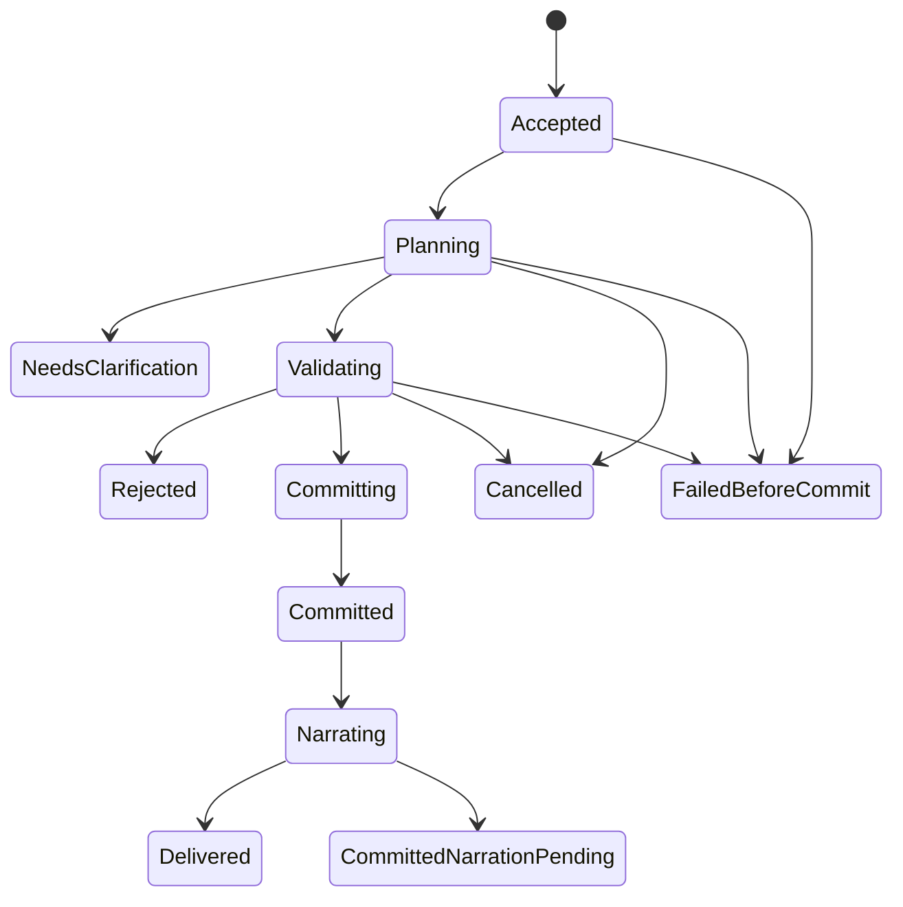

# Command and Turn Protocol

## 1. Command classes

| Class | Examples | Canonical effects |
| --- | --- | --- |
| Deterministic consultation | Sheet, inventory, legal abilities, known quests, current combat options | None; no Codex required |
| AI consultation | Ask a guide to explain a discovered clue | Read-only response; no world/turn/time/RNG changes |
| Narrative action | Speak, travel, investigate, use an item, attempt an uncertain action | One validated canonical operation if resolved |
| Combat action | Move, strike, guard, use ability, speak, negotiate, interact with the scene, react, end turn | Validated encounter transition and recorded consequences; chat uses the same turn/cost checks |
| Administrative operation | Export, restore preview, migrate pack, apply explicit correction | Separate permissions and audit rules |
| Presentation preference | Text size, theme, audio enabled | Preference store; no world effects |

Typing “inventory” inside a sentence must not accidentally become a command. Prefer explicit UI modes and structured command types, with a small documented exact-command parser as convenience.

Speaking to an in-world participant during a fight is a combat command, not a read-only guide consultation. The [combat dialogue policy](11-combat-system.md#71-dialogue-and-scene-changing-intent-during-combat) distinguishes bounded speech from a negotiation or other consequential action. Free text supplies the player's attempted words/action and intended recipient; it never directly rewrites a past event or the encounter. Identify the supported action, current actor, encounter and revision before resolution. Clarify unknown costs, ambiguous recipients or a combined speech/action request before spending anything. Outside an eligible player decision, keep an editable draft without submitting or silently queuing it for a future activation. A rejected, busy or stale submission leaves the fight unchanged and requires explicit review/resubmission; reconnect cannot send the draft.

## 2. Operation lifecycle

P06.2 HTTP state/continue and known-state/inventory/quest/ability reads use a
consistent committed player snapshot with explicit scope/revision tokens. They
create no operation, transcript, event, random draw or narration job. Continue
only reloads the save; it cannot choose the pending decision. P06.3 creation
persists a version-1 starting marker at revision/turn/time/event zero. State/continue
expose its pinned localized public situation and `STARTING_SITUATION`/`FREE_TEXT`
metadata without an operation, transcript delivery or automatic player choice.
Clearing/replacing a marker belongs to a later canonical command; reading or
retrying creation never restores it. Exact text command
consultations use the P06.4 exact read adapter described below.

`NeedsClarification` is terminal for that proposed action and consumes nothing. The clarified response is a new command referencing the clarification. An operation is never reported as cancelled after its effects committed. `CommittedNarrationPending` is a successful game action with recoverable presentation work.

## 3. Acceptance

1. Validate local owner access, campaign ID, payload size, command type, and mode.
2. Normalize the command for hashing while preserving meaningful text and choices.
3. Insert an operation journal row using campaign-scoped idempotency key and payload hash. A duplicate with identical hash returns its current or final result; a changed payload using the same key returns a conflict.
4. Acquire the campaign mutation lease for actions, with a fencing token and base revision. A competing action is rejected as busy or stale, not silently queued behind an unseen future state.
5. Resolve deterministic consultations immediately from the last committed public projection. Record transcript delivery separately if desired.

The acceptance response identifies the durable operation. A dropped HTTP response does not mean the action failed.

P03.2 persistence guards now give each mutable journal row a storage `row_version`
separate from `operationVersion` and the canonical revision. JPA rejects a stale
copy; raw SQL must compare the expected row version and check the affected-row
count. PostgreSQL permits multiple uncommitted NULL revisions, but only one
operation per `(campaign_id, committed_revision)`. Committed statuses carry both
receipt and revision; other statuses carry neither. Once recorded, neither commit
field can change, and terminal statuses cannot reopen. These are database bounds;
P03.3 now adds the internal commit service, exact revision checks and durable outbox.
Acceptance API, leases/fencing and gameplay authorization remain later tasks.
See [domain constraints](05-domain-model.md#3-database-organization).

## 4. Planning and validation

Capture a consistent state revision and assemble authorized context. Known structured actions bypass AI interpretation. Free text may need a Codex intent proposal. An ambiguous action that could spend a rare item, make a binding commitment, or affect several targets requires clarification before spending anything.

The proposal identifies intent, existing content IDs, targets, requested effects, a bounded content-creation proposal when necessary, and referenced facts. It does not contain authoritative dice results, resource deltas, or a claim that a reward has been granted.

Validate shape, operation allowlist, actor ownership, turn eligibility, target scope, prerequisites, known abilities, equipped items, current resources, range, knowledge, generation bounds, and causal dependencies. Reject unknown fields that imply hidden side effects. A multi-effect action is atomic as a whole unless the selected rule explicitly defines staged outcomes. Never apply the valid half of a potion or trade transaction.

The rules service produces a resolved mechanical plan. Random draws are allocated by the backend in a short durable planning transaction, keyed by operation and draw ordinal, before final resolution. Their values are private until relevant output is committed. A same-operation retry reuses them. A new deliberate attempt is a new action only if allowed by the game state. Cancelling after allocation does not permit reroll fishing: the reserved draw remains bound to the attempt and the attempt policy must prevent recreating an equivalent unresolved action solely to reroll.

P03.4 implements `RandomDrawService.reserve(context, ordinal, sides)` as a backend-only
database boundary for an already journaled `VALIDATING` operation. Call it outside any
ambient transaction, before canonical commit. It locks campaign then journal, checks
adventure/campaign/payload scope and reuses an existing ordinal before freshness checks.
Changing a reserved bound is a conflict. New ordinals require the exact current
revision/content/operation version; stale, cancelled or committed attempts cannot add
draws. A matching existing reservation remains readable internally after cancellation
or commit. Each call returns detached evidence only after its own COMMIT, uses the
same 2s lock/5s statement/10s transaction limits as canonical commit, and changes no
world or journal counters. This is not the speculative narrative planner: that planner
has no access to this primitive or its private seed data.

Canonical receipts now contain an ordinal-ordered backend-owned `randomDraws` array
with each operation reservation's ID, ordinal, sides, value, algorithm and version;
no draws produces an empty array. Caller `details` cannot override this array. The
receipt captures all reservations belonging to that committed operation, so the trusted
resolver must reserve only draws appropriate for its committed mechanical outcome.
Exact stored old receipts replay unchanged, including receipts predating this field.
Event-level calculation/reference schemas belong to later rules work. Seed bytes and
uncommitted values never enter outbox envelopes or runtime contexts. The service has
no public endpoint; future command authorization and equivalent-attempt cancellation
policy are still required to prevent reroll fishing with new operation IDs.

## 5. Canonical commit

Open a short PostgreSQL transaction and re-check the revision, lease/fencing token, current encounter actor, selected ruleset, and affected resources. If stale, do not reuse the proposal against new state; fail or explicitly replan before committing.

Commit together:

- All domain changes and generated canonical definitions.
- World-time changes and scheduled consequences due within this action.
- Domain events and their provenance.
- Reward settlements due at this boundary.
- New state revision, game-turn increment where applicable, and pending decision.
- Operation receipt including calculation and random-draw references.
- Outbox messages for public state and required narration.

If this transaction fails, no canonical effects are visible. Durable operation and draw records may remain for diagnosis/retry, but are not world state. The save acknowledgment includes operation ID and committed revision; it is produced by the backend, never accepted from model prose.

P03.3 implements this persistence boundary for the currently available world,
resource, event and settlement types. `CanonicalCommitService.commit(ResolvedCommit)`
requires an already journaled `VALIDATING` operation, trusted backend-resolved data
and no ambient transaction. It locks campaign then operation, checks adventure scope,
payload hash, exact base/current revision, operation version and pinned content, and
checks resource scope/version/bounds. JPA also catches an intervening resource writer.
Fresh commits increment revision once; turn advancement is explicit and world duration
is supplied by deterministic resolution. Event sequence/provenance and receipt identity
are assigned inside the transaction. Matching retries return the exact stored receipt,
even after later world changes; changed payload hashes fail before replay.

Each commit writes one `PUBLIC_STATE` intent and, when requested, one
`NARRATION_REQUIRED` intent. These immutable outbox records carry only campaign,
operation and revision references. They neither publish data nor grant audience access.
No network client, callback or delivery listener participates in the transaction;
the caller receives detached receipt data after COMMIT. Database contention is bounded
by a 2-second lock timeout, a 5-second statement timeout and a 10-second transaction
timeout. Plans allow at most 128 resources, 128 events (at least one), 128 settlements
and 32 KiB receipt details; existing stored JSONB limits remain authoritative.

This internal primitive does not accept player/model proposals directly. Command
acceptance/authorization, semantic rules, encounter checks,
leases/fences, cancellation coordination and outbox dispatch/recovery remain their
later roadmap tasks. New domain effect types must join the same explicit commit path.

## 6. Narration after authority

Codex narrates the **resolved event bundle**, receiving only the intended audience's permitted view. Do not stream unvalidated outcome prose to the player. During planning, show application-generated progress such as “Resolving your action.” Provider commentary, tool output, and intermediate JSON stay private.

The MVP publishes final narrative after validation against the resolved bundle. Checks include schema, actor/target references, forbidden secret markers, inconsistent numeric claims, and unsupported state assertions. These checks cannot prove every implication in natural language. Adversarial evaluations and a correction mechanism remain necessary. Use structured narrative sections and bounded length to make review tractable.

If prose is invalid, allow one narration-only repair. If repair fails or Codex is unavailable, publish a deterministic mechanical receipt and keep a narration-pending flag. Retrying narration cannot re-run the original action or roll new dice. Text generation is outside the canonical transaction.

No second AI request is needed for local consultations. A structured action may need only a narration request. Free-text actions may need interpretation followed by narration. The engine must measure this cost rather than claim every turn is a single call.

## 7. Counters and time

Canonical state-changing player actions increment `gameTurn` once. Their rules determine world duration. Speaking a meaningful line may consume narrative time and create a fact, but editing a draft or viewing history does not. Administrative corrections can increment state revision and append events without advancing the game turn.

Combat player and NPC operations update initiative and encounter state according to the scheduler. World time advances once per completed combat round by the ruleset's round duration, not once per actor. Partial rounds persist their progress without prematurely advancing the round clock. If combat ends mid-round, apply one configured partial-round duration once at settlement; AI RPG Skirmish rounds this to one round. Time-triggered effects must use the encounter timing rules, not duplicate both world-time and round-time ticks.

## 8. Interrupt and recovery matrix

P03.5 foundations (verified 24 October 2026): `MutationLeaseService` grants an
internal worker one campaign mutation lease for 1..300 whole seconds measured with
PostgreSQL time. V5 keeps a persistent fence high-water mark per campaign; every
grant, release and expiry retirement increments it, so a late holder can never
match again. `ResolvedCommit.Context` carries the holder/fence token. New draws and
canonical commits check it under the campaign → journal → lease locks, while
immutable draw/receipt replay still comes first. A commit releases the lease in the
same transaction. Before the web server starts, `JournalRecoveryService` scans keyset
pages of 100, one transaction per operation. It preserves live leases, retires
expired ones and moves orphaned `ACCEPTED`/`PLANNING`/`VALIDATING`/`COMMITTING` work
to `FAILED_BEFORE_COMMIT`. It moves `NARRATING`, and `COMMITTED` with a narration
outbox intent, to `COMMITTED_NARRATION_PENDING`. Receipts, draws and world state are
unchanged; any recovery error aborts startup. Limits: recovery assumes one local
installation, with no other admitter between acceptance and lease grant.
`COMMITTED` without a narration intent stays `COMMITTED`. P03.6 persists preparation
attempt accounting and lease renewal; runtime cancellation transport remains P07/P08. The
[database backup tool](../tools/database_backup/README.md) retires all saved leases
on restore and advances the campaign recovery generation.

P03.6 job recovery scans unfinished rows in keyset pages of 100, with campaign →
job lock order and one short transaction per job. A live current-generation lease
survives service restart. An expired lease closes the attempt as interrupted,
increments its fence and enters `RECONCILIATION_REQUIRED`; it never silently requeues
potentially running external work. Only explicit `confirmStopped` allows a bounded
retry, cancellation or expiry. Retired-generation work becomes `SUPERSEDED`.
Recovery failure aborts startup and keeps claims/admissions gated. Completed audit
rows remain immutable; duplicate admission also checks the current generation.

| Interruption point | Required behavior |
| --- | --- |
| Before planning completes | Cancel generation, release lease, no canonical changes |
| During validation | Cancel before commit if cancellation wins the commit lock |
| At commit boundary | Transaction decides; inspect receipt before reporting outcome |
| After canonical commit | Preserve effects; stop optional narration; mark presentation pending |
| After delivery but before HTTP acknowledgment | Same idempotency key returns committed result |
| Backend restart during generation | Reconcile journal; expire old lease; rotate affected AI context; no speculative commit |
| Codex dies or emits invalid output | No commit from incomplete proposal; retain committed results and pending narration |
| SSE connection drops | Reconnect from cursor or query operation; do not resubmit blindly |

Process cancellation is not database rollback. Killing Codex never undoes a committed turn. The UI must distinguish “cancelled before resolution” from “action saved; narration interrupted.”

## 9. Retry limits

Protocol reconnect may retry safe discovery/read requests. Proposal repair is limited to one bounded retry with the same canonical context. A valid but disallowed action is a gameplay rejection, not a reason to ask AI repeatedly until it passes. State-changing transport retries always use the original operation key. AI service errors have capped backoff; no infinite automatic loop or silent provider switch.

## 10. Player agency and narrative facts

An action resolves only the player's declared intent and unavoidable consequences. Suggested actions fill the composer or open a confirmation preview; they never submit themselves. A narrative answer must stop where another meaningful choice is needed.

Generated details that change future possibilities must be registered through the content/fact proposal path before their narration is published as canon. A final narrator can choose atmosphere and wording but cannot introduce a usable potion, secret passage, binding promise, new attacker, or extra player action after commit. If such a proposal is desirable, it belongs in a subsequent planned operation.

## 11. Background preparation and presentation

P03.6 implements the persistence/admission foundation below as internal services,
without a dispatcher or gameplay endpoint. `ResolvedCommit.Preparation` carries up
to 64 affected query scopes and 16 job intents. Epoch bumps, critical enqueue and
query-based plan invalidation share the world/event/receipt/outbox transaction; a
deferred database check requires a critical job's originating operation to have a
committed outcome. Duplicate intent must also match payload/schema and origin.

Snapshot capture checks assembler revision, recovery and presentation tokens under
locks, then stores the exact selected state and typed dependency manifest. Admission
requires that complete manifest, the recorded result digest, current job fence,
generation and query epochs. Public snapshot locale/glossary tokens must still
match; language-neutral private structure can survive a locale change. A public
snapshot requires an initialized presentation row so capture/admission can lock it.
Unrelated revision changes do not alone invalidate an artifact. Non-query semantic
dependencies currently reject with `UNSUPPORTED_DEPENDENCY`; author/rules/quest
semantic validation remains P08.7. Rejection permits at most one regeneration within
the durable attempt/deadline budget. Concurrent duplicate delivery stores one
immutable version/admission receipt; later versions append and supersede prior ones.

Quest acceptance commits its known terms and current pending decision through
this pipeline; it does not wait for a deep quest outline. A background job may
prepare compatible future possibilities from that snapshot. Until admission,
immediate narration uses only known/committed facts and the playable baseline,
never promises that an undiscovered clue or particular ending exists.

On completion, validate the versioned plan's scope, author constraints and
declared/read/query dependencies, then repeat the affected checks transactionally
with fencing and idempotency. Unrelated world revisions alone need not discard
independent content. New deaths, discoveries, removals or query phantoms do
invalidate affected assumptions. Reject or selectively replan with bounded
retries; never resurrect a required NPC or reopen a completed quest merely to
preserve a plan. The canonical [plan admission contract](28-asynchronous-narrative-planning.md)
defines the state machine and dependency rules.

Only ordinary validated commands activate facts, consequences or scheduled
events, with the existing receipts and source settlement keys. Accepting a
noncanonical artifact, changing locale, reading a passage or playing audio has
no world effect. Typed public presentation events are derived after accepted
narration; replay/cancel/skip cannot resubmit a game command. Locale mismatch or
optional media failure preserves the original canonical receipt.

## Exact consultation delivery (P06.4)

The admitted consultation GET accepts only whole `status`/`stato` and
`inventory`/`inventario` aliases (outer whitespace and case ignored, 64 UTF-16
units maximum). Other text is rejected, never sent to interpretation or treated
as an action. It returns a detached typed passage plus its source scope/revision
from the existing read-only snapshot. Presentation delivery is distinct from
canonical state and operation receipts: no transcript row or delivery counter is
written, and repeating, displaying or discarding a passage changes no world
revision, turn, time, event sequence, resource, pending decision or RNG. Optional
durable transcript history remains a separate later presentation writer; its
identity/retry policy must not reuse canonical commits to track reading. See the
[HTTP contract](13-api-and-ui.md#exact-local-consultations-p064).
