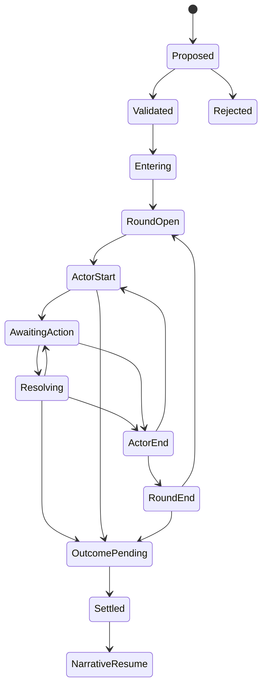

# Turn-Based Combat: AI RPG Skirmish

## 1. Intent and boundaries

Combat should preserve the recognizable experience of tabletop role-playing: ordered turns, meaningful actions, uncertain attacks, defenses, skills, equipment, abilities, conditions, and progression. **AI RPG Skirmish** is a proposed original default ruleset, not a reproduction of Dungeons & Dragons, its content, stat blocks, or rules text.

The engine supports configurable definitions and selected policies. The initial implementation supplies one concrete scheduler and one zone model. A new tactical algorithm requires an explicit ruleset extension. Numerical values here are design defaults to implement and playtest, not claims of proven balance.

Codex may propose encounters, portray participants, select legal enemy tactics, and narrate outcomes. The Java rules engine owns initiative, legality, dice, costs, damage, conditions, defeat, and settlement.

## 2. Combat state machine

Before entry, persist a validated roster, profiles, zones, equipment, conditions, objectives, risk policy, ruleset hash, and initiating cause. A saved active encounter must include phase, actor cursor, round, remaining action points, reaction state, effect timers, and pending decision. AI thread renewal changes none of these.

## 3. Encounter entry

A committed action, world trigger, or player-confirmed hostile intent can request combat. A mere narrative mention of a monster does not start a fight. Codex may propose an encounter when appropriate, but the engine validates it before any attack or resource loss.

Entry reveals only observable participants, positions, threats, escape options, and stakes. Hidden participants require registered concealment, an entry condition, and budget accounting. They are not created after a die roll to negate success. The player can negotiate, withdraw, or avoid combat when the established situation permits it.

The transition to combat is atomic with the triggering consequences. If the player's action is already the attack that starts combat, use the explicit opening-action policy: initialize initiative, then execute that attack only at its allowed opening slot. Never apply the same attack once in narrative mode and again on the first tactical turn.

## 4. Default actor profile

| Field | AI RPG Skirmish default |
| --- | --- |
| Attributes | Force, Finesse, Insight, Resolve; normal supported range 0–6 |
| Skills | Pack-defined competencies; rank 0–5 |
| Health maximum | `18 + 3 × Force + 2 × (level - 1)` |
| Focus maximum | `6 + 2 × Resolve + (level - 1)` for actors using Focus |
| Guard | `10 + Finesse + equipment Guard modifier` |
| Resistance | `10 + Resolve + supported resistance modifier` |
| Armor | Flat reduction 0–4 by default; penetration may reduce it to a minimum of zero |
| Action points | 3 at the start of a valid activation; unused points expire |
| Reaction budget | 1 per round, unless a validated trait changes it |
| Initiative | `2d10 + Finesse + Insight`, rolled once on entry |
| Base stride | One adjacent-zone transition for a normal Move action |

Derived equipment Guard modifiers default to a combined cap of +3 before temporary defensive conditions. Health and Focus stay within bounds. Actors without a Focus mechanic omit that resource rather than showing fictional infinite energy.

The same actor used in exploration carries the same health, conditions, inventory, learned abilities, and equipment into combat. Entry does not equip a weapon, refill ammunition, remove injuries, or grant a new skill.

The derived Health/Focus formulas are the default player and companion progression profile. Creature/archetype templates may instead provide explicit validated Health, defenses, attack scores, and resource limits within their catalog threat bands. These overrides are recorded in the frozen creature definition; they cannot be improvised during the fight or applied silently to a player character.

## 5. Space: zones

An encounter is a small directed graph of **zones**. Each zone has ID, tags, cover, visibility, hazards, capacity if relevant, and traversal edges with cost and requirements. All actors occupy a valid zone. Default range bands are same zone, adjacent zone, or two edges away.

Melee requires the same zone unless an ability specifies reach. Ordinary ranged attacks require a known target within the weapon's maximum zone distance and line of sight. Full cover blocks a direct attack; partial cover grants +2 Guard against relevant ranged attacks. Zone graph distance does not imply physical meters unless authored explicitly.

Move normally costs one action point per traversed normal edge. Difficult terrain doubles the edge's action cost. A character cannot pass a blocked edge or hidden destination. Flying, teleporting, or forced movement requires an explicit capability and valid arrival zone. Leaving a zone does not create a universal free attack; only a declared reaction ability can do so.

Use zones to keep dynamic encounter creation practical. A grid-based tactical map is future scope and must not be implied by a decorative image.

## 6. Initiative and round order

Sort initiative descending, then Finesse descending, then stable actor ID ascending. Persist the results. No new roll occurs on page refresh, AI renewal, or reconnect. New participants enter through an explicit event at the next round boundary using their own initiative; immediate interruption needs a defined trait.

Round-open refreshes each eligible actor's reaction budget once. Each actor then activates in fixed order. Activation-start first expires effects tied to that actor's next activation, processes start triggers in the ordering below, checks whether the actor can act, and grants action points if eligible. Incapacitated actors receive no usable points.

The player may end an activation with points remaining. Points do not carry into another activation. NPC and companion activations use the same scheduler. A round ends after all eligible initiative entries have been processed, then end-round effects and terminal conditions resolve.

Default round duration is **eight in-world seconds**. Advance world time once per completed round. If combat ends partway through a round, settlement advances the unfinished round once to its eight-second boundary. Effect tick rules prevent that clock adjustment from applying a second condition tick.

## 7. Action economy

| Action | AP | Default behavior |
| --- | --- | --- |
| Move | 1 per normal edge | Traverse a legal edge; difficult terrain costs 2 |
| Strike | 2 | One legal weapon attack; relevant attribute/skill defined by weapon/ability |
| Guard | 1 | Gain +2 Guard until the start of your next activation; no stacking |
| Use item | 2 | Consume one available item and resolve its defined effects |
| Ready/equip | 1 | Change one valid equipment assignment; hand/slot rules apply |
| Interact | 1 | One bounded scene interaction; important actions use their own definition |
| Assess | 1 | Attempt a supported observation/check; reveal permitted information on success |
| Ability | Definition | Usually 1–3 AP plus supported resource cost and cooldown |
| Withdraw | 2 | Move one legal edge toward an escape zone and suppress supported movement-trigger reactions for that move |
| End activation | Remaining points expire | Pass control to the scheduler |

Guard can be selected once per activation. The +2 from Guard and the +2 from Brace below use the same defensive stacking key; apply the higher applicable bonus, not +4. Partial cover is a separate source and may combine, subject to a default total situational Guard cap of +4.

No ordinary extra attack is granted just because prose describes several blows. A two-attack ability must define its two resolutions, costs, targets, and caps. An invalid action consumes no points or items. A valid attempted attack that misses consumes its declared AP, ammunition, charges, or Focus as specified.

A normal ability must consume at least one AP. A zero-AP exception requires an explicit once-per-activation or once-per-encounter limit and cannot restore its own availability. End activation and changing a permitted predeclared reaction policy are control commands, not repeatable free-effect abilities. Bound automatic effect processing per operation and fail safely on an unsupported cycle.

## 8. Checks and attacks

The default attack score is:

`2d10 + relevant attribute + trained skill + situational modifier`

Compare against the target's effective Guard for physical attacks or Resistance for an explicitly mental/energy contest. The ability fixes which defense applies. The situational attack modifier is clamped to -3..+3 after supported effects. Meeting the defense succeeds. A success margin of at least six is a **strong hit** and adds 1d4 damage once if that attack permits it.

This ruleset does not use automatic natural-1 failure, automatic natural-20 success, external proficiency tables, spell slots, or copied action categories. A non-damaging ability defines its own strong-success benefit or none. A check cannot bypass an unavailable target, missing prerequisite, or immunity merely because dice are high.

Dice are generated by the backend, not by Codex. Store algorithm/version, operation ID, draw ordinal, die faces/results, and calculation. Use a server-owned unpredictable seed for normal play; deterministic seeded streams are available for tests and explicit replay. Keep future draw material private so the UI cannot predict rolls.

## 9. Damage and healing

For a successful damaging hit:

`rawDamage = ability dice + attribute contribution + admitted flat modifiers + strong-hit die`

`effectiveArmor = max(0, armor - penetration)`

`damageTaken = max(0, rawDamage - effectiveArmor)`

Temporary absorption is consumed after armor and before Health. Damage cannot reduce Health below zero. Zero damage is a valid outcome; do not invent a mandatory point of damage. If several damage types exist, the ability explicitly partitions them before applying defenses; do not apply full armor independently to arbitrary prose fragments.

Healing restores at most the missing Health. Ordinary healing does not automatically remove a condition or revive a defeated actor. Revival requires a declared supported effect and the pack's defeat policy. Overhealing is not a barrier unless the ability defines one.

Equipment damage dice are original pack data. A neutral starting light blade may deal `1d6 + Force`; a ranged device may deal `1d6 + Finesse` and consume one charge. Neither definition imports an external stat block.

## 10. Reactions

v1 reactions use **predeclared policies**, selected outside an enemy's hidden decision and before its roll. The initial default reaction is **Brace**: if an eligible visible attack targets the actor and a reaction is available, spend one reaction to gain +2 Guard against that attack. The actor may select off, first eligible attack, or a supported resource/health predicate. A player changes the policy before combat or during their own activation; it cannot be changed after seeing a roll.

Additional reaction abilities declare trigger, priority, cost, target constraints, and effect. Skip a default Brace when its stacking key would not improve effective defense. Default maximum reaction depth is one: reaction effects cannot trigger reaction chains. Simultaneous eligible reactions are ordered by declared priority, initiative, and stable actor ID. Insufficient resources skips the reaction without inventing costs.

Interactive manual reaction windows are excluded from v1. They require a separate durable pending-action workflow and must not be bolted onto an atomic action by leaving a database transaction open while the player decides.

## 11. Effect timing and stacking

Every effect specifies its phase: round-open, activation-start, action-declared, pre-roll, post-hit, post-damage, activation-end, or round-end. Sort simultaneous effects by phase, explicit priority, source event sequence, then stable effect ID. Resolve each supported effect once for its trigger key.

For a normal attack: validate intention → determine predeclared reactions → allocate/reuse random draws → calculate hit → calculate damage → apply post-hit/post-damage effects → check defeat/objectives → commit the entire resolved action. These are calculation phases inside one operation, not separate unprotected saves.

Durations use a declared clock: instant, until a named actor's next activation, a number of target activations, a number of round-end ticks, world-time expiry, or persistent until a removal condition. Combat effects using activation/round clocks are not also ticked by the world-time advancement event. Converting a remaining combat condition to exploration uses a defined conversion recorded at settlement.

Stacking modes: replace, refresh duration, strongest magnitude, independent instances up to a cap, or additive up to a cap. Default is strongest magnitude with refreshed duration. A condition must define whether it prevents movement, actions, reactions, or resource spending. “Stunned” cannot exist as undefined prose that silently removes turns.

Damage-over-time, healing-over-time, shields, forced movement, and cooldowns require explicit timing. Duration zero expires immediately. An effect whose source is defeated persists or ends according to its definition, never an AI guess.

## 12. Legal actions and AI tactics

At each activation the backend produces legal candidates with AP/resource costs, target IDs, reachable zones, and public estimates. Disabled options expose known reasons such as no ammunition or out of range. Hidden information is not leaked through a disabled label.

Codex chooses within the acting NPC's knowledge and candidate set. Revalidate at commit. If unavailable or invalid after one bounded repair, use deterministic fallback: pursue a declared objective if a legal move is available; otherwise Strike a known reachable hostile target; otherwise Guard if eligible; otherwise end activation. Stable ranking avoids nondeterministic target switching in tests. The player is told when AI-assisted tactics fall back if it materially changes the experience, without exposing hidden strategy.

## 13. Terminal conditions

Check terminal predicates after each resolved action, defeat event, and round-end trigger. Order priority is: explicit objective/campaign emergency rule, no active opposing sides, declared escape/withdrawal completion, accepted surrender/agreement, then configured stalemate/round cap. A default round cap of 30 pauses combat for review or a declared disengagement policy; it does not arbitrarily kill participants.

Supported outcomes: victory, defeat, escape, surrender, negotiated end, objective success without elimination, and stalemate. Reaching zero Health means defeated/incapacitated under the default policy, not automatic death. Permanent death requires the pack's explicit policy and a supported recorded event.

Enemy morale can lead to a surrender proposal using a declared threshold, current losses, goal, and knowledge. The AI may portray fear but cannot force acceptance of terms. The player may spare a defeated enemy; this is a valid outcome with persistent consequences.

## 14. Settlement and return to narrative

Use one settlement key per encounter/outcome policy. Atomically finalize outcome, surviving positions, remaining conditions, time adjustment, casualty/recovery policy, objective updates, rewards, quest/faction changes, event records, and next pending decision. Do not refill resources unless the outcome rule explicitly does so.

Loot starts on the appropriate corpse, container, or world location unless an explicit auto-collect policy is enabled. Defeating an enemy does not necessarily imply looting, killing, or taking prisoners. Record those distinctions.

Publish a mechanical recap and request narration from the finalized public result. Missing narration does not prevent inspecting the saved outcome. Refresh, reconnect, or a new Codex session cannot repeat settlement.

## 15. Originality and content policy

Use original terminology, formulas, writing, ability definitions, creature designs, and presentation. Familiar turn order and skill checks are design inspiration; changing names alone is not a rights strategy. No SRD text or third-party stat blocks are required by this design. If a future pack deliberately uses licensed external rules material, document its exact source, license, attribution, and compatibility separately. See [publication guidance](18-github-publication.md).

## 16. Required acceptance cases

Invalid targets spend nothing; legal misses spend declared costs; armor can absorb all damage; Guard/Brace stacking is bounded; reaction refresh happens once; a poisoned defeated actor cannot act; no random redraw occurs on retry; renewal preserves the exact actor/AP/effect state; escape does not imply death; a party defeat reaches the configured recovery state; settlement is idempotent; every outcome returns to a valid campaign mode.
