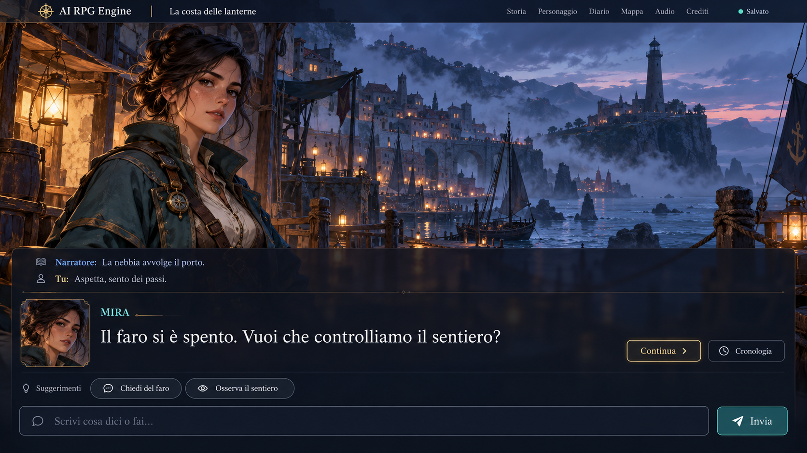
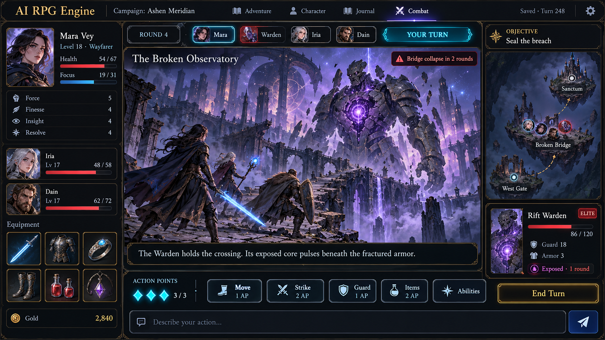

# Application API and Player Interface


P06.1 implements an owner-scoped creation service, durable request results and
`POST /api/v1/campaigns` behind local Host/Origin/session/CSRF admission.
The trusted owner comes from server configuration, never a client owner field.
Creation accepts external profiles and grants through a verified pinned
dependency closure. Custom skill keys use root-local IDs or `pack#definition`
for dependency skills, including skills local to an external creation profile;
bare equal IDs from other packs are rejected.

`GET /api/v1/session` bootstraps the local session described in
[HTTP security](14-security-and-operations.md#4-application-http-boundary).
Creation requires `Origin`, the session cookie, `X-CSRF-Token` and UTF-8
`application/json`. The body is at most 16 KiB (including chunked bodies):

```json
{
  "requestId": "a4ef32ab-d8d5-4f21-a769-245262e23f8d",
  "adventureId": "b4ef32ab-d8d5-4f21-a769-245262e23f8d",
  "contentRevisionId": "c4ef32ab-d8d5-4f21-a769-245262e23f8d",
  "title": "First expedition",
  "narrativeLocale": "en",
  "choices": {
    "name": "Traveler",
    "archetypeId": "surveyor",
    "attributes": {},
    "skills": {}
  }
}
```

Identities are canonical lowercase UUIDs. `choices.background` and `choices.role`
are optional bounded strings; `archetypeId` may be missing/null for custom
allocations. Both allocation maps are required, with exact integer values.
Unknown fields (including owner, resource/item/ability overrides), duplicate keys,
bad UTF-8, trailing documents and type coercions are rejected. IDs and budgets
must resolve in the selected sealed snapshot. The example uses fixture-specific
choices; applications obtain creation metadata from later projection work.
Successful creation and identical retries return HTTP 201 with exactly
`campaignId`, `actorId`, `contentRevisionId`. No narration or game counter advances.
Changed-payload retries return 409; inaccessible adventure/revision returns 404;
malformed JSON/shape returns 400; illegal choices return 422; oversized bodies
return 413; non-JSON/encoded bodies return 415; admission fails with 403,
capacity with 429 and unavailable configuration/storage/content with 503.
Failures return only a stable `code`; raw pack, SQL and exception messages are
excluded. Retry uncertain responses with the original request and payload.

### Campaign projections (P06.2)

The read adapters use the same configured local owner, Host/Origin checks and
session cookie as creation. GET needs no CSRF token and returns `Cache-Control:
no-store`. `GET /api/v1/campaigns` returns `{campaigns, nextAfter}`. Optional
`adventureId` filters the owner page; `after` is an exclusive campaign UUID
cursor and `limit` defaults to 50 (1–100). Ordering is by campaign UUID; null
`nextAfter` ends the page. A foreign adventure produces an empty owner page.

`GET /api/v1/campaigns/{id}/{section}?adventureId={uuid}` requires the exact
owned adventure/campaign pair. Sections are `state`, `continue`, `known-state`,
`inventory`, `quests` and `abilities`. State and continue return the same
snapshot: `scope`, `campaign`, `player`, `resources`, `inventory`, `abilities`,
`knownFacts`, `quests`. Other sections return `{scope, data}` for that collection.
Scope carries adventure, campaign and content revision IDs plus state revision.
Campaign metadata carries title, mode, four world counters, update timestamp
and `pendingDecisionAvailable`. Raw decision JSON, seed identity, NPC state,
internal events, plans and pack definitions are never returned. P06.3 adds nullable
`startingSituation: {text, locale, fallback}` and `pendingDecision: {type, inputMode}`
to state/continue. New campaigns store a version-1 `STARTING_SITUATION` marker;
its public type is `STARTING_SITUATION` and input mode is `FREE_TEXT`. Text resolves
only `$pack` `/entrypoint/situation` from the sealed pinned root in the campaign's
narrative locale. Missing overlays explicitly fall back to the source language.
There are no invented choices, prologue, guide or accepted action. Unknown decision
shapes/versions, cleared decisions and legacy characters return null for both
fields; `pendingDecisionAvailable` still indicates any stored pending decision.
Reads never recreate a cleared marker or backfill old saves. Frontend binding and
command submission remain P05.6/P07. Pending-content failures return sanitized 503.

Player includes identity, display name, own location, integer attributes/skills,
background and role. Legacy campaigns without a creation-bound character return
`player: null`. Resources expose exact current/minimum/maximum values. Inventory
exposes item UUID, pinned definition ID and quantity; abilities expose learned
definition ID and rank, without claiming current legal use. Known facts retain
`KNOWN`, `BELIEVED` or `RUMORED` confidence; quests expose only known title,
objective and status. Unrevealed records are absent, never inferred from lore.
Definition labels/artwork and action legality remain later projection work.

All sections share one read-only repeatable-read snapshot per request. A section
over 1,000 records fails closed rather than returning a misleading partial list.
Continue performs no activation, narration, transcript delivery or world write.
Missing required input or malformed/noncanonical scope/cursor/limit returns 400;
nonexistent/foreign/mismatched scope shares 404; admission returns 403;
unavailable storage/content returns 503.
Errors contain only a stable `code`. Frontend API binding remains P05.6.

### Exact local consultations (P06.4)

`GET /api/v1/campaigns/{id}/consultation?adventureId={uuid}&command={text}`
uses the same local admission, scope authorization, no-store policy and sanitized
errors as projection reads. Whole aliases `status`/`stato` and
`inventory`/`inventario` are accepted after outer whitespace removal and
locale-neutral case normalization. Input is at most 64 UTF-16 units before
normalization. Missing, empty, oversized or unsupported text returns 400
`CAMPAIGN_READ_INPUT_INVALID`; sentences, punctuation and slash commands are
not interpreted or submitted as actions. Both languages work independently of
presentation locale. Pack aliases and arbitrary intent interpretation are excluded.

The response is `{type: "DETERMINISTIC_CONSULTATION", scope, passage: {kind, data}}`.
`STATUS` data contains only `{player, resources}`; `INVENTORY` data is the existing
owned inventory collection. Scope identifies the committed source snapshot;
it is not a new revision or delivery sequence. A legacy player remains null.
The passage can be rendered as a transient transcript entry or panel without
claiming an accepted action, narrative continuation or legal ability.
No transcript record is persisted by this GET. Optional durable transcript
storage/deduplication and browser rendering remain later delivery work; a future
writer must use its own delivery identity and must not advance world counters.
Continue/state never deliver or replay this passage automatically. Retries return
the same data while the committed projection is unchanged; after a world commit,
a fresh read may legitimately return a newer source revision. No runtime call,
operation, event, draw, outbox intent, timestamp or game counter is written.

### Persisted adventure library (P06.5 checkpoint)

`GET /api/v1/adventures?after=<uuid>&limit=<1..100>` returns
`{adventures, nextAfter}` for the server-configured owner. The default page size
is 50; UUID ordering is ascending and `after` is exclusive. A null `nextAfter`
ends that snapshot's page sequence; later pages use fresh committed snapshots.
Empty workspaces appear independently of installed packs or saved campaigns.
`GET /api/v1/adventures/{adventureId}` returns the same detached metadata shape:
`adventureId`, `title`, `genre`, `sourceLocale`, `metadataRevision`, `createdAt`
and `updatedAt`. The metadata revision is a storage version, not a world counter.
Equal titles never merge identities. No owner ID, specification, pack bytes,
campaign secrets, job state or media path is returned.

Both GETs require local session admission and return `Cache-Control: no-store`.
All methods below the adventure subtree receive the admission guard, including
unknown routes. Canonical lowercase UUIDs and bounded controls are required;
malformed inputs return 400 `ADVENTURE_READ_INPUT_INVALID`. Missing and foreign
workspaces share 404 `ADVENTURE_SCOPE_UNAVAILABLE`; storage failures return 503
`ADVENTURE_READ_STORAGE_UNAVAILABLE`. Reads neither create nor activate a
workspace. Use the existing campaign listing with `adventureId` and scoped
continue to read its saves. The browser binds these reads read-only: `/library`
lists saved cards by UUID and `/saved/<adventureId>?playthrough=<campaignId>`
shows one scope and selects only playthroughs listed under that adventure.
Malformed, foreign or duplicate rows are rejected rather than rendered, and a 403
triggers one session re-bootstrap. Switching adventures aborts the previous reads.
The packaged jar does not yet serve `/saved/...` on reload or as a direct link.
Workspace creation and browser play of saved campaigns are still pending.

## 1. Contract status

Except for the session/creation/projection/consultation/library endpoints above, the following endpoints and DTO
fields are proposed v1 contracts. There are no generated OpenAPI definitions.
API and content versions are separate. Use an `/api/v1` namespace and explicit
schema versions for persisted/imported data.

## 2. Proposed endpoint families

| Method and path | Purpose | State behavior |
| --- | --- | --- |
| `GET /api/v1/health` | Application liveness | No AI call |
| `GET /api/v1/readiness` | Database, migrations, adapter support, configured AI readiness | Sanitized diagnostics |
| `POST /api/v1/packs/validate` | Stage and validate a selected pack | No campaign effects |
| `POST /api/v1/packs/import` | Register a successfully validated immutable revision | Owner action |
| `GET /api/v1/packs` | List installed revisions and diagnostics | Public author metadata only |
| `POST /api/v1/campaigns` | Create from pack/ruleset revision and creation choices | Transactional and idempotent |
| `GET /api/v1/campaigns` | Owner's campaigns | Scope to local owner |
| `GET /api/v1/campaigns/{id}/state` | Player projection at one revision | No advancement |
| `GET /api/v1/campaigns/{id}/journal` | Known events and quests with cursor | No secret notes |
| `GET /api/v1/campaigns/{id}/actions` | Legal current actions and known reasons | No hidden-information hints |
| `POST /api/v1/campaigns/{id}/commands` | Submit typed action or free-text intent | Returns durable operation |
| `GET /api/v1/campaigns/{id}/operations/{operationId}` | Operation progress, receipt, or clarification | Safe retry/reconnect path |
| `POST /api/v1/campaigns/{id}/operations/{operationId}/cancel` | Request cancellation | Receipt determines whether effects already committed |
| `GET /api/v1/campaigns/{id}/stream` | Resumable authorized event stream | Transport delivery only |
| `GET /api/v1/campaigns/{id}/encounter` | Public current combat projection | No raw enemy secrets |
| `POST /api/v1/campaigns/{id}/ai-session/renew` | Renew idle role contexts safely | Does not advance world |
| `GET /api/v1/runtime/status` | Selected narration runtime (Codex or Claude), version, account and model readiness | No credentials or raw RPC identifiers; read-only, the runtime is changed through the launcher (ADR 0020) |
| `GET /api/v1/models/status` | Slots, assigned backends and models, billing and privacy classes, probe results, hardware profile and admission state | No keys or endpoint credentials; read-only |
| `PUT /api/v1/settings/models` | Owner-only slot assignment and same-class fallback lists | Validates, probes and audits; a class change needs acknowledgement; keys are never accepted here (ADR 0021) |
| `PUT /api/v1/preferences` | Reading, sound, routing, renewal preferences | No game effects |
| `POST /api/v1/campaigns/{id}/exports` | Create full-owner or player-facing export | Explicit audience selection |
| `POST /api/v1/restore/preview` | Validate archive compatibility and integrity | No overwrite |
| `POST /api/v1/restore/apply` | Restore reviewed snapshot to a new campaign identity by default | Owner action with concrete preview token |
| `POST /api/v1/campaigns/{id}/corrections/preview` | Show proposed administrative correction | No mutation |
| `POST /api/v1/campaigns/{id}/corrections/apply` | Apply validated correction | Audit, backup, revision increment |
| `GET /api/v1/assets/{assetId}` | Serve one registered authorized asset | Path never supplied directly by client |
| `POST /api/v1/application/shutdown` | Stop local application gracefully | Owner action; owned resources only |

No endpoint proxies arbitrary runtime methods, SQL, filesystem paths, shell commands, or general-purpose AI tools.

## 3. Command envelope

Required fields: `requestId` (idempotency identity), `expectedRevision`, `commandType`, and bounded `payload`. Include command locale where it cannot be derived from the campaign. Typed combat payloads include actor ID, action/ability ID, targets, and destination if applicable. Free text is explicit input, never a replacement for validation.

The backend returns operation ID, accepted status, base revision, and a query/stream reference. The final receipt includes status, committed revision if any, source event IDs, known mechanical consequences, pending decision, and narrative delivery state. Do not return provider thread IDs or internal prompt text.

Use HTTP 202 for accepted asynchronous work, 200 for current/final queries, 201 for created resources, 400 for malformed input, 403 for denied origin/owner/capability, 404 for inaccessible identities, 409 for busy/stale/idempotency conflicts, 422 for valid-shaped but illegal content/action, 429 for local admission limits, and 503 for unavailable required runtime dependencies. Keep detailed safe error codes stable across localized messages.

### P07.1 admission and status

Implemented routes use the existing local session/owner admission and return
`Cache-Control: no-store`:

- `POST /api/v1/campaigns/{campaignId}/commands?adventureId={uuid}` admits an envelope
  and, since P07.4, resolves a fresh one locally in the same request.
- `GET /api/v1/campaigns/{campaignId}/operations/{operationId}?adventureId={uuid}`
  reads its durable status without changing any row.

Path/query UUIDs and `requestId` require canonical lowercase UUID text. POST requires
Origin, session cookie, CSRF token and UTF-8 JSON, with a 16,384-byte body cap even
for chunked input. The object has exactly `requestId`, `expectedRevision`,
`commandType` and object-valued `payload`. Revisions are nonnegative exact JSON
integers within signed 64-bit range; decimals/strings are not coerced. Type syntax
is `[A-Z][A-Z0-9_]{0,63}`. Unknown envelope fields, duplicate keys, invalid UTF-8,
multiple documents and malformed UUIDs fail before storage. For new requests, P07.2 applies the closed `MOVE`/`WAIT`/`SPEAK` payloads and
transactional eligibility checks in the [turn protocol](07-turn-protocol.md#p072-typed-intentions-and-atomic-common-semantics);
P07.3 adds `USE_ABILITY` (`abilityId`, `targetActorIds`) and the
[current-state rules](07-turn-protocol.md#p073-current-state-rule-validation).
Unknown types, arbitrary patches, extra/missing fields and wrong payload types are
semantic 422 errors. These are intentions only; the server calculates every effect
([local execution](07-turn-protocol.md#p074-local-action-execution)).

New requests return 202 after local execution with their final status: `COMMITTED`,
or `REJECTED`/`FAILED_BEFORE_COMMIT` when current state or storage refused them after
durable admission. Identical retries return 200 with the same operation ID and its
stored status and receipt; they never re-execute. Both and GET return exactly
`operationId`, `campaignId`, `commandType`, `status`, `baseRevision`, nullable
`committedRevision`, `operationVersion`, `replayed`, `createdAt`, `updatedAt`, nullable
`receipt` and relative `query` URL. `replayed` is false for GET. No stream reference is
available yet. `receipt` is the player-safe projection of a committed operation:
`stateRevision`, `firstEventSequence`, `lastEventSequence`, and for locally resolved
commands `commandType`, `elapsedSeconds`, `turnAdvanced`, `destinationId` (moves only),
`resources` (the player's own net `resourceKey`/`before`/`after` changes), `calculations`
(`path`, `kind`, `value`, `drawOrdinals`), then `randomDraws` (`ordinal`, `sides`,
`value`). Stored receipt details, other actors' values, speech text, clarifications,
payloads, hashes, draw identities/seeds and lease/holder/fence values are excluded. An
operation status is stored progress, not evidence that a worker is currently alive.

| HTTP | Stable command code | Meaning |
| --- | --- | --- |
| 400 | `COMMAND_INPUT_MALFORMED` | Invalid JSON/envelope or missing/malformed scope identity |
| 404 | `COMMAND_SCOPE_UNAVAILABLE` | Missing/foreign owner, adventure, campaign or operation |
| 409 | `COMMAND_REQUEST_CONFLICT` | Same request identity with different normalized command |
| 409 | `COMMAND_STALE_REVISION` | Expected revision is below or above current revision |
| 409 | `COMMAND_CAMPAIGN_BUSY` | Live campaign permit or transient admission contention (nothing journaled) |
| 413 | `COMMAND_BODY_TOO_LARGE` | Body exceeds the byte cap |
| 422 | `COMMAND_INVALID` | Canonical bounds, unknown command type, invalid closed payload or generic patch |
| 422 | `COMMAND_MODE_ILLEGAL` | Current scheduling mode has no supported command contract |
| 422 | `COMMAND_DECISION_UNAVAILABLE` | Pending decision shape/version does not permit supported input |
| 422 | `COMMAND_ACTOR_UNAVAILABLE` | Missing creation player; or a recipient/target that is missing, foreign, the speaker itself, not co-present or concealed |
| 422 | `COMMAND_DESTINATION_UNAVAILABLE` | Destination unknown, concealed, current, unlinked or blocked, or the player has no current location |
| 422 | `COMMAND_ABILITY_UNAVAILABLE` | Ability not pinned or not learned by the acting player |
| 422 | `COMMAND_PREREQUISITE_UNMET` | A prerequisite ability or skill rank is missing |
| 422 | `COMMAND_TARGET_ILLEGAL` | Target count violates the ability's policy, or the policy needs encounter zones |
| 422 | `COMMAND_RESOURCE_INSUFFICIENT` | A declared cost exceeds the player's current resource above its minimum, or belongs to another pack's vocabulary |
| 422 | `COMMAND_CONTENT_UNAVAILABLE` | The pinned content closure cannot be loaded by this engine build for a rule that needs it |
| 422 | `COMMAND_EFFECT_UNSUPPORTED` | The ability's effect program needs a later system (damage, healing, conditions, movement, reveal, items), more than 128 draws, or actor values from another pack's vocabulary |
| 429 | `COMMAND_ADMISSION_LIMIT` | Two live mutation permits already belong to this owner |
| 503 | `COMMAND_STORAGE_UNAVAILABLE` | Required transaction/storage unavailable |

The existing filter supplies its local 403/415/429/503 codes before these handlers.
Errors contain only `code`, with no SQL, submitted text or internal exception.
Duplicate replay precedes revision, current typed/semantic/rule and busy/capacity checks.
Fresh requests check exact revision, typed/common semantics, current-state rules, busy,
then owner capacity. Concealment-sensitive rule failures share one code each, so a
rejection never confirms that a hidden location, route or actor exists.
New rejected requests consume
no journal identity or capacity, and no action is queued. Retry an uncertain
transport result with its original identity/payload; review a stale action against
fresh state before explicitly submitting another command.

This checkpoint connects no gameplay executor or browser Send action. Admission
stores a hash and fenced permit only; uncompleted work eventually fails through
expiry/recovery. It cannot apply arbitrary payload fields to canonical state.
Typed semantic resolution, public receipts and delivery remain subsequent work.

## 4. Stream contract

Use durable public message IDs and `Last-Event-ID` resumption. Proposed message types: `operation.accepted`, `operation.progress`, `operation.clarification`, `operation.rejected`, `state.committed`, `narrative.ready`, `narrative.pending`, `encounter.updated`, `media.ready`, and `application.closing`.

Only committed state events carry mechanical consequences. Progress text is application-generated. The client deduplicates delivery IDs and ignores messages from an obsolete campaign or revision. If a cursor is outside retention, return a reset instruction and retrieve a complete current projection. Reconnect never auto-submits an action.

The SSE stream is at-least-once delivery, not exactly-once gameplay. Durable operation idempotency and transactional settlements provide the latter guarantee for canonical effects.

## 5. Screens

P05.1 implements these seven initial shells in the [frontend](../frontend/README.md):
library, character creation, visual-novel story, sheet, inventory, journal and
settings. Two hand-authored local genre previews provide original vector scenes
and narrator/character passages, bounded read-only Continue and a revealed-text
chronicle. Character-name validation produces an unsaved preview only. Library
adventures and installed packs remain distinct; unknown preview identities fail
closed. No campaign/pack API binding, canonical stats/items/quests, playable input,
full graphic kit or bilingual interface is claimed. Later P05/P06 tasks retain
the full contracts below; the shells do not satisfy full QA-29/30/35.

P05.2 binds these shells to typed public content metadata: closed terminology keys,
stable attribute/resource IDs with display names, and optional guide/creative-ability
panel configuration. Navigation, headings and character-name labels derive from the
current adventure's projection; absent or blank labels use neutral English wording
(definition IDs are the last-resort name). Optional panels appear only when configured;
direct disabled routes show an unavailable state. Labels/descriptions render as text,
never markup, route paths or executable directives. Resource definitions show “Not
connected” instead of fabricated balances. Local samples mirror fixture resource
names (Awareness/Vigor and Logic/Charge) and demonstrate different terminology and
optional panels. They are public preview projections, not a new authored-pack schema
or an implementation of pack module execution. Registered pack/campaign API binding
remains P06, catalog locale resolution and bilingual UI remain P05.6.

| Screen | Responsibilities |
| --- | --- |
| Library | Independent adventure workspaces and create/continue playthroughs; reusable installed packs managed separately |
| Character creation | Pack-defined choices, budgets, preview, validation, explicit create |
| Narrative play | Default visual-novel scene, attributed narrator/character/player passages, editable quick replies, persistent composer and expandable chronicle |
| Character/inventory | Authoritative stats, skills, equipment, resources, conditions, item actions |
| Journal/world | Known quests, discoveries, map knowledge, promises, event history |
| Combat | Initiative, active actor, AP/reactions, zones, legal actions, targets, consequences and persistent dialogue/action chat |
| Advancement | Pending entitlements, legal purchases, cost/effect preview |
| Settings | Reading, theme, sound, narration-runtime readiness (the selected runtime is shown; it is changed through the launcher), the Models panel (advisor presets, per-slot backend and model, probe results, class badges, budgets), routing, context renewal |
| Author/owner tools | Validation, export, restore/correction previews, credits and diagnostics |

## 6. Interface direction

P05.3 adds a Settings reading-layout choice: default visual novel or text focused,
with no scene/portrait elements in text mode and a live scene description instead.
The tab preference and reading positions survive local navigation, not reload.
Portraits resolve from stable public speaker IDs scoped to each preview; failed
or absent artwork keeps live speaker attribution and a neutral initial fallback.
The ordered chronicle contains only revealed passages and explicit speaker roles.
Native Continue and Chronicle controls support Enter/Space and visible focus;
on the final advancement, focus moves to the dialogue before Continue disables.
There are no global reading shortcuts to intercept input. No animation or audio
is used. P05.4 adds persisted drafts below; durable campaign projections and real player submissions remain later work.

Retain the first project's structured RPG panels and readable dark-theme option. Its obsidian, violet, gold, and cyan palette can become the default theme. It is not mandatory for all packs; support neutral and high-contrast profiles. Content terminology and visible panels derive from enabled modules.

The **default play experience is a dynamic visual novel**: one dominant scene image, a readable dialogue area, and the player's persistent composer. On desktop the scene should occupy approximately the upper 60–70% of the story workspace when space permits; text size and actual content take precedence over a fixed ratio. Character portraits may overlay the scene without replacing it. Character sheet, inventory, map and journal open through compact navigation or dismissible panels, rather than permanently surrounding the story with dense columns. Combat can expose its dedicated tactical controls when needed. A text-focused alternative remains complete without artwork and is available as a reading/accessibility preference.

### 6.1 Speakers and reading flow

Each passage identifies **narrator**, a known **character**, or **you/the protagonist** through explicit labels, with a portrait when available. Character labels and portraits resolve from stable public identities; unknown people use an appropriate public label. Distinguish narration from quoted speech without relying on color. Player speech comes from the player's submitted words, never newly invented protagonist dialogue. A submitted action can appear as a pending attempt; rejection must not make it look like an action that occurred.

Show the current passage and optionally a compact preceding exchange; the complete attributed transcript is in an expandable chronicle. `Continue` reveals the next already available passage and never starts a new world action, spends time/resources, submits input or requests continuation beyond the pending player decision. Reading back, opening a panel and changing text size are local UI actions. Optional text-reveal animation can be skipped immediately and respects reduced motion. Reconnect preserves reading position and deduplicates messages.

### 6.2 Contextual quick replies and free input

Offer up to three concise, optional replies/questions/actions when useful, especially after an NPC question. They are dynamic suggestions grounded in the current public situation and pending decision, not a fixed branching story script. For example, after a question about investigating a lighthouse: “I'll come with you,” “What do you know about it?” and “Let's look from here first.” The player can always ignore them and write freely.

Selecting a chip **fills an editable draft**; only the separate, explicit Send action submits it. Do not overwrite a nonempty unsent draft without a deliberate replacement action. Label speech, question and action suggestions clearly; consequential actions disclose known costs and targets. All submitted drafts use the same validation/idempotency pipeline as typed input. Suggestions must not reveal hidden information, invent available objects or imply the protagonist has agreed. No suggestions is a valid outcome. Invalidate them when the source scene/revision/pending decision changes, and do not resubmit them on reconnect. Their absence or generation failure never disables the composer.

### 6.3 Graphics, persistent portraits and item identity

P05.5 implements the local [graphic-kit inventory](../frontend/public/ui/README.md):
original scalable controls, resource/progress bars, 20 allowlisted line icons,
dialogue/portrait/item frames, a separate sample item illustration and persistent
help disclosure. Settings links the review surface and bundled MIT/source notices.
Unavailable campaign resources/items retain explicit text fallbacks; review-page
numbers/artwork are examples only. Native focus/selected/disabled/busy/invalid and
pointer states, contrast and narrow/forced-colour/reduced-motion variants pass
browser checks. Campaign media delivery/persistence and runtime images remain P17.

Building the UI includes delivering its complete usable asset kit, not leaving the illustrative mockup as a substitute. Produce original graphics through supported image-generation tools when suitable, or obtain them from verified free libraries with preserved notices. Use accessible CSS/SVG for scalable bars and controls; decorative frames, textures, portraits and distinct item artwork can be separate image assets. Text, focus indicators and numerical values remain live UI elements. The inventory, required interaction states, source records and acceptance checks are specified in [presentation assets](23-presentation-assets.md).

During play, supported bounded image-generation jobs can create new scene art, character portraits and identifying item icons. Save and reuse the results by stable entity/appearance identity. A named sword in a shop retains its image when inspected, purchased, equipped, saved or restored. Equivalent copies can share definition artwork; a visually distinct unique variant has its own identity. A reusable decorative portrait frame is distinct from the character portrait. Rarity uses an explicit tier name plus shape/icon/text treatment and the pack's rules, never color or artwork alone.

Technical details such as model ID, reasoning level, session counters, and latency belong in settings/diagnostics. Ordinary play displays clear progress and save status. A guide panel is shown only if configured. A creative-ability panel is not labeled Rune unless the pack chooses that label.

The header identifies the selected adventure/playthrough. Switching restores its drafts, reading position and art while rejecting old callbacks. The adventure-list/create/detail routes and selected-adventure campaign envelope are specified in [workspace isolation](25-adventure-workspaces.md); a world is not merely a quick-save slot.

## 7. Combat interaction

Combat is a dedicated tactical mode that returns to visual-novel play after settlement, preserving actors, inventory and canonical state. Use the default ruleset unless the adventure pins another supported configuration. The later editor exposes the bounded customization in [combat](11-combat-system.md) and [its editor plan](26-adventure-editor-roadmap.md#4-combat-as-a-customizable-mode).

Show active actor, initiative order, remaining action points, available reaction policy, visible positions, known conditions, and objective. Actions expose known costs and legal targets before submission. Highlight reachability and cover with text/icon equivalents. A target card shows only revealed enemy statistics; the engine may know exact hidden values without returning them.

Free text can express intent, but ambiguous targets or resource spending produce a clarification. Selecting a suggestion only prepares input unless the control is explicitly a named action button with a clear cost and submit behavior. No auto-attack, automatic protagonist dialogue, or automatic build choice occurs merely because Codex proposes it.

During NPC activations, show resolved public consequences. Maintain a pause/interrupt control for AI work, with accurate wording after a state commit. Rule-only NPC fallback may finish a bounded activation; the next player decision must remain explicit.

### 7.1 Combat chat

Keep a readable attributed conversation and editable composer available alongside tactical controls throughout the fight. The player can address known participants, speak to allies/enemies, negotiate, offer surrender or describe actions that could change the scene. Distinguish player words, NPC replies, narrator descriptions and mechanical receipts without relying on color. On desktop use a compact expandable panel or lower dialogue area; on mobile use a reachable dialogue/tactics switch that preserves draft, target and reading position. Conversation must not cover the active actor, remaining AP or the explicit end-turn control. Both views remain keyboard/screen-reader usable, and the public conversation joins the campaign chronicle after combat.

Show an optional recipient selector from permitted public identities, plus free input and a separate Send control. Do not invent a recipient for ambiguous text. Contextual quick replies such as “Why are you attacking us?”, “Let's negotiate” or “Mira, cover the exit” fill an editable draft only. An ally's reply does not itself execute that ally's requested movement or attack. Name the supported action and disclose known AP/resource costs and targets before confirming a consequential interpretation. Speech-only input follows the bounded policy in [combat section 7.1](11-combat-system.md#71-dialogue-and-scene-changing-intent-during-combat); the chat is not an unlimited free-action channel.

During an NPC activation or a pending operation, keep reading/drafting available and explain why Send is unavailable; never queue a draft for automatic submission on the next turn. A recipient can refuse or counteroffer. Agreement terms require an explicit player decision. Only an accepted receipt updates the battle, and a negotiated ending uses the usual settlement/return-to-story path. Rejection, clarification, stale revision, provider failure and committed-but-narration-pending states retain the draft/operation identity and a usable mechanical recap. Retry/reconnect/renewal cannot duplicate speech costs, checks, effects or settlement. Suggestions and recipient projections refresh with the encounter revision without silently replacing the player's draft.

Optional [speech input](35-speech-input-and-hands-free-play.md) can prepare these
same dialogue/action drafts, with voice-only preview, correction, confirmation and
cancel. It cannot change turn eligibility, auto-submit next turn or force an NPC
agreement. See section 13 for the proposed input boundary.

This is a planned P11/P12 contract. The P05.1 preview shells do not implement playable combat chat.

## 8. Loading, empty, error, and recovery states

Every panel defines loading, empty, unavailable, and error states. Last committed state remains inspectable while AI works. Avoid replacing a valid inventory with an empty one when a request times out.

Distinguish no installed pack, invalid pack, no campaign, missing asset, disconnected narration runtime, stale revision, awaiting clarification, cancelled before commit, committed with narration pending, and restore required. These are actionable states, not one generic “AI error.”

After reconnect, fetch operation status before enabling a retry. Reusing the original request identity is a retry; editing the action creates a new request. Keep an unsent draft separate from submitted text so a refresh cannot accidentally replay it.

P05.4 implements this foundation in the local previews with a separate
`StoryInputState` feature service. Public deliveries carry stable adventure/campaign
IDs, a nonnegative canonical revision and an independent presentation revision;
reading changes only the presentation revision. Scope activation gives callbacks
an epoch, including when leaving the story and returning to the same scope. Detachment
invalidates callbacks and reactivation refreshes reply references. Wrong-scope, old-epoch,
older and duplicate deliveries leave the accepted snapshot intact. Accepted
revision history survives route changes in memory. A newer snapshot replaces
contextual replies without replacing the unsent draft; recovery states retain the
last accepted snapshot. A projection is public display data, never a world write.

The composer stores up to 4,000 UTF-16 code units and bounded selection offsets
in versioned same-origin device storage keyed by the pair of stable IDs. Local
samples use the reserved `local-preview` campaign identity. Drafts survive route
changes/reload; no operation, receipt, submitted text, credential or hidden world
state is persisted by this service. Corrupt/incompatible data produces a visible
fallback; denied/quota storage keeps the new draft in memory with an explicit
warning. Device storage is local convenience, not a campaign backup or cross-tab
merge protocol (the latest device write wins). Shared-device users can explicitly
clear each draft. P05.6 review variants preserve these drafts/selections on explicit
language reload and refuse unsaved/conflicting storage. Full operation/cursor-safe
reload acceptance remains dependent on campaign transport.

Suggestions are at most three unique typed speech/question/action plain-text replies (240 code units each),
supplied by revealed public fixture context. Choosing requires an empty composer
and the exact current reply object; old deliveries, dismissed chips and recovery
states cannot populate it. Existing authored text must be explicitly cleared
before replacement. Choosing focuses editable text, dismissal changes no text,
and neither action advances reading, canonical revision, time or the world.

The screen distinguishes loading, local preview, current context, disconnected,
reconnecting, refresh error, stale revision, clarification, cancelled-before-commit,
narration pending and restore required. Browser connectivity is only a hint:
returning online requires future operation-status reconciliation before retry.
Raw errors are never rendered. All states preserve drafting and reading. Send
remains disabled in every preview state; this increment implements no command
submission, operation-status endpoint, automatic replay or retry. Real durable
operation identity/submitted-text separation and reconciliation remain P06/P07.

P05.6 review variants provide English/Italian public sample passages, attribution,
suggestion types/dismiss names, media fallbacks, status/persistence notices and
native form validation/unsaved receipts. Every local preview screen and neutral
term has reviewed resources. Chronicle counts use ICU plural branches; meter
text uses the compiled locale while numeric ARIA values remain unchanged. These
are local presentation messages, not implemented backend error-code or operation
receipt contracts. Compiled review Settings now persists English/Italian device
language, verifies draft bytes across scopes and reloads with validated tab reading
preferences/positions and equivalent-control focus. Unknown saved preferences
fall back visibly to English; storage failure and unresolved recovery block
reload even after leaving the story. Old projection callbacks and reply references
are invalidated. Real campaign contexts remain blocked until operation/cursor
reconciliation exists. The unlocalized packaged build does not offer switching;
localized Spring routing and resource checks remain P05.6.

## 9. Accessibility and responsive behavior

- All controls support keyboard navigation and visible focus.
- Dialogs trap/restore focus correctly and support escape where safe.
- Narrative text size initially supports 15–24 px, following the demo; allow zoom and future wider ranges without layout loss.
- Respect reduced motion and avoid flashing effects.
- Do not encode health, rarity, threat, faction, or target legality by color alone.
- Provide meaningful accessible names, scene descriptions, and media alternatives.
- Keep composer, submit, and interruption controls available on narrow screens.
- Preserve reading position unless the player is following the newest output.
- Announce concise operation status, not every streamed token, to assistive technology.
- Audio is optional, user-activated, independently adjustable, and never required for clues.
- Dynamic music uses the reviewed catalog and complete current-track/Music Credits treatment in [music and credits](24-dynamic-music-and-credits.md); ordinary play cannot trigger unapproved remote requests.

These are targets requiring actual browser and assistive-technology review. A stylesheet or DOM unit test does not certify accessibility.

## 10. Frontend state ownership

Signals hold UI selections, drafts, dialog state, and the latest server projection. RxJS handles transport streams, cancellation, and retries. The backend owns rules and canonical state. Client-side previews are labeled estimates and must be replaced by the accepted receipt. Do not locally decrement inventory as if an optimistic display change were a saved game effect.

Use revision-aware feature services and presentational components. Avoid a single application component that directly owns chat, combat, inventory, audio, settings, and model routing. This preserves the modular design intended by the primary project.

## 11. Illustrative advanced-gameplay concept

The primary narrative-screen concept is below. It illustrates the owner's visual-novel direction, including speaker separation, quick-suggestion chips and free input. Italian labels are consistent with the subsequent first-class EN/IT requirement; English remains the default. This is a design image, not an implemented UI or a runtime asset kit. [Prompt and provenance](mockups/visual-novel-ui-v1.prompt.md).



The earlier image below remains a secondary **combat-screen** concept; it does not define the default story layout.



This generated design concept illustrates an evolved campaign during a turn-based encounter. It is not implemented software. The example adventure, names, portraits, inventory, and numerical values are illustrative and do not change the generic engine or mechanical rules. Character and item images here are baked into one concept image; this does not implement dynamic asset generation. [Final prompt and provenance](mockups/advanced-gameplay-ui-v1.prompt.md).

## 12. Bilingual presentation-event contract

Language settings follow [localization](29-localization.md): English default,
Italian fully supported, persisted UI/campaign narrative preferences and a safe
variant reload preserving draft, operation ID, cursor and reading position.
Localized API errors use stable codes/parameters. Source-language content
fallbacks are visible. A language change cannot submit a draft or advance time.

Proposed `PresentationEvent` fields: stable delivery ID, adventure/campaign and
audience scope, narrative/message/line ID, source scene/revision, locale and
presentation generations, allowlisted kind, and bounded typed payload. Initial
kinds are `scene.show`, `character.show`, `character.expression`, `ambient.set`
and `speech.ready`. Actor/pose/asset references must exist in the authorized
public projection. Expression/position uses admitted enums, normalized bounded
slots and registered appearance variants, never arbitrary CSS/JavaScript, URLs,
HTML, SSML, shell commands or instructions to fetch local files.

The backend derives/validates cues from admitted public facts and accepted
narration; a narrator suggestion is not a trusted frontend command. Events
cannot introduce a hidden actor, threat, costume/item change or new canonical
location. Missing assets retain the prior compatible frame or a labeled public
fallback. Reconnect deduplicates delivery; switching scenes/adventures/languages
invalidates stale callbacks. Reading/skipping a line never changes world state.
Keep multi-character composition readable on narrow screens and expose live
speaker labels, reduced-motion transitions and keyboard focus.

Speech is explicitly enabled, plays only validated accepted lines and follows
their language/voice identity. Text is available first; skip/cancel/history replay
are local presentation actions. No automatic old audio replay on reconnect;
history playback is deliberate. Separate voice/music/effect controls, captions,
volume/mute and optional speech progress remain accessible. Optional planning
status is generic and public-safe; do not reveal a quest secret through queue
labels or imply a future branch is guaranteed. Core play does not wait for
advanced planning, illustrations or speech. See QA-35, QA-38, QA-40 and the
[speech contract](30-local-speech-synthesis.md).

## 13. Optional microphone input and hands-free interaction

This is an unimplemented, disabled-by-default P17.8–P17.10 contract under
[ADR 0022](adr/0022-optional-speech-input.md), distinct from TTS playback. The
[STT specification](35-speech-input-and-hands-free-play.md) defines capture,
recognition, EN/IT qualification, voice controls, privacy and QA-45. No concrete
recognizer or audio transport/endpoint is selected here.

The UI requires deliberate microphone enablement, selected device/input language,
bounded push-to-talk or opt-in hands-free mode, visible/accessible listening and
transcribing status, and independent microphone mute/stop. Typed controls remain
complete. Speech prepares a labelled editable draft; silence, partial results and
playback completion never submit. Consequential input requires a separate public
action preview and explicit confirmation. Full hands-free support includes
audible known costs/targets and voice-only repeat, correction and cancel; if
audible output is unavailable, show the limitation and retain dictation/text.

The future capture boundary uses existing admitted owner/session/origin controls
and finite audio duration/byte/rate limits. Bind every session, utterance, chunk
and result to adventure, campaign, capture generation and input locale; include
sequence/finality and bounded transcript fields. Recognition results are transient
input proposals, never `state.committed`, `speech.ready` or world operations.
No raw paths, credentials, hidden actor vocabulary or arbitrary recognizer options
are accepted. Raw audio is ephemeral and absent from ordinary history/exports.

Confirmations reference an immutable preview identity, payload, expected revision
and pending decision. Correction, scope/locale switch or stale state invalidates
the old preview. The final command uses the existing command envelope and one
durable `requestId`, with duplicate/conflict/receipt semantics unchanged. Audio
retries and duplicate recognition results cannot generate new gameplay requests.
Cancellation after submission uses the existing operation-cancel contract and
reports committed effects accurately. No confirmation can override combat
legality or queue an out-of-turn action.

Stop capture on scope switch, permission/device loss, reload or disconnect;
reconcile pending operations and require explicit resume. Reject stale results.
Suspend recognition during TTS/readback and clear contaminated audio; mute
soundtrack/effects during listening windows unless their isolation is qualified.
Return to listening after bounded readback only in the same still-enabled scope;
continuous music cannot block input indefinitely. Qualify interruption/echo
separately before advertising it. Mic, worker or shared
resource failure leaves the committed state and typed composer usable. All
microphone, voice-only and audio/browser acceptance checks remain unrun.
