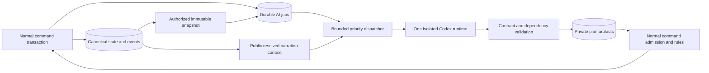

# Bounded Asynchronous Narrative Planning

## 1. Status and purpose

This application contract and research synthesis was recorded on **23 October 2026**. P03.6 subsequently implements the database and internal admission foundations described below (24 October 2026). No production dispatcher, complete semantic planner, concurrency benchmark or narrative-quality result is delivered. The checked P01 runtime work remains limited to its recorded evidence. [ADR 0014](adr/0014-bounded-asynchronous-planning.md) records the design decision.

The V6 foundation persists jobs/attempts, immutable input snapshots, versioned plans,
typed dependencies, admission receipts, append-only dispositions, query epochs and
campaign recovery generations. Critical enqueue/epoch invalidation shares the
canonical transaction. Capture rejects stale assembler tokens; admission keeps the
entire engine-recorded manifest and rechecks query epochs, generation, lease and
public presentation tokens under locks. Non-query semantic dependencies fail closed
until P08.7 supplies typed evaluators. Unrelated world revisions alone do not reject
a plan. Claims/admissions wait for startup reconciliation; expired leases require
explicit external-stop confirmation before retry. Restore retires old generations
and usable plans. Seventeen real PostgreSQL preparation tests plus canonical tests
and a populated restore/startup rehearsal establish this limited scope. Full epoch
tagging by gameplay writers, scheduler fairness/budgets, runtime cancellation,
author/quest semantics and plan consumption remain P07.6/P08.6–P08.7.

P07.6 (28 October 2026) completes the transactional half of that admission and the
check at actual use. Under the campaign lock the V12 gate also checks scope (current
generation, no private reads or secret definitions in public input), pinned content
(revision, pack and ruleset hashes, cited definitions), author constraints (a digest
recomputed from the sealed pin, cited required/fixed entities) and typed row-version
dependencies on actors, resources, items, character state and player-knowledge records,
and requires every cited campaign entity to be covered by a recorded dependency. Every
canonical commit re-evaluates admitted plans against the rows it changed. Only an
ordinary canonical command uses a plan: its commit rechecks the cited branches against
current rows before writing any effect and records each branch once in
`plan_activation`; the plan contributes no fact, time, reward or draw. Predicates,
constraint rows, the quest-plan body contract, consumers that build commands from plans,
dispatch and budgets remain P08.6–P08.7, P09.1 and P10. See the
[P07.6 contract](07-turn-protocol.md#p076-plan-admission-and-activation).

P08.6 (28 October 2026) implements the dispatch half of section 9: one durable fair
priority queue (`InferenceScheduler`, V14 `inference_task`) in front of every inference
task, with interactive-first selection, isolated and ordered role/audience lines, background
aging and fair campaign rotation, separate interactive and background queue places,
rolling usage quotas, a durable account backoff for background work, preemption of
background work with the permit kept until its terminal result, reconciliation holds
for unconfirmed outcomes, write-ahead runtime references and restart recovery. One active
turn installation-wide stays the only accepted limit, enforced also by a database
index. Only interactive task kinds exist yet; planners and other background kinds
(P08.7, P09.3, P12, P15) will submit through the same queue. See
[docs/06 section 12](06-codex-integration.md#p086-durable-fair-scheduling).

Keep the playable loop small: validated intent when needed, deterministic resolution, canonical save, then public narration. Prepare selected expensive narrative situations separately, so accepting a mystery does not require generating its whole future before acknowledging the action. A prepared situation supplies motives, causal dependencies, clues and alternatives; it never prescribes the protagonist's choices or makes an anticipated outcome inevitable.

This extends the existing [architecture](04-architecture.md), [turn protocol](07-turn-protocol.md), [memory model](08-memory-and-continuity.md), [authoring contract](09-adventure-packs.md), and [task envelopes](21-ai-task-contracts-and-prompts.md). Those remain authoritative for canonical mutations, supported mechanics and public narration. A plan is preparation, not a second world-state store.

## 2. Evidence and architectural implications

### Runtime evidence

The official [Codex app-server documentation](https://learn.chatgpt.com/docs/app-server) describes threads, turns, correlated RPC replies, terminal notifications, per-turn model/effort overrides and structured output. Model and effort can become subsequent thread defaults; `outputSchema` applies to one turn. Interrupt acknowledgment is separate from terminal status. These documented surfaces do not establish an account's throughput, priority guarantees or latency.

The exact pinned project evidence is stronger than a claim based only on current documentation, and narrower than production readiness:

| Evidence | What was actually established | Remaining limit |
| --- | --- | --- |
| P01.1 discovery and IPC | Runtime 0.164.0, stdio and packaged Unix-socket WebSocket framing, discovery and paginated model catalog | Catalog visibility is not successful inference or entitlement |
| P01.2 scripted lifecycle | Seven turns across two threads; explicit upstream model/effort/schema comparisons; reconnect/resume; failed, completed and interrupted outcomes | Scripted upstream, not model-quality or service-throughput evidence |
| P01.2 overlap case | T2's held upstream request X remains open while T1's C completes; foreign events interleave; X later interrupts and its stream closes | Demonstrates overlapping app-server turns against a test double; no live-provider concurrency, speedup, priority or production dispatcher proof |
| P01.2 live neutral smoke | One completed neutral structured task and second-process stdio resume, with explicit model/effort | Historical account-backed text result; predates the rebuilt isolation profile; not a concurrent inference test |
| P01.3 isolation | Container boundary, managed tool-less configuration, inherited-config guard, effective read-only/never policy, upstream `tools: []` and rejection of non-narration items | Rebuilt-profile live recheck reached `usageLimitExceeded`; it remains an exit gate |
| P01.4 lifecycle | Connection loss can leave packaged work running; fresh-connection reconciliation and explicit terminal interruption; bounded queues/shutdown/redacted diagnostics | Not application save coherence or production recovery |
| P01.5 retained fixtures | Exact-version neutral projections and offline replay with explicit platform limits | Replay does not qualify another runtime, platform or account |

Sources: [compatibility matrix](../tools/runtime_probe/COMPATIBILITY.md), [probe instructions](../tools/runtime_probe/README.md), actual [session correlation](../tools/runtime_probe/session.py), [overlap sequence in `run_session_fixture`](../tools/runtime_probe/probe.py), [live neutral report](../tools/runtime_probe/evidence/live-neutral-0.164.0.json), and [verified ADR 0013](adr/0013-narration-runtime-isolation.md). These were inspected read-only; no runtime or live-inference check was run for this design update.

### Planning research

| Primary source inspected | Relevant finding | Project adaptation and limit |
| --- | --- | --- |
| Park et al., [Generative Agents](https://arxiv.org/abs/2304.03442v2), 2023, abstract/architecture | Combines retrieved observations, reflection and planning; reports believability evaluations in a 25-agent sandbox | Retrieve source-linked NPC commitments and revise plans after observations. Its evaluation does not prove quest quality, transactional correctness or acceptable cost here; do not run an LLM for every NPC/time tick |
| Riedl and Young, [Narrative Planning: Balancing Plot and Character](https://faculty.cc.gatech.edu/~riedl/pubs/jair.pdf), JAIR 39, 2010, abstract and conclusions | IPOCL represents causal plot support and character intentions; its stated limitations include character-goal failure | Record motives and causal links, while explicitly supporting abandonment, failed goals and player-created solutions. Do not import a planner that guarantees a particular ending |
| Nau et al., [SHOP2: An HTN Planning System](https://www.cs.umd.edu/~nau/papers/nau2003shop2.pdf), JAIR 20, 2003, sections 1–3 | Domain methods decompose tasks into subtasks with partial ordering | Use bounded optional subgoals and refine only relevant areas. A full HTN solver and external-program operators are unnecessary and outside pack/runtime permissions |
| Jeff Orkin, [Three States and a Plan: The A.I. of F.E.A.R.](https://www.gamedevs.org/uploads/three-states-plan-ai-of-fear.pdf), GDC 2006, author paper, GOAP/replanning discussion | Goals, action preconditions/effects and replanning can decouple desired outcomes from particular actions | Reuse typed prerequisites and local legal-action selection for bounded NPC decisions. Tactical GOAP is not evidence that an LLM narrative director improves long campaigns. The author's site was inaccessible; the inspected PDF is a mirror of the primary paper |

These are design influences, not comparative results for this engine. The proposed synthesis is a small planner/executor boundary: the LLM proposes flexible situations; backend predicates, schedules and commands decide what is legal and what occurs. Event-driven invalidation and progressive refinement are project choices to control waste and retain player freedom. No new agent framework, vector database or general autonomous-agent loop is required.

## 3. Runtime topology and roles

Retain one modular Spring Boot application, PostgreSQL and one isolated Codex runtime per installation. Add a backend-owned durable priority queue. Keep independent logical sessions/threads for their different roles and audiences, and **default to one active inference turn across the installation**. Many stored threads and pending jobs do not imply many simultaneous generations.

The arrows denote application-owned data movement. Codex has no database, shell, browser, filesystem-tool or general network-tool access. Preserve [ADR 0013](adr/0013-narration-runtime-isolation.md): the background roles use the same verified tool-less profile. Model-service egress is still required; this is not offline narrative inference.

| Logical role | Task kinds | Context and result | Scheduling |
| --- | --- | --- | --- |
| Interactive narrator | Existing intent interpretation and resolved narration are distinct task kinds | Permitted current choices for intent; public resolved events for narration; typed proposal or attributed prose | Highest inference priority; no extra classifier/reviewer call by default |
| Quest planner | `quest-plan`, bounded `quest-plan-refine` | Authorized immutable world slice, author constraints, source-linked motives; versioned conditional plan artifact | Selective background work; no canonical mutations |
| World director | `world-development-proposal` | Relevant faction/NPC goals, world-time horizon and established causes; candidate developments | Occasional, optional; deterministic schedules/clocks remain local |
| Narrative reviewer | `plan-review` | One plan and the minimum permitted source context; bounded issues with evidence references | Disabled by default; enable only after comparative quality/cost evidence |

Role names are not operating-system processes, product personas or a requirement to create more agents. Existing guide, tactic and summary roles retain their own scopes. Since P08.3 the roles exist as `AiRole` values with a fixed audience rule ([docs/06 section 7](06-codex-integration.md#p083-session-scoping)). The interactive narrator is split into the public `interpreter` and `narrator` roles, each with its own session. The quest planner, world director and narrative reviewer (`quest-planner`, `world-director`, `plan-reviewer`) may run only in the `privileged` audience, which corresponds to the snapshot audience `PLANNER_PRIVATE`, and a public role can never run there. A planner and the narrator of one campaign therefore always use different runtime threads. A narrative reviewer is an ordinary tool-less `turn/start` with a versioned `plan-review` output contract, not Codex's code-oriented `review/start` or a delegated subagent. No additional critic, translator, supervisor or memory-agent chain is justified by this design.

External development orchestration may use Claude or Codex to work on this repository. That developer workflow is separate from the game's narration runtime (Codex by default, Claude as the selectable alternative under [ADR 0020](adr/0020-selectable-narration-runtime.md)) and cannot silently introduce a gameplay provider, delegated model, paid fallback or broad runtime capability. Switching the game's runtime is an explicit owner operation, never an automatic fallback.

### Alternatives

| Alternative | Benefit | Cost/risk | Decision |
| --- | --- | --- | --- |
| Single narrator, no deep plans | Smallest playable baseline and lowest extra inference cost | Less prepared long-arc structure | Retain as complete fallback and evaluation baseline |
| One runtime, distinct threads, serialized durable jobs | Isolates context with existing deployment; explicit budgets/recovery | Running background work can delay narration until safely interrupted | Initial design; dispatch only bounded work with verified cancellation |
| One runtime, multiple active turns | May overlap tasks without another container | Shared account quota; event routing and preemption complexity; benefit unmeasured | Opt-in only after P08 qualification below |
| Multiple runtime instances or a pool | Process-level failure separation and possible scaling | More accounts/state/IPC/resource lifecycle; same account may retain shared limits; no inherent latency benefit | Defer until measured contention justifies it |
| Agent framework or orchestration microservice | Could provide reusable workflow infrastructure | Adds persistence semantics, deployment and permissions to reconcile | Reject as an initial dependency; the finite job lifecycle is sufficient |

## 4. Player experience and work selection

Accepting a quest first commits an already valid quest identity, basic objective, source, known stakes and an achievable initial lead. Publish its acknowledgment through ordinary grounded narration. The background planner may enrich later opportunities; neither acceptance nor the next move waits for a complete arc.

Choose preparation locally using task type, importance, novelty, imminent use and budget:

| Situation | Initial policy |
| --- | --- |
| Main mystery, complex investigation, consequential recurring commitment | One small plan, then refine a relevant unresolved branch |
| Ordinary NPC dialogue | Immediate narration from current knowledge; no planner |
| Simple delivery/collection errand | Authored or local procedural objective logic |
| Combat arithmetic, rewards, schedules, faction resource updates | Deterministic rules; no LLM calculation |
| Significant committed faction/relationship change | Optional targeted director/quest refinement after commit |
| Unaccepted quest the player is likely to encounter soon | At most a small cancellable speculative preparation when idle, within a separate low budget |

Do not precompute every quest, all NPC lives or full dialogue trees. Prefer a small causal skeleton plus one useful next situation over a complete upfront story. Preserve committed discoveries and author-fixed truths when refining; an undisclosed proposal is not an established culprit or past event merely because a model wrote it.

If the player reaches a lead before its plan is ready, resolve against the authored/procedural baseline and current state. Offer valid visible approaches or a deterministic receipt, preserve the next decision, and later revalidate the plan against that new evidence. Do not stall behind “the story is generating,” manufacture a locked route, or pretend the clue has appeared. The final narrator cannot invent pending-plan facts. A quest must remain playable when all advanced planning is disabled or unavailable.

Ordinary play needs only clear existing operation/save status. Background-plan titles, secret progress, provider thread IDs and detailed budgets belong in protected diagnostics. The composer remains usable while preparation is queued. Language follows the [localization contract](29-localization.md): `en` is the default and `it` is equally supported; generate directly in the selected narrative language with stable entity/term IDs. Bind public output to `outputLocale`, `localeRevision` and glossary/policy versions. Locale changes invalidate stale public prose, not language-neutral mechanical identities; re-rendering/translation cannot introduce facts or rerun actions. Internal planner text can use a fixed language while its audience-filtered public rendition follows the campaign preference.

## 5. Durable records and lifecycle

Proposed additions to the existing PostgreSQL table families are logical aggregates, not implemented migrations:

| Record | Required data |
| --- | --- |
| `AiJob` | Adventure/campaign identity, campaign generation, kind, target, deduplication key, priority, status, payload/schema/policy hashes, snapshot reference, due/expiry times, attempt and regeneration counts, lease owner/expiry/fence, runtime generation/thread/turn references, cancellation state, estimated/reserved/observed usage, result digest and safe failure code |
| `PlanningSnapshot` | Immutable source revision/event high-water mark/world time, selected state and permitted knowledge, source references, complete read/dependency manifest, pack/ruleset/author-constraint/policy hashes, audience and context digest |
| `QuestPlanArtifact` | Stable plan identity/version, target quest, predecessor, source snapshot, typed body, exact dependency manifest, validation receipt, status and supersession links |
| `PlanDependency` | Typed entity-field/fact/query/constraint dependency, expected version or predicate, scope, branch references and invalidation severity |
| `PlanValidationReceipt` | Validator versions, checked revision, dependency fingerprint, accepted/rejected branches, reasons, source/result hashes and admission identity |

Use relational keys/constraints for ownership, uniqueness, attempts and leases; bounded versioned JSONB is suitable for immutable snapshots and plan bodies. Persist critical job creation with its originating canonical transaction/outbox so a crash cannot lose a required post-commit task. Speculative requests can be inserted independently with explicit provenance. A replayed outbox uses the same deduplication key.

Job states are `queued`, `leased`, `running`, `cancel-requested`, `result-received`, `validating`, then `completed`, `superseded`, `cancelled`, `failed` or `expired`; bounded retry records a new attempt while retaining the same logical job. An uncertain runtime request becomes `reconciliation-required` and cannot be treated as queued until reconciled. `completed` means this preparation job has a durable accepted result, not that a quest or world event occurred.

Plan states are `proposed`, `validated`, `partially-invalidated`, `invalidated`, `superseded` or `rejected`. A validated artifact is eligible preparation under its dependency stamp; it is not canonical truth. Keep the distinction from an existing quest's canonical lifecycle and from any future event occurrence.

Claim jobs in a short transaction using a lease and increasing fencing token, with a supported row-lock strategy such as `FOR UPDATE SKIP LOCKED`. Do not hold a database lock while waiting for Codex. Every heartbeat, result persistence and validation write checks the current job fence and campaign generation. Expiry allows reconciliation/recovery; it does not prove the upstream turn stopped. A worker that loses its lease can never publish a late result.

Deduplicate by adventure/campaign/generation, task kind, target, dependency fingerprint, policy/contract versions and refinement purpose. Unique result/admission keys provide at-most-one accepted artifact version per attempt; delivery and worker execution may be at least once. Retain attempts and rejection reasons without claiming exactly-once inference or billing. Identical results arriving twice do not create two branches, clues or rewards.

## 6. Versioned quest-plan contract

Add `quest-plan` and `quest-plan-refine` to the [common task envelopes](21-ai-task-contracts-and-prompts.md), with backend-bound adventure/campaign/generation, job/attempt identity and snapshot/dependency digests. Public text also carries the localization envelope's `outputLocale`, `localeRevision` and glossary revision. Preserve all existing envelope checks; a model's echoed digest never authenticates its output. Candidate schema version 1 has the following bounded fields:

| Field | Meaning and validation |
| --- | --- |
| `planId`, `planVersion`, `questId`, `predecessorPlanId` | Stable backend-owned target/version bindings; proposal-local IDs for new candidates; never derive identity from a title |
| `premise`, `tensions`, `planningHorizon` | Situation and bounded world-time horizon, not an accomplished event or guaranteed ending |
| `establishedLoreRefs`, `requiredWorldFacts` | Source-linked existing facts and typed predicates; unknown sources fail validation |
| `participants` | Existing entity IDs, relevant motives/goals/beliefs with sources and explicit knowledge scopes |
| `secrets` | Distinguish established private fact references from new secret proposals; include authorized knowers and disclosure prerequisites |
| `nodes` | Optional opportunities, clues, developments and subgoals with causal support references, visibility, eligibility, expiry and candidate content references |
| `branches` | Typed guarded alternatives, supported objectives and flexible outcome candidates; no mandatory protagonist action |
| `failureAndAbandonment` | Supported expiry/failure predicates, no-progress fallback, and bounded consequence proposals; no automatic punishment for disobeying a plot |
| `pendingEventProposals` | Trigger/window/cause/content candidates for later command admission, separate from canonical pending events |
| `authorConstraintRefs` | Protected fixed facts, required entity/appearance identities, allowed gaps and exclusions from the supplied immutable constraint revision |
| `readDependencies`, `assumptions` | References to engine-supplied dependencies; branch applicability and source-linked uncertainty, never a self-selected complete read set |
| `locale`, `terminologyRefs` | Selected prose locale, stable proper names and controlled terms; structural identifiers remain language independent |
| `validationMetadata` | Backend-written contract/validator versions, source/result hashes, dependency fingerprint, checked revision and branch disposition; not trusted when model supplied |

Predicates use the existing bounded expression vocabulary, for example `all`, `any`, `not`, `actor-status`, `fact-known-to`, `quest-status`, `item-available`, `relationship-band`, `location-reachable` and `world-time-window`. These are proposed typed names to compile during P04/P08, not executable syntax already supported by the engine. Unknown operators, arbitrary code, SQL, host paths, unbounded recursion and free-text conditions used as sole mechanics are rejected.

An illustrative branch is: when an established witness is alive, reachable and willing, offer a permitted interview opportunity; alternatively, allow an already admitted document to supply the same investigative objective after inspection. Neither branch orders the player to interview or inspect. A surprising lawful solution can satisfy the objective predicate without traversing a listed node. A dead witness is never resurrected to preserve a preferred route.

Encode causal ordering only where required: discovering evidence can support an accusation, but two independent leads need not be visited in a fixed order. Reject impossible mandatory cycles; bound optional revisits separately. Critical root assumptions invalidate the whole dependent plan; an optional branch can be dropped only if remaining branches still satisfy protected constraints and do not cite its missing support.

An author requirement to introduce a specific NPC preserves that identity and its stated conditions. It does not imply immortality, instant travel, compulsory romance or player agreement. Conflicting fixed requirements yield diagnostics. The future [E-series editor](26-adventure-editor-roadmap.md) will edit the same contract; no editor UI is required for this design.

Candidate initial caps are 24 nodes, eight alternatives, depth six for the plan graph, and the existing context/output application budgets; reduce scope if these cannot fit. These are tuning proposals, not benchmarks or replacements for tighter rules/content limits. No complete story or every possible branch is required before admitting a small valid artifact.

## 7. Dependency-sensitive staleness and admission

### Capture complete dependencies

The snapshot assembler, not the model alone, records everything it supplies or queries. Include:

- Entity/field or aggregate versions for life/status, presence/reachability, ownership/resources, quest state, relationships and relevant clocks.
- Fact identity/version, audience/disclosure version, provenance, supersession and relevant NPC belief/knowledge scopes.
- Immutable content, ruleset, author-constraint, locale-policy and task-contract hashes.
- Predicate/query dependencies, including empty results, negative facts and collection membership; world-time windows and expiry conditions.

Recording only returned entity rows misses phantoms. “No one has discovered clue X” and “no living witnesses in district D” depend on absence and query membership. Maintain a versioned predicate/collection epoch for each supported bounded query scope, incremented by every canonical writer that can change its truth or membership. Record its definition, parameters, audience, epoch and result digest. Inserts, deletes, moves, death, changed disclosure and newly admitted facts must update affected epochs in the canonical transaction. If precise affected scopes cannot be established, use a conservative larger scope epoch or re-evaluate the predicate under the admission lock. Unsupported open-ended queries are not silently trusted.

Model-declared assumptions may add dependencies but cannot remove engine-recorded ones. If a conclusion relies on omitted information, reject or recapture the relevant snapshot; do not treat an incomplete manifest as proof of freshness. Start with aggregate versions for correctness and refine to field-level versions only when measured false invalidations justify their maintenance cost.

### Revision 100 to 108 example

| Change while the plan runs | Required disposition at revision 108 |
| --- | --- |
| Unrelated actor spends currency in a distant region | Keep the artifact if no supplied dependency/query scope changed; a global revision difference alone is not rejection |
| Required witness is killed | Invalidate witness-dependent interview nodes and their causal descendants; retain an independent admitted-document route only if feasibility/constraints still pass |
| Player leaves the harbor | A future harbor opportunity can remain conditional; an assumption that the player is currently there must be refreshed before use |
| Another quest spends the unique key or destroys a clue object | Recheck ownership/existence/availability; invalidate affected routes, never recreate the item from the old snapshot |
| Player reveals the secret first | Refresh disclosure/knowledge predicates and remove redundant reveal beats; preserve the actual discovery and its source |
| New witness/fact makes a prior empty query false | Query epoch/predicate recheck detects the phantom even though none of the old returned rows changed |
| Faction relationship crosses a required threshold | Re-evaluate its band and invalidate only dependent negotiations/opportunities |
| Pack/ruleset/policy/author constraint or campaign generation changes | Reject the incompatible artifact; require an explicit new snapshot/version or supported migration |

Prefer pruning optional stale branches and bounded targeted refinement to regenerating everything. Preserve the prior artifact with a disposition record; do not edit its bytes to conceal the assumption change. If no viable supported branch remains, retain baseline play and request at most the configured regeneration allowance. A new unrelated revision cannot cause a perpetual replan loop.

### Two admission checks

First validate shape, identities, provenance, author constraints, causal support, feasibility, knowledge scopes, budgets and dependencies outside the canonical transaction. This produces a provisional validation receipt, never unconditional permission to use future facts.

Then, in a short admission transaction, lock/recheck the campaign generation and relevant dependency rows/query epochs, artifact predecessor/version, job fence, cancellation/supersession and validation-policy versions. All canonical writers share the campaign lock/epoch-update protocol, preventing a change between dependency checks and insertion. If relevant dependencies changed since provisional validation, reject or revalidate rather than copying an earlier “valid” flag. Store the immutable validated artifact, accepted branches, fresh dependency fingerprint and unique admission receipt atomically. This metadata write does not advance `stateRevision`, `gameTurn`, `worldTime`, RNG or the canonical domain-event sequence.

At **actual use**, the normal [command transaction](07-turn-protocol.md#5-canonical-commit) checks its exact current `expectedRevision`, campaign mutation fence, actor eligibility, relevant plan dependencies, constraints and resources again. Only that transaction can admit a proposed canonical definition/fact, adopt a pending event, reveal evidence or apply a consequence. Background dependency-sensitive validation does not weaken the existing exact-revision requirement for game actions. If state changes after validation, the command's second check wins.

P07.2 implements the common typed activation gate for the currently registered
exploration intentions. A resolver must bind its intention to the admitted request
hash and recheck mode, pending decision and creation-player/recipient scope inside
canonical commit. A validated artifact cannot supply generic patches or bypass that
gate. P07.3 adds the resource, ownership, prerequisite, knowledge and causal rules to
that same gate, re-derived from current rows at activation and commit; a validation
receipt or cached catalog never substitutes for them. P07.4 local execution bumps
the `actor:<uuid>` query epoch of every actor whose placement or resource pools a
command changed, in the same canonical transaction, and invalidates current plans that
read a bumped scope; plans that depend on an actor's position or pools should record
that scope. P07.6 implements the second check and typed activation: the admission gate
rechecks scope, pinned content, author constraints, query epochs and typed row versions
under the campaign lock, and a canonical commit that cites admitted branches rechecks
them live before any effect and records each use once (see the
[P07.6 contract](07-turn-protocol.md#p076-plan-admission-and-activation)). A reveal or
other writer added later must bump the affected scope (for example `knowledge:<actorId>`)
or step the row version it changes. No new background world writer is added.

P07.5 post-commit presentation jobs (`presentation_job`) are deliberately separate from
`ai_job`: one per committed operation, created by the canonical transaction, settled
together with the journal's presentation status and never admitted as an artifact. They
cannot change world facts, time, rewards or draws. Since P08.5/P08.6 the job's
`NarrationPort` call is where the fair queue and its runtime permit take over: its
narration runs as interactive work of the P08.6 scheduler, the time it waits counts
against its narration budget, and the job keeps its own fence, lease and attempt budget;
its cancellation request follows the interrupt/reconcile rules of section 9.

## 8. Plans, pending events, knowledge and canon

| Data class | Authority and permitted use |
| --- | --- |
| Proposed narrative content | Untrusted private candidate; unavailable as a world fact or public clue |
| Validated plan artifact | Durable preparation eligible for rechecked use; not truth, past events, rewards or player knowledge |
| Canonical world fact/definition | Admitted through the normal authoritative command/content path, with source and visibility |
| Canonical pending event | A committed conditional obligation/possibility in the backend registry; not an occurred event |
| Committed event | Recorded occurrence with causation, world time and canonical transaction receipt |
| NPC belief/private knowledge | Scoped claim with its own source and truth status; not automatic knowledge of the planner's whole design |
| Player knowledge/public transcript | Authorized discoveries and delivered text; secret plans are excluded |
| Presentation output | Wording, image/audio cue or rendering of public committed sources; cannot establish mechanics or facts |

The canonical pending-event registry records event identity, cause, source plan/version/node, typed trigger and prerequisites, world-time due/expiry window, visibility, target IDs, settlement key and lifecycle (`scheduled`, `eligible`, `resolved`, `cancelled` or `expired`). Creating/changing/cancelling it is a canonical mutation through the normal command service. On due world-time boundaries, deterministic rules recheck eligibility and resolve supported consequences through that same service. A director result or job completion is not a clock tick, an NPC action or an event trigger. Administrative cancellation/restore keeps explicit causation and audit.

Planner context may include authorized secrets; public narrator, guide and tactic context must be assembled independently. Never reuse a privileged planner thread for narration or carry raw planner transcripts into a public handoff. A secret-marked string is not made safe by removing its label. The backend creates a minimal public projection from actually admitted/discovered facts. Apply the same sink policy to quick replies, plan-progress labels, SSE, journal, images, music, TTS, asset names/metadata, exports and diagnostics. Final-output checks are defense in depth; they do not make arbitrary secret-containing context safe.

## 9. Priority, cancellation, quotas and restart

The dispatcher enforces installation/account-wide limits before per-campaign limits. Separate canonical campaign mutation leases from AI-job leases and runtime admission permits; a running planner holds no campaign mutation lease. A backend instance cannot multiply concurrency by starting another worker. Persist/reconcile shared permits and accounting alongside jobs.

P07.1 implements a separate database cap of two live canonical mutation permits
per owner across adventures, including internal reacquisition and renewal. This
bounds command work only; it neither raises the one-active-inference-turn baseline
nor admits planners, narration or media jobs through campaign mutation leases.
The runtime dispatcher and job budgets below remain their separate P08 scope.

Order work as: interactive intent/resolved narration and immediate legal-tactic work; required bounded continuity work; accepted-quest preparation/refinement; speculative preparation/director/review. Deterministic reads require no inference permit. Public receipt fallback remains available if a narration job cannot be admitted. Use an age-aware fair rotation among campaigns within a class, with at most one candidate per campaign before another gets a turn. Background work never ages above active interaction. An inactive campaign's speculative work is paused/superseded; switching the UI does not reset budgets, kill another campaign or allow its callbacks into the selected view.

Initial candidate policy: one active inference turn globally, one unresolved plan job per target, at most two pending background jobs per campaign and eight installation-wide, bounded attempts, and no review/speculation when usage is uncertain. Queue caps reject/coalesce optional work; they never silently queue a second canonical player action behind an unseen state. Use measured pressure and aging before expanding caps.

When an interactive request arrives during a planner turn, request interruption by exact thread/turn identity, retain its permit until terminal confirmation, discard incomplete output, and schedule the interaction next. The scheduler must not call the partial plan a checkpoint. A running request cannot be paused/resumed from internal reasoning; continuation starts from a complete artifact or a new bounded task. Set a finite per-attempt generation deadline and a separate short cancellation/reconciliation deadline. Candidate tuning values are 30 seconds for a background attempt, five seconds to seek interrupt confirmation, and at most one fresh regeneration after a meaningful dependency change; these are local limits to qualify at P08, not provider promises. Structural repair and stale-world regeneration share the job's total attempt/token/time budget and cannot recursively enqueue each other.

If confirmation is lost, retire that runtime connection generation, reconcile on a fresh connection and keep the uncertain turn accounted for. Do not launch another turn under the assumption that a disconnected planner stopped. Do not terminate the shared runtime solely to make optional work appear cancelled; a controlled installation restart belongs to the existing owned-runtime lifecycle and reconciles every affected task. If safe bounded preemption cannot be qualified, run optional jobs only in an explicit idle maintenance window, or disable them. Baseline gameplay remains the release path.

P01.7 records the bounded concurrent-turn/cancellation capability result. The P08.6 production dispatcher runs one turn installation-wide; enabling concurrency greater than one first requires qualifying it with the exact pinned runtime/policy/platform and an explicitly authorized account-backed neutral experiment. Require per-turn event routing without discarding another task's events; isolated failure/cancellation; terminal reconciliation; interactive priority under a running background task; quota/backpressure behavior; restart with uncertain turns; and measured p50/p95 latency plus usage against the serialized baseline. The scripted X/C overlap is a prerequisite fixture, not that qualification. A negative/unavailable capability result retains valid serialized operation and does not require a pool. Lack of measurable benefit also retains serialization.

On account errors (`usageLimitExceeded`, rate limit, authentication failure or unknown quota), suspend optional admissions and expose a sanitized actionable status. Bound backoff with jitter and expiry; honor any supported retry timing. Never promise unlimited subscription inference, infer remaining tokens from a model catalog, enable paid overage, switch to API billing or another provider implicitly. Reserve estimated usage before dispatch, reconcile observed token/account information when supported, label estimates when not, and retain conservative usage for interrupted or unknown outcomes. Local budget reservations cannot guarantee that the provider will stop billing at an exact token count.

On application restart, stop admissions until job leases, runtime permits, operations and terminal states are reconciled. Expired workers are fenced out; uncertain upstream work is inspected/interrupted before resubmission. Never replay a canonical action to recover a plan. Requeue only an uncommitted eligible task with remaining budget and a fresh validated snapshot. Retire affected contexts and follow the existing renewable-session policy; a new thread does not reset logical job budgets or attempt counts.

### Operating profiles

P01.7's [retained qualification](../tools/runtime_probe/CONCURRENCY.md) now
explicitly selects that one-turn installation-wide baseline. The managed
runtime passes bounded interleaved dispatch and targeted cancellation against
an internal scripted upstream, including interrupt/reconcile/dispatch priority.
P08.6 delivers the production queue, fairness, quotas, backoff and recovery with
that baseline ([docs/06 section 12](06-codex-integration.md#p086-durable-fair-scheduling)):
the concurrency and pending-background candidates of this section are its defaults
(per-target plan limits and background attempt budgets belong to the P08.7 planner
jobs), and the higher-limit gate
above stays closed (`max-active` above 1 fails startup). Live simultaneity/headroom,
service priority, quota behavior and cancellation latency remain unverified.
Scripted overlap gives no live throughput result.

Assess these first as internal policy presets behind one optional planning setting, not three mandatory player-facing screens:

| Candidate profile | Preparation policy | Added cost and trade-off |
| --- | --- | --- |
| Economy | Off or small authored/procedural skeletons; no speculative work/reviewer | Lowest extra inference; complete baseline gameplay |
| Balanced | Selected accepted quests; one small plan/refinement within fixed budgets; no review by default | Extra calls only where likely to be used |
| Cinematic | Larger explicitly bounded preparation allowance; occasional director; reviewer only if its gate passes | Higher usage/waste risk; same safety, public-context and global concurrency limits |

Default to conservative Balanced only after its safety/benefit gate; otherwise Economy. Budget settings cover calls, estimated/observed tokens, elapsed time, pending jobs and per-campaign/session/day totals plus global account limits. A preset cannot override owner-selected model quality, paid-access policy or safe caps. Expose detailed model/effort controls in existing settings only if they help an owner make an informed resource choice.

## 10. Save, export, restore and renewal

Full-owner backups include immutable validated plans/snapshots, dependency and admission records, job attempt history, current canonical pending events, pinned hashes, audience classifications and referenced content. Player-facing exports include only authorized discovered content; omit secret plans, private assumptions, internal thread identifiers and raw traces.

Do not export live runtime leases, connection secrets or claims that an in-flight task will resume. Restore remaps adventure/campaign/entity/fact/quest/pending-event IDs and source provenance using a manifest. Default restore creates fresh campaign identities and a fresh campaign generation. Old job callbacks, fences, sessions and public delivery cursors are invalid in that destination even if revision numbers match. No same-name matching or cross-campaign result reuse is allowed.

Imported plan artifacts are inactive until ownership, dependency mapping, hashes, audience and validator compatibility pass. Unmappable dependencies invalidate the affected artifact; fall back to baseline play. Restore re-establishes canonical pending events only from the validated save, deduplicates their settlement keys and rechecks world-time eligibility without advancing time on load. Queued optional jobs may be reconstructed from current demand after reconciliation; never replay captured `turn/start` frames. Renewal rebuilds planner and narrator context separately from canonical state plus eligible plan references, never from an undifferentiated transcript.

## 11. Validation and measurable comparisons

The following acceptance contracts are **planned**, not passing results. They supplement the QA register and its existing 500-turn/25-renewal scenario; they do not replace integrity or runtime-isolation gates.

| ID | Scenario | Required evidence |
| --- | --- | --- |
| AP-01 | Revision 100→108 with unrelated changes | Valid independent branches survive; no global-revision-only replan |
| AP-02 | Witness death, destroyed object, spent resource, faction/quest change | Affected branches and causal descendants invalidate; no resurrection, duplication or forced route |
| AP-03 | Empty query/negative predicate, insertion/move/disclosure phantom | Complete query-dependency detection and second-check rejection; conservative fallback when precision is unavailable |
| AP-04 | Change between provisional validation and transactional admission/use | No stale artifact/fact/event admitted; existing exact command revision/fence checks hold |
| AP-05 | Two workers, duplicate result/outbox, expired lease, late callback | One accepted artifact/admission; obsolete fence/generation rejected; no duplicate canonical consequence |
| AP-06 | Cancel acknowledgment, lost connection, timeout, restart with running turn | Permit retained until reconciliation/terminal proof; no blind replay, unbounded retry or cross-turn event loss |
| AP-07 | Immediate player progress before plan completion; planner/reviewer unavailable | Same baseline actions/objective remain playable; grounded acknowledgment and next decision; no pending-plan facts leaked |
| AP-08 | Plan completes while campaign is idle; due event on world-time boundary | Plan save changes no canonical counter; pending-event adoption/resolution uses ordinary commands once |
| AP-09 | Secret sentinels across roles and output sinks | No leak through prose, quick replies, assets/audio/TTS, status, export or diagnostics; actor belief scopes retained |
| AP-10 | Two active adventures, quota exhaustion, restored clone and locale switch | Fair bounded scheduling; persistent global usage; no cross-scope callback, spending fallback or stale-language delivery |
| AP-11 | Fixed author facts, unexpected lawful solution, failure/abandonment | Identity/constraints preserved without prescribing player actions; valid solution/objective and failure policies remain available |
| AP-12 | Narrator A, planner B, planner+reviewer C | Paired bilingual quality/latency/usage report with configuration, raw counts, uncertainty and failures; no superiority claim without evidence |

QA-36 owns AP-01–AP-05's stale-plan/admission assertions (P07.6 records the first deterministic real-PostgreSQL evidence for them and for AP-08's no-canonical-change rule; see the [quality record](15-quality-and-acceptance.md)), QA-37 owns priority, quota, cancellation/recovery and concurrency scenarios, QA-39 owns AP-12's paired bilingual narrative comparisons, and existing QA-07/16/23/33/34 plus QA-35/40 cover agency, scope, restore, authorship, locale and presentation sinks. These references are coverage mappings, not passed tests. Use deterministic scripted jobs and real PostgreSQL for race, lease, phantom, idempotency, restart and safety checks. Runtime adapter fixtures test event interleaving and fault handling without live inference in normal CI. Qualify account-backed concurrency separately and minimally; live access is not needed to review this document. Long quality evaluations use a controlled explicit inference allowance.

For AP-12, compare A (single narrator), B (same narrator plus bounded planning), and C (B plus optional review), keeping pack/ruleset, task/model settings, locale, seeds and evaluation prompts recorded. Include simple errands, mystery with several leads, an unavailable witness, a spent unique resource, faction conflict, rejected romance/commitment, abandonment, secret discovery, renewal and restore. Use matched scenarios with randomized/blinded presentation order, at least two human raters and the same rubric in English and Italian. Follow the [central evaluation protocol](31-research-validation-and-evaluations.md) and its proposed floor of ten paired short situations per language; expanding to 30 per locale is a candidate study after budget review. Add a 100-turn continuity exercise, then the existing 500-turn release soak. Neither sample proposal is a statistical power claim; publish disagreement, variation and confidence intervals where meaningful.

Score causal coherence, understandable motives, factual consistency, feasible alternatives, preserved agency, meaningful failure and prose quality on anchored 1–5 scales. Record concrete contradiction/forced-action examples and branch diversity without rewarding sheer branch count. Separate objective invariant failures from human preference. Automated checks can verify IDs, predicates, counters and sentinels; an LLM judge is optional advisory evidence with model/prompt/version, bias and disagreement recorded, never the sole authority on secrecy or quality.

Report interactive acceptance, queue wait, cancellation/reconciliation, first permitted narrative and full-turn latency separately at p50/p95; provider generation separately from backend overhead. Measure calls, input/output/reasoning tokens where available, estimated usage uncertainty, repair/replan counts, total/background usage, abandoned/superseded work, queue starvation, recovery time and retained-plan reuse. Define wasted-work rate explicitly as unused/superseded/invalidated preparation cost divided by all preparation cost, over a declared observation window; an unused optional branch is not automatically a failed quest.

Promotion requires zero canonical integrity/secret/agency hard failures, a useful paired causal/motivation quality improvement, interactive p95 overhead within a predeclared tolerance and preparation usage within the owner's fixed cap. Measure A first, then record exact tolerances, minimum useful difference and usage allowance in the central protocol before running the comparison. A small quality gain below meaningful uncertainty does not qualify the feature. C must add measurable benefit over B within its separate allowance; otherwise keep the reviewer disabled. These are proposed objectives, not observed results or a guaranteed service level.

## 12. Delivery boundaries and dependencies

| Classification | Scope and owning stages | Value, effort and operating burden |
| --- | --- | --- |
| MVP critical | Baseline bilingual narration, deterministic quest/time/command authority, public-context isolation, cancellation/recovery and fallback; P03/P07–P10/P14 | High player/integrity value; existing foundational work; bounded ordinary inference and transaction tests |
| v1 critical foundation | Durable jobs/snapshots/artifacts/dependencies at P03.6, fenced admission at P07.6, no-time-advance separation, fair queue/budgets at P08.6, minimum bounded planner contract/fallback at P08.7, context at P09, restore at P16 and hardening at P18 | Medium/high implementation and race-test cost; moderate schema maintenance; supports safe opt-in preparation and other existing background jobs |
| v1 optional enablement | Deep quest planning and targeted refinement after safety and AP-12 benefit checks; P08.7/P10/P15/P18 | High potential narrative value; additional capped inference and bilingual quality testing; independently disabled despite the required minimum contract/fallback |
| v1 optional | Occasional director/relationship arc preparation; P15.6/P18 | Selective value; greater causality/knowledge testing and usage; no LLM per ordinary world tick |
| v1 optional, evidence gated | Reviewer and larger Cinematic allowance | Extra latency/usage/maintenance; retain only if C improves B |
| Post-v1 | Broad faction/long-arc orchestration, solver integration, runtime pool or framework after demonstrated need; editor E01–E06 remains separate | High scope and maintenance; new performance/rights/security evidence required |
| Rejected | Mandatory advanced plan before play, autonomous filesystem/DB writes, rigid protagonist script, paid/provider fallback, unbounded retries, vector store solely for planning | Conflicts with authority, responsiveness, budgets or evidence |

P14 should record one optional A/B demonstration in both languages when the planner is available, or a precise unavailable/deferred result with AP-07 fallback evidence. That comparison is a learning milestone, not a new blocker for the otherwise complete playable MVP. P18.6 owns the full paired quality/cost comparisons. v1 cannot enable asynchronous preparation without its durable safety foundation; inability to demonstrate a quality gain can keep the feature off without invalidating baseline play. Advanced arcs, reviewer, pool, local speech and the editor never become hidden MVP dependencies.

### Research checkpoint

Completed for the 23 October design checkpoint: inspected relevant existing architecture/turn/memory/author/workspace contracts, runtime probe source and retained evidence; fetched current official app-server documentation and four primary planning papers; compared topology alternatives and recorded explicit proposal/verification boundaries. That checkpoint ran no inference, implementation or benchmark. P03.6 and P07.6 implementation evidence is recorded in section 1. Remaining investigations belong to P08/P09/P10/P18: query-epoch tagging by later writers (reveals, items, quests), semantic predicate/constraint dependencies, exact supported-account concurrency/priority/cancellation measurements, bilingual A/B/C study and policy tuning. The design does not change P01's remaining live isolation/image gates.
