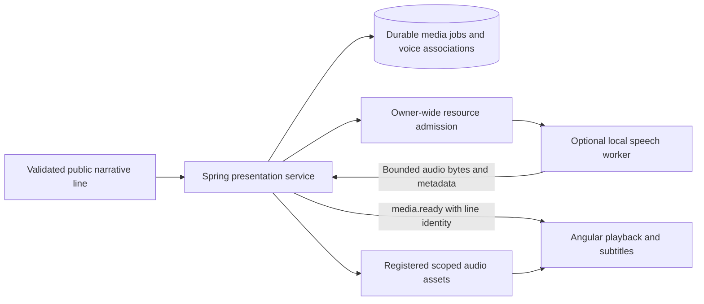

# Optional Local Speech Synthesis

This document covers TTS output. Optional microphone recognition and hands-free
commands have a separate [STT specification](35-speech-input-and-hands-free-play.md)
and [ADR 0022](adr/0022-optional-speech-input.md); no TTS candidate is selected as
a recognizer, and playback must respect that specification's echo controls.

## 1. Status, scope and recommendation

Research checked on 23 October 2026. This is an accepted **design for an optional feature**, under [ADR 0016](adr/0016-optional-local-speech.md), with a provisional model choice. No speech worker, model weights, voice samples, inference result, hardware benchmark or playback implementation is delivered by this documentation change. Repository/API inspection is evidence of available interfaces and published artifacts, not proof of installation, voice quality or performance on the owner's machine.

English is the default and Italian is a first-class initial language under [localization](29-localization.md). Both are required for text from the initial supported release. Speech is **v1 optional**, disabled by default and independent of MVP/core-v1 completion. A shipped enabled speech profile must pass English **and** Italian admission; an English-only profile cannot be advertised as the supported bilingual feature. A missing approved profile leaves complete text play available.

Recommend **Qwen3-TTS-12Hz-0.6B-Base** as the first primary candidate for a local Python worker, using admitted reference recordings and reusable speaker conditioning. Recommend **Kokoro-82M v1.0 on CPU**, preferably through a validated ONNX conversion, as the lightweight fallback candidate. This recommendation balances available bilingual artifacts, persistent voice conditioning, declared commercial-compatible model licenses and implementation cost; it is not a measured quality ranking. Chatterbox Multilingual V3 is the main challenger. Evaluate Qwen's 1.7B Base only if its measured Italian benefit justifies its resource cost.

The target is Windows 11, RTX 4070 with 12 GB VRAM, Docker Desktop and WSL 2. The reference host measured on 25 October 2026 has one 16 GB DDR5-5600 module (single channel, three free slots), not the 32 GB first assumed here; see [inference backends](34-inference-backends-and-model-selection.md#2-verified-facts-and-sources). Neither parameter count nor file size establishes that a full model, tokenizer, activations and caches fit this target. Selection remains conditional on the rights, environment, resource and bilingual listening gates below. No paid service, account or cloud TTS is introduced by this feature; local text and image models are separate optional backends ([ADR 0021](adr/0021-inference-backends-and-model-selection.md)).

## 2. Candidate comparison and evidence boundaries

### 2.1 Capabilities and runtime implications

| Candidate | English and Italian evidence | Persistent voice mechanism | Expressiveness and limitations | Disposition |
| --- | --- | --- | --- | --- |
| **Qwen3-TTS 12Hz 0.6B/1.7B Base** | Both are explicitly listed in the released model cards; Base API takes an explicit language. Actual quality still requires listening in each language | Reference waveform plus transcript; `create_voice_clone_prompt` returns reusable reference codes/embedding. Keep the original reference and model binding as durable identity | Base cloning is distinct from 1.7B VoiceDesign and instruction-controlled CustomVoice. Do not expose an emotion-instruction control on Base merely because the family supports it | **Primary candidate: 0.6B Base**; 1.7B Base is a measured upgrade candidate, not a second simultaneously resident model |
| **Chatterbox Multilingual V3, 500M** | `ChatterboxMultilingualTTS` source explicitly accepts `en` and `it`; V3 checkpoint is present in the publisher's model repository | Reference audio, voice encoder and reusable conditioning; cross-language similarity is a publisher claim to validate | Exaggeration/CFG controls and built-in PerTh watermarking exist. The inspected loader still defaults to V2, despite the latest-release V3 README; select V3 explicitly and verify the complete decoder/checkpoint pairing | **Quality challenger**. Do not substitute English-only Chatterbox Turbo or Nano for bilingual Multilingual |
| **Kokoro-82M v1.0** | Actual pipeline maps English to `a`/`b`, Italian to `i`; published Italian voice tensors are `if_sara` and `im_nicola` | Stable catalog voice ID and tensor/hash; optional reviewed blends create a new identity. The released decoder does not offer arbitrary zero-shot voice cloning | Small fixed cast, speed control; limited actor differentiation. Publisher grades both Italian voices C and warns about thin non-English data/G2P. No assumption of primary-model quality or cloned-speaker preservation | **Lightweight CPU fallback candidate**, conditional on Italian gate and admitted conversion |
| **Piper, maintained OHF implementation** | Actual voice catalog has `en_US`/`en_GB` and `it_IT`; separate ONNX voice models/configs | Fixed voice model plus speaker index where supported. New custom voices require training, not a short-reference cloning API | Efficient offline design; voice quality and rights vary per artifact. Two languages generally mean separate voice assets, not one shared bilingual timbre | **Reserve option**, after GPL distribution review and explicit per-voice admission; do not adopt the archived MIT implementation as the maintained default |
| **XTTS-v2** | Publisher lists both `en` and `it` among 17 languages; downloadable model artifacts exist | Reference-based cross-language cloning and cached conditioning in the maintained Coqui fork | Streaming/quality claims do not resolve model licensing. Current maintained code is a separate project from the old model release | **Excluded from the free commercial-compatible default** because its CPML weights and outputs are noncommercial; no silent acceptance of terms |

Evidence: [Qwen 0.6B Base card](https://huggingface.co/Qwen/Qwen3-TTS-12Hz-0.6B-Base), [Qwen inference implementation](https://github.com/QwenLM/Qwen3-TTS/blob/022e286b98fbec7e1e916cb940cdf532cd9f488e/qwen_tts/inference/qwen3_tts_model.py), [Qwen released variants](https://github.com/QwenLM/Qwen3-TTS/blob/022e286b98fbec7e1e916cb940cdf532cd9f488e/README.md#released-models-description-and-download), [Chatterbox multilingual implementation](https://github.com/resemble-ai/chatterbox/blob/5de7a54aa4e5e2baadb0182dde554908b48b85c2/src/chatterbox/mtl_tts.py), [Kokoro pipeline](https://github.com/hexgrad/kokoro/blob/dfb907a02bba8152ca444717ca5d78747ccb4bec/kokoro/pipeline.py), [Kokoro voice inventory](https://huggingface.co/hexgrad/Kokoro-82M/blob/f3ff3571791e39611d31c381e3a41a3af07b4987/VOICES.md), [Piper voice contract](https://github.com/OHF-Voice/piper1-gpl/blob/619f513580c04dff5ef9a680f6f3f6979ed94d2e/docs/VOICES.md), and [XTTS-v2 card](https://huggingface.co/coqui/XTTS-v2).

Two additional alternatives were screened. [OpenVoice V2](https://github.com/myshell-ai/OpenVoice/blob/74a1d147b17a8c3092dd5430504bd83ef6c7eb23/README.md) declares MIT and native English, Spanish, French, Chinese, Japanese and Korean support; Italian is absent from that native list. A voice-conversion chain with another Italian TTS would add components and rights checks without proving a better result, so defer it. [Sherpa-onnx](https://github.com/k2-fsa/sherpa-onnx/tree/88204440c2ad19158fe77dbf470bb1fe7fdee613) is an actively updated Apache-2.0 runtime alternative, not another voice model. Its [inspected Kokoro package documentation](https://k2-fsa.github.io/sherpa/onnx/tts/pretrained_models/kokoro.html) explicitly limits that integration to English/Chinese even though the tensor inventory contains Italian voice names. Do not infer Italian runtime support from those names.

### 2.2 Code, weights and voice/sample rights are separate

| Candidate | Code license at inspected revision | Weights/artifacts declaration | Voice inputs, samples and redistribution decision |
| --- | --- | --- | --- |
| Qwen3-TTS | [Apache-2.0](https://github.com/QwenLM/Qwen3-TTS/blob/022e286b98fbec7e1e916cb940cdf532cd9f488e/LICENSE) | The selected [0.6B Base](https://huggingface.co/Qwen/Qwen3-TTS-12Hz-0.6B-Base), [1.7B Base](https://huggingface.co/Qwen/Qwen3-TTS-12Hz-1.7B-Base) and [12Hz tokenizer](https://huggingface.co/Qwen/Qwen3-TTS-Tokenizer-12Hz) declare Apache-2.0 | Use an owned/consented recording or separately admitted synthetic reference. A public demo URL is not permission to copy the recording, clone that speaker or redistribute it. CustomVoice's built-in cast is a separate artifact choice; it has no native Italian speaker in the published list |
| Chatterbox | [MIT](https://github.com/resemble-ai/chatterbox/blob/5de7a54aa4e5e2baadb0182dde554908b48b85c2/LICENSE) | [Publisher model card](https://huggingface.co/ResembleAI/chatterbox) declares MIT and contains multilingual V2/V3 weights | Keep watermarking; sample/performer consent is still required. Do not treat MIT software/model metadata as permission to impersonate a reference speaker or reuse every promotional recording |
| Kokoro | [Apache-2.0](https://github.com/hexgrad/kokoro/blob/dfb907a02bba8152ca444717ca5d78747ccb4bec/LICENSE); [kokoro-onnx wrapper MIT](https://github.com/thewh1teagle/kokoro-onnx/blob/3596b26764286a7de9d90c363e988d50578918e5/LICENSE) | [Model card](https://huggingface.co/hexgrad/Kokoro-82M/blob/f3ff3571791e39611d31c381e3a41a3af07b4987/README.md) declares Apache-licensed weights; voice tensors are published in that model repository | Preserve model/voice provenance and the card's listed CC BY training acknowledgements. Do not relabel reference/sample recordings as Apache by association. Review converted tensors and voice archive separately; a wrapper's MIT license does not relicense weights |
| Piper | Maintained [OHF code GPL-3.0](https://github.com/OHF-Voice/piper1-gpl/blob/619f513580c04dff5ef9a680f6f3f6979ed94d2e/COPYING); old [MIT repository](https://github.com/rhasspy/piper/tree/73c04d81d5590ecc46e522de3601ce7fb29fc2be) is archived | Repository-level MIT metadata on `piper-voices` is not a universal per-voice grant; upstream explicitly instructs checking each `MODEL_CARD` | For example, [Paola's card](https://huggingface.co/rhasspy/piper-voices/blob/5041a7a49ae5b3a0f30e6837769eb03fdbb231bd/it/it_IT/paola/medium/MODEL_CARD) points to an [Italian dataset declaring CC0](https://huggingface.co/datasets/paolapersico1/Voice-Dataset-Italian/tree/2f6d1613f2388b58daf18aa7174eba53aeaa4f62). That is useful evidence, not a separately verified checkpoint/performer grant. No Piper voice is bundled or fully admitted by this review |
| XTTS-v2 | Maintained [Coqui fork MPL-2.0](https://github.com/idiap/coqui-ai-TTS/blob/03339e5b790b5e16ea8867a142e8bb26ec646d94/LICENSE.txt) | Actual [CPML 1.0.0](https://huggingface.co/coqui/XTTS-v2/blob/6c2b0d75eae4b7047358e3b6bd9325f857d43f77/LICENSE.txt) restricts the model **and outputs** to noncommercial purposes | Code availability and a user's right to a recording do not remove the weight/output restriction; exclude it from the default commercial-compatible path |

MIT/Apache permit commercial software/model use subject to their actual terms; this is not a blanket grant for unrelated recordings, performer identity or every generated output. Preserve required notices and any separate restrictions in the installed profile and exported audio manifest. Review the exact distributable, including native libraries, not only its top-level Python package. Italian Kokoro uses eSpeak NG; [eSpeak NG's GPL license](https://github.com/espeak-ng/espeak-ng/blob/master/COPYING) must be accounted for. A process boundary is not evidence that distribution obligations disappear.

No model, converted weight, voice tensor or audio sample has been copied into the repository. Default optional setup may offer only reviewed public artifact IDs/revisions, download sizes, hashes and notices. Installation is an explicit owner action outside ordinary story playback; never fetch model code or weights because a dialogue line arrives. Use no account token in the runtime worker. Missing public artifacts produce `speech.unavailable`, not a request for broader privileges or paid credentials.

### 2.3 Dependencies and maintenance

| Implementation | Actual inspected dependency/maintenance evidence | Packaging consequence |
| --- | --- | --- |
| Qwen `qwen-tts` 0.1.1 source | [Package manifest](https://github.com/QwenLM/Qwen3-TTS/blob/022e286b98fbec7e1e916cb940cdf532cd9f488e/pyproject.toml) pins Transformers 4.57.3 and Accelerate 1.12.0; uses PyTorch/torchaudio, audio libraries and ONNX Runtime. Publisher recommends an isolated Python 3.12 environment and optional FlashAttention 2 | Pin Python, PyTorch/CUDA, tokenizer and all dependencies in a separately built worker. FlashAttention is an optional optimized build with its own compatibility/resource gate, not a requirement imposed on the owner during launch |
| Chatterbox 0.1.7 source | [Manifest](https://github.com/resemble-ai/chatterbox/blob/5de7a54aa4e5e2baadb0182dde554908b48b85c2/pyproject.toml) includes PyTorch/torchaudio 2.6.0 for the proposed Python range, Transformers 5.2.0, diffusion/audio dependencies and a PerTh Git dependency on moving `master` | Do not combine its environment with Qwen by assumption. Lock PerTh to an audited commit and resolve the complete dependency graph before adoption; pin local checkpoint loading instead of the upstream `revision="main"` convenience loader |
| Kokoro 0.9.4; kokoro-onnx 0.6.1 source | [Kokoro manifest](https://github.com/hexgrad/kokoro/blob/dfb907a02bba8152ca444717ca5d78747ccb4bec/pyproject.toml) uses PyTorch/Misaki. [ONNX wrapper manifest](https://github.com/thewh1teagle/kokoro-onnx/blob/3596b26764286a7de9d90c363e988d50578918e5/pyproject.toml) uses ONNX Runtime, eSpeak loader, phonemizer and NumPy; [actual wrapper](https://github.com/thewh1teagle/kokoro-onnx/blob/3596b26764286a7de9d90c363e988d50578918e5/src/kokoro_onnx/__init__.py) accepts `lang` and bounded phoneme chunks | Prefer CPU execution explicitly. Verify `lang='it'`, voice archive membership and pronunciation against native Kokoro. Quantization is optional and requires a new quality comparison |
| Piper | OHF source has recent commits, Python/C/C++ interfaces, ONNX voice/config artifacts and a request for maintainers in its [README](https://github.com/OHF-Voice/piper1-gpl/blob/619f513580c04dff5ef9a680f6f3f6979ed94d2e/README.md) | Active commits are not a support SLA. Account for native phonemizer builds, GPL artifacts and each voice's maintenance/rights |
| XTTS-v2 | [Idiap fork](https://github.com/idiap/coqui-ai-TTS/blob/03339e5b790b5e16ea8867a142e8bb26ec646d94/README.md) identifies the original repository as unmaintained and provides current `coqui-tts` code; original model snapshot dates to 2023 | A maintained inference fork does not relicense the old weights. No reason to introduce its larger dependency surface for the selected path |

The revision ledger in section 11 records observed commit dates. A recent commit, an unarchived repository or a popular demo does not establish security, release stability, native Windows support or future maintenance.

## 3. Published measurements versus local evidence

| Evidence | What can be concluded | What cannot be concluded |
| --- | --- | --- |
| [Qwen technical report v1, tables 2 and 6](https://arxiv.org/html/2601.15621v1) reports 12Hz 0.6B first packet 97 ms, RTF 0.288 at concurrency one; multilingual WER English 0.836/Italian 1.534 for 0.6B and English 0.934/Italian 0.948 for 1.7B | Published experiments support testing both sizes, with particular attention to Italian. Efficiency uses an internal vLLM V0 engine, compiled/CUDA Graph decoding and a generically described compute resource | Those are publisher results, not this engine's measurements. They do not establish RTX 4070 VRAM, Python wrapper streaming, owner reference quality, or a universal 1.7B advantage |
| [Chatterbox V3 release evaluation](https://www.resemble.ai/resources/chatterbox-multilingual-v3-tts-with-embedded-watermarking-for-25-languages) describes 100 held-out prompts per language, Whisper-large-v3 transcription and CER | Useful evidence of the publisher's robustness evaluation and motivation for a bilingual challenger | CER through one recognizer does not prove RPG naturalness, identity stability, Italian stress, game latency or this hardware's VRAM |
| [kokoro-onnx README](https://github.com/thewh1teagle/kokoro-onnx/blob/3596b26764286a7de9d90c363e988d50578918e5/README.md) claims near-real-time performance on a Mac M1 | A small CPU deployment is a reasonable candidate to measure | It is not a Windows/WSL CPU benchmark. Quantized file size is not resident memory or proof of unchanged Italian quality |
| This repository's speech measurements | **UNEXECUTED: none** | No measured latency, VRAM, RTF, MOS or comparative listening winner may be reported |

The [Qwen Python implementation](https://github.com/QwenLM/Qwen3-TTS/blob/022e286b98fbec7e1e916cb940cdf532cd9f488e/qwen_tts/inference/qwen3_tts_model.py) returns waveform arrays. Its `non_streaming_mode=False` parameter explicitly describes simulated streaming text input, not true streaming input/generation. The initial engine contract therefore delivers complete bounded lines/segments. Streaming is a future optimization requiring a selected runtime's actual incremental API, cancellation and browser-buffering proof. Do not synthesize an unvalidated token stream or promise sub-100 ms playback.

## 4. Service boundary and deployment

Retain the modular Spring Boot authority in [architecture](04-architecture.md), its database-backed job control in [asynchronous planning](28-asynchronous-narrative-planning.md) and the existing isolated Codex runtime. A TTS worker is justified by native Python/model dependencies; it is a media processor, not a second gameplay or orchestration authority.

The worker joins only a private backend-to-speech network, with **no published host port, PostgreSQL route, Codex inference route or outbound Internet access**. The backend connects to separate data, inference-IPC and media boundaries as required; the speech worker does not join the existing database network for convenience. It receives no account store, database password, Docker socket, source checkout, campaign save directory or arbitrary host mount. Use a nonroot UID, read-only root filesystem, dropped capabilities, `no-new-privileges`, bounded temporary storage, process/memory limits and a read-only model snapshot. GPU device exposure is limited to the optional GPU profile.

The backend sends only one authorized plain-text segment, locale, admitted voice profile/revision, allowed synthesis settings, request identity and deadline. References arrive as bounded admitted audio/feature data, not a caller-selected filesystem path. The worker returns audio bytes and checked metadata; the backend validates, hashes, stores and registers the result. Only the backend owns durable job state and associations. Worker-local prompt caches are disposable accelerators.

The adapter exposes capability/status, synthesize, result and cancellation operations only. It does not expose an upstream demo server or a generic Python API. Reject arbitrary SSML/XML, HTML, scripts, model IDs/revisions, generation kwargs, file paths, audio URLs, shell options and mount specifications from packs, narration or browser requests. Upstream Qwen accepts URL/path inputs; the engine must not pass untrusted strings into that branch. Validate bounded PCM/container formats, channels, sample rate, duration, byte count and finite samples before publication; quarantine malformed output and remove incomplete temporary files after reconciliation.

Compare deployment options deliberately:

| Option | Benefit | Cost / decision |
| --- | --- | --- |
| Separate Python media worker | Official Qwen/Chatterbox interfaces, independent dependency locks, process isolation and unload/restart behavior | **Selected design** for optional primary TTS. No shared dependency installation in Spring/Codex containers |
| ONNX CPU in that worker | Avoid GPU contention and PyTorch for fallback; actual Kokoro wrapper exists | **Preferred fallback trial**, subject to conversion parity, eSpeak packaging and bilingual gates; no claim all models export cleanly |
| ONNX/JNI directly in Java | Could remove one process for a fixed catalog model | Defer: phonemizer/native packaging, cancellation isolation and model compatibility are additional work; it does not run Qwen Base merely because its dependency tree contains ONNX Runtime |
| Browser/OS speech | Little installation effort on some hosts | Not the supported fallback: voice inventory, offline behavior and stable Italian/English identities vary by platform; text remains the unconditional fallback |
| General inference server/pool | Broader serving features | Defer until measured workload needs them. No vLLM service or multi-worker GPU pool is required for one owner's optional media |

[Docker's GPU documentation](https://docs.docker.com/desktop/features/gpu/) requires an NVIDIA GPU, supported Windows driver, updated WSL kernel and the WSL 2 backend for Linux-container GPU passthrough. [NVIDIA's WSL guide](https://docs.nvidia.com/cuda/wsl-user-guide/index.html) documents WSL-specific driver and monitoring limitations. Record tested OS/driver/WSL/Docker/CUDA/PyTorch combinations before claiming support; a working host GPU is not proof of container inference. GPU/profile failure must not affect ordinary application readiness or require a model download during health checks.

## 5. Voice identity, consent and language

Use a versioned `VoiceProfile`, distinct from character name, portrait, provider process and narration thread. Proposed durable fields are stable opaque `voiceId`, owning adventure/campaign or admitted public-pack scope, `voiceRevision`, narrator/public-speaker association, supported locales, engine/checkpoint/tokenizer/conversion revisions, catalog voice ID or reference hashes, admitted pronunciation profile, allowed settings, and provenance/rights record. A display-name rename, new AI thread, model unload or application restart never rerolls a voice.

Keep a stable logical character voice with tested per-locale realizations. Prefer an authorized bilingual reference pair where appropriate; cross-language conditioning from one clip must pass the same similarity/accent gate. A fallback catalog voice can preserve the character association while sounding different: store an explicit fallback mapping and disclose the temporary change. Never claim it preserves the original clone. Choose a limited reviewed cast for narrator and recurring NPCs; finite catalogs cannot provide unlimited distinct actors. Unsupported optional character settings remain hidden or disabled.

Human voice cloning is an owner enrollment operation, never an LLM-selected sample, remote URL, automatic microphone capture or scraped performer recording. Record the speaker's documented consent and recording rights separately, permitted purposes/languages, commercial and redistribution permissions, reference source/date, retention choice and revocation state. Use only self-recorded or explicitly authorized samples. Do not ship celebrity/third-party clones as sample assets. Synthetic voice design, if separately enabled, uses a pinned admitted model and an owner-reviewed original persona; a repeated text description alone is not a stable voice identity. Save its accepted reference and provenance, then reuse it. The Qwen 1.7B VoiceDesign enrollment workflow is optional and never loaded alongside Base by default.

Treat reference audio, transcripts, embeddings and conditioning codes as sensitive. Raw references and derived clones are private by default; keep them out of diagnostics, source control and player exports. On consent revocation, stop new jobs, invalidate voice bindings and derivatives/caches under that grant, and show a safe replacement/text option. Explain that an already exported copy cannot be remotely recalled. Do not accept arbitrary serialized Python/pickle objects as imported voice profiles; admit bounded validated data and reconstruct model-specific conditioning from the trusted reference when necessary.

Speech takes the validated narrative locale from [localization](29-localization.md); it does not independently detect or translate every line. Map engine `en`/`it` to the selected runtime's exact values (`English`/`Italian`, `en`/`it`, or Kokoro `a`/`b`/`i`) in the adapter. English accent is a voice choice, not a new UI-language setting. A locale change invalidates queued audio for the old presentation and produces a separate cache identity; untranslated pack content follows the localization admission rule before speech. Never speak Italian text with an English fallback silently.

Keep visible text immutable and derive a separate, versioned speech-normalized form. Handle Unicode accents/apostrophes, abbreviations, numbers, dates, currency, RPG terminology and punctuation in the selected locale. Maintain a bounded pack/campaign pronunciation lexicon keyed by public entity/term ID and locale. The lexicon may contain reviewed spoken aliases or a narrowly validated phoneme form only when the selected adapter supports it; it cannot contain executable markup. For example, test Italian stress and doubled consonants, `l'acqua`, `perché`, `1.234,50` and consistent fictional names. Record the lexicon/normalizer hash in cache keys and preserve original subtitles. Unsupported pronunciation control uses an admitted spoken alias or ordinary reading, not fabricated SSML support.

Assign speech to the **public speaker identity** authorized for that line. A disguised NPC, unrevealed real identity or secret emotional state must not leak through voice selection, filenames, credits or an expressive preset. Narration, known NPC dialogue and the player's submitted spoken words are distinct segments; do not invent protagonist speech from an action description. Expressiveness may use only reviewed supported public delivery cues with bounded values, never secret intent or arbitrary model instructions.

## 6. Durable jobs, audio storage and caching

Use the shared bounded job infrastructure with `media.speech` kind, not a second scheduler. A job binds `jobId`, idempotency key, adventure/campaign/authorized audience, narrative record/revision, `lineId`, text hash, public speaker, immutable `passageLocale`, current `localeRevision`, voice revision, model/settings/normalizer/lexicon hashes and expiry. Lifecycle: `queued → admitted → running → validating → ready`, with explicit `cancelled`, `expired`, `failed` and `superseded` outcomes. A repeated identical request returns its durable status/accepted asset; the same identity with a changed payload is a conflict.

Queue only validated public lines after narrative acceptance. Neither private planning text nor partially generated/unreviewed narration becomes speech. Speech work never holds a canonical transaction, lease or player decision open. Failure cannot roll back a committed action or start another narration request.

Cache key: a hash of schema version, adventure/campaign or explicitly admitted shared scope, audience, public source-line/text revision, normalized text, locale, voice/reference revision, model/tokenizer/conversion and runtime precision revisions, lexicon/normalizer version, synthesis settings and output encoding. Keep byte integrity hash separate from request hash. Include a recorded seed only if the chosen API actually supports and uses it; persisted accepted bytes, not a seed promise, preserve historical playback. Equal NPC names or equal text across private adventures must not create a global shared cache hit.

Store accepted originals in the managed campaign asset tree, for example `campaigns/<campaign-id>/assets/generated/speech/`, plus private admitted voice references in managed restricted storage. Registry records bind file hash, MIME, sample rate, channels, duration, profile/version, source line and provenance. The backend resolves opaque asset IDs with ownership checks; filenames and URLs do not expose text, secret names or host paths. Write temporary bytes, validate and hash them, then atomically publish the association; reconcile orphan files or incomplete rows after a crash. Do not persist only a worker temporary path.

Use bounded per-campaign/owner disk quotas and a documented retention policy. Evict reproducible audio cache by least-recent use when unpinned, retaining source text and stable voice/provenance mappings. Keep explicitly retained historical/exported audio until its retention action; deleting raw references can make exact regeneration impossible and must be disclosed. Missing cache is a permitted text fallback, not a broken save.

Full-owner backups include admitted voice metadata, allowed private references, selected retained audio, hashes and rights records. Player exports include only public lines and audio with explicit redistribution rights; omit private reference recordings, embeddings, hidden cast mappings and absolute paths. Model weights are normally separate installation dependencies represented by immutable manifests, not stuffed into every campaign archive. On restore, validate manifests/hashes/rights and remap adventure/campaign identities, voice associations and scoped cache keys. Reuse permitted verified bytes; an unavailable model or omitted reference yields text/approved fallback without redownloading, resetting voices or altering story history. Derived conditioning is rebuildable and version-specific, never a portable canonical authority.

Recovery reconciles durable jobs with registered assets. A finished valid result may be retained in its originating scope after navigation; it cannot start playback or overwrite the new view. Changed text, deleted source, revoked consent, newer voice revision or stale presentation identity makes the result superseded. Whole-world revision equality alone is unnecessary: unrelated inventory changes need not invalidate an unchanged historical public line. On restart do not automatically regenerate every historical line or replay an interrupted utterance; resume text and offer explicit replay of available audio.

## 7. Playback, synchronization and accessibility

Extend the existing `media.ready` event with typed audio metadata: source adventure/campaign, narrative ID/revision, `lineId`, public speaker, `passageLocale`, `localeRevision`, voice revision, segment sequence, asset ID/hash and duration. It remains presentation output, never a gameplay command. Stream delivery is at least once; deduplicate by media/event identity and keep a separate playback-generation token for the selected view. An explicit replay of historical text uses that passage's stored language, while new active-flow callbacks must match the current locale generation.

Render subtitles immediately. Playback is sequential by accepted line order; late segment N cannot speak over N+1, replay a prior line, or switch portraits in another campaign. Selecting history requires explicit replay. A line's known speaker/portrait and subtitle use the same public association; highlight the currently playing segment. Start with line-level synchronization. Word timings, forced alignment and lip sync require actual support/measurement and are not inferred from model token counts. The inspected ONNX wrapper can report phoneme timing only when the selected export actually has duration outputs; empty timings do not justify fabricated word highlighting.

Offer deliberate speech enablement, per-line play/replay, pause/resume, skip current line, cancel pending speech, mute, speech volume and optional bounded playback rate. Music/effect volumes remain independent; optional speech ducking restores the previous music level after pause/skip/failure. `Continue` may skip audio and reveal the next already available passage but never submits a gameplay action. Do not wait for audio to finish before enabling free input or a legal command. Speech completion never advances a world clock, dialogue choice or quest.

Require a user gesture for playback; browser autoplay rejection is an inactive, understandable state, not a retry loop. Persist the owner's enablement/volume preferences with the existing preferences model; do not resume speaking on reconnect, campaign switch, tab restoration or application restart without the defined playback gesture/policy. Invalidate old callbacks and stop/pause current audio on adventure/locale switch; send bounded cancellation for queued work. A completed old job may populate its own cache only after validity checks.

Keep complete text and keyboard-operable controls at all times, visible focus, localized accessible labels/status, and a clear speaking/paused state. Screen-reader users can disable TTS independently to avoid competing voices. Do not make clues or identity recognition audio-only. Respect reduced motion and avoid announcing every audio chunk to assistive technology. Provide a clear stop/mute control before playback and a concise reminder that local dialogue is audible to nearby people; respect deliberate headphones/private-listening preference without pretending a browser can reliably detect headphones or prevent loudspeaker output.

## 8. Shared GPU, CPU and queue policy

Use one owner-wide local-media admission coordinator. Default to **one heavy GPU job across speech and local image generation**, not one of each. This is an explicit conservative policy for 12 GB VRAM, not a measured optimal concurrency limit. Remote image generation consumes its provider budget rather than local VRAM; do not invent local GPU usage for Codex narration. Local gameplay text inference is an optional backend under [ADR 0021](adr/0021-inference-backends-and-model-selection.md) and shares this coordinator, with interactive text taking priority over speech and images ([inference backends §10](34-inference-backends-and-model-selection.md#10-shared-admission-and-speed)). Owner-run external GPU applications, including LLMs, still reduce available memory and must be treated as unowned contention; never terminate them.

Initial proposed bounds, to calibrate in the benchmark: one executing TTS segment; at most two not-yet-started segments for the active reading flow; finite owner-wide queue (initial ceiling eight media jobs); no full-campaign presynthesis. Use a character/token/duration cap per request and sentence-aware segmentation, initially no more than 500 text characters per segment with a separately checked model-token cap. These are defensive defaults, not evidence every model performs best at that length. Preempt pending speculative images for requested current-line audio, but do not assume GPU kernels can be interrupted safely; a running image reaches a bounded cancellation/completion point. Age queues fairly across adventures, expire obsolete prefetch, and return a localized pending/unavailable state if an active-line wait exceeds its configured budget.

Admission requires a previously measured profile for the exact model/precision, context/reference bounds and host. Check currently free VRAM against the profile's measured worst observed incremental peak plus a configurable reserve for display/WSL/unowned activity (initial planning reserve 2 GiB, subject to calibration). Check system RAM and container limits too; 32 GB host RAM is shared with Windows, WSL and the rest of the engine. File sizes and a theoretical parameter-memory calculation are insufficient. Missing/stale telemetry or an unknown profile denies GPU admission safely and chooses approved CPU/text fallback. Measurements have uncertainty; keep a margin and record actual OOM failures.

Only one primary model is resident by policy. When local images need memory, drain/cancel bounded speech work and unload the primary model if necessary; on an idle timeout it may also unload. Release model references and synchronize cleanup; a CUDA allocator-cache call alone is not proof all allocations are released. If necessary restart the **owned media process** and verify memory is reclaimed before admitting the next heavy model. Include reload latency in user-facing performance measurements. Keep small CPU fallback within its own measured RAM/thread allowance rather than assuming idle CPU/RAM is free.

| Condition | Required behavior |
| --- | --- |
| GPU absent, unsupported driver/container, insufficient memory or external contention | Approved CPU Kokoro profile if its selected locale/voice passed; otherwise immediate complete text play and quiet optional-media status |
| Queue full or deadline expired | Reject/drop prefetch first; never block commands/saves. Permit explicit replay/retry under a finite budget |
| OOM | Stop that attempt, discard partial output, reconcile/restart owned worker if needed and mark profile degraded. At most one bounded retry with a smaller admitted segment/profile or CPU; never an unbounded reload loop |
| Missing weights, license/consent failure or unsupported Italian voice | Disable affected speech profile; no English voice substitution for Italian, cloud fallback or automatic model fetch |
| Cancel/skip | Remove queued work promptly; running inference may finish if cancellation is not cooperative. Its result cannot autoplay after the playback token changes |
| Worker dies/restarts | Reconcile job/asset identity, retain canonical state and text, retry only according to bounded policy and current source validity |

Expose safe queue/load/memory/error metrics in settings/diagnostics, not technical internals in ordinary story dialogue. Log IDs, bounds, durations and error categories; do not log full dialogue, reference audio or embeddings by default. “Free local” means no TTS provider charge; CPU/GPU time, electricity, storage, installation and maintenance still have costs.

## 9. Acceptance and benchmark protocol — UNEXECUTED

QA-38 covers the optional service, voice persistence, rights/scope boundaries, synchronization, resource/failure behavior, paired English/Italian voice quality and hardware measurements. The cross-feature protocol is in [research validation](31-research-validation-and-evaluations.md). Ordinary CI uses neutral local fixtures and a controllable fake worker; real inference is an opt-in release/profile qualification. Never place private campaigns, an unconsented voice or an account in those fixtures.

### 9.1 Reproducible experiment

1. Record CPU, GPU/VRAM, system RAM, Windows build, driver, WSL kernel/distribution, Docker version/backend/resource limits, worker image digest, Python/PyTorch/CUDA or ONNX Runtime versions, attention/precision settings, exact code/model/tokenizer/voice/conversion hashes, audio format, and power/thermal conditions. Record an idle engine baseline and other GPU activity. Prove GPU visibility and a neutral container inference separately from installation success.
2. Admit owned/consented bilingual references and a fixed public script: at least 24 lines **per language**, eight each of short dialogue, medium narration and long segmented passages. Include questions, interruptions, negation, numbers/dates, combat/item names, abbreviations, fantasy/cyberpunk terms, accents and Italian stress/double consonants. Add multi-speaker scenes and reappearances across ten scenes. Keep reference recording/transcript quality controlled and record EN→IT/IT→EN conditioning trials separately from same-language trials.
3. Compare Qwen 0.6B Base, Chatterbox Multilingual explicitly selected V3, and native Kokoro versus admitted CPU ONNX Kokoro on identical scripts. Trial Qwen 1.7B Base only after memory admission; evaluate approved Piper voices only after their rights gate. Do not install rejected XTTS weights as an automatic benchmark step. Keep voices appropriate to each model and disclose that exact timbre matching across families is impossible for fixed catalogs.
4. Run five cold process/model starts and three randomized warm repetitions of the script per candidate/locale. Distinguish process cold start, model reload in a running service, warm inference and accepted-audio cache hits. Report sample counts, individual failures and percentile uncertainty; a small five-run cold set cannot support a precise cold p95 claim.
5. Repeat active-line speech with a queued/running local image, external GPU pressure, low RAM, forced OOM, worker crash, full queue, cancellation during load/inference, rapid Continue, locale/adventure switch, duplicate/out-of-order SSE, restore to fresh identities, missing reference/model and revoked consent. Confirm canonical state/events/RNG and committed receipts remain unchanged by speech operations.

### 9.2 Measurements and gates

| Area | Required recorded metric / proposed gate |
| --- | --- |
| Latency | Record submit, queue admission, model-ready, first complete playable segment, asset-ready and browser-audible timestamps. Report queue/load/synthesis/transfer/decode separately, p50/p95 for sufficiently sampled warm runs, cold observations, and cache-hit playback. Do not fold waiting for narrative into TTS compute |
| Throughput | `RTF = synthesis wall seconds / generated audio seconds`, excluding queue/model load but reporting them separately. Record segment length/tokens, audio seconds, output sample rate, stall/drop rate and total owner GPU occupancy |
| Memory/resources | Idle, loaded and peak total VRAM plus process/allocator allocated/reserved memory where available; incremental peak, system/container RAM, CPU threads/utilization, disk/cache growth, unload/reload time and OOM count. Record WSL telemetry gaps instead of treating missing readings as zero |
| Content fidelity | Native human checking plus independent ASR WER/CER per locale; count omitted/added/repeated words, wrong-language passages, pronunciation errors and silence/truncation. ASR is a diagnostic with language/accent bias, not proof of naturalness or exact fidelity |
| Human listening | At least two native reviewers per language, blinded/randomized level-matched clips; resolve material disagreement with another reviewer. Score intelligibility, naturalness/prosody, fatigue/artifacts, fictional-name pronunciation, character distinctness and identity consistency on 1–5 rubrics; score cross-language similarity separately |
| Initial quality proposal | Each language: median intelligibility ≥4/5, naturalness ≥3.5/5, identity consistency ≥4/5 for the primary cast; report distributions. No critical omitted negation/clue, invented speech, sustained language drift or identity/spoiler leak in the admission set. Fallback must independently pass intelligibility/pronunciation; disclose its smaller cast/prosody limits |
| Initial usability proposal | Warm current-line first playable segment p95 ≤5 s and median RTF ≤1 on the target under the chosen policy; no stalls from media in text/commands/saves. These are proposed speech-profile gates, not existing NFR achievements. Change thresholds only with recorded rationale, not to relabel a failed run |
| Safety/correctness | Zero cross-scope audio, unauthorized reference access, duplicate autoplay, stale-view playback or canonical changes; bounded cancellation, retry, queue, storage and resource usage; explicit autoplay denial and keyboard/screen-reader checks |
| Cost | Installation bytes, model/voice/cache disk, inference wall/GPU/CPU seconds and optional measured energy per generated audio minute; no fabricated monetary estimate. Zero external TTS calls/paid overage; record ongoing packaging/license/update work |

No single aggregate score can hide failed Italian or rights checks. Tune segmentation, normalization and references on a development set, then freeze them for a held-out admission set. Store hashes, environment, anonymized reviewer results, audio rights and limitations with the report. Human impressions and ASR numbers are not interchangeable. A passing Qwen profile does not certify a new checkpoint, precision, conversion, voice or hardware configuration automatically.

### 9.3 Release/rollout gates

| Gate | Current state | Exit evidence |
| --- | --- | --- |
| Source/artifact availability research | Inspected only | The fixed revision ledger and linked source files below |
| Complete installable rights inventory | **Pending** | Exact distributed code/dependencies/weights/voice/sample notices and grants, consent and allowed exports |
| Windows/WSL container and offline operation | **UNEXECUTED** | Reproducible build plus GPU/CPU smoke, no runtime egress or account/DB access |
| Bilingual quality/resource comparison | **UNEXECUTED** | Protocol above on RTX 4070/32 GB; native Italian and English review; no fabricated measurements |
| Persistence/UI/fault acceptance | **UNEXECUTED** | QA-38 results with restored identities, stale audio, resource contention and text-only play |
| Optional enablement | **Disabled** | Owner enables an admitted installed profile; failure of any gate keeps text-only core release valid |

P03 establishes reusable job/asset/profile persistence; P05 exposes localized presentation hooks and accessible controls without requiring speech; P16 defines audience-aware media backup/restore; **P17.7** performs optional speech capability selection and rollout; P18 runs QA-38. No earlier phase requires Python/CUDA/model installation to complete text play. Source review, new specifications and ADR acceptance do not check those implementation tasks off.

## 10. Explicit exclusions and unresolved risks

Defer real-time microphone input, speech recognition, voice chat, fine-tuning, unlimited custom actors, word alignment/lip sync, multi-GPU serving and mandatory incremental streaming. Reject arbitrary generated SSML/code/paths/URLs, automatic unconsented cloning, a generic inference-control endpoint, implicit paid/cloud fallback and forcing audio completion before the next player decision.

Open risks are Italian reference/phonemizer quality, catalog diversity, cross-language identity drift, long-line hallucination/truncation, differing consent/export rights, the Chatterbox V2/V3 loader/decoder contract, Python/CUDA dependency compatibility, ONNX conversion/quantization parity, GPU unloading under WSL, and measurement variability under other Windows workloads. Each is attached to an admission gate instead of represented as solved. If the primary and fallback both fail, ship the complete bilingual text experience and retain this optional feature as unqualified.

## 11. Primary-source revision ledger and continuation record

GitHub metadata/commit APIs and Hugging Face model APIs were read without authentication, model installation or audio/weight downloads. `sha` below is the inspected repository/model revision, not a locally verified artifact checksum. Commit timestamps are source maintenance observations, not benchmark dates. Immutable raw/blob sources were inspected; some Hugging Face blob pages did not render in the web reader, so their raw text/API metadata was read instead. No inaccessible source was treated as passed evidence.

| Source | Inspected revision and observed date | Files/evidence inspected |
| --- | --- | --- |
| [QwenLM/Qwen3-TTS](https://github.com/QwenLM/Qwen3-TTS/tree/022e286b98fbec7e1e916cb940cdf532cd9f488e) | `022e286b98fbec7e1e916cb940cdf532cd9f488e`; commit 17 Mar 2026; unarchived | README variant/language/speaker tables; LICENSE; pyproject; `qwen_tts/inference/qwen3_tts_model.py` voice prompts, URL loading, output and simulated streaming contract |
| [Qwen 0.6B Base weights](https://huggingface.co/Qwen/Qwen3-TTS-12Hz-0.6B-Base/tree/5d83992436eae1d760afd27aff78a71d676296fc) | `5d83992436eae1d760afd27aff78a71d676296fc`; 29 Jan 2026 | Card/license metadata, safetensors/tokenizer file inventory; no weight execution |
| [Qwen 1.7B Base weights](https://huggingface.co/Qwen/Qwen3-TTS-12Hz-1.7B-Base/tree/fd4b254389122332181a7c3db7f27e918eec64e3) | `fd4b254389122332181a7c3db7f27e918eec64e3`; 23 Jan 2026 | Card, variants and available files |
| [Qwen 12Hz tokenizer](https://huggingface.co/Qwen/Qwen3-TTS-Tokenizer-12Hz/tree/7dd38ad4e9bad454aae9cd937d0cd577604fe229) | `7dd38ad4e9bad454aae9cd937d0cd577604fe229`; 29 Jan 2026 | Separate artifact/license and file inventory |
| [Qwen report](https://arxiv.org/html/2601.15621v1) | `2601.15621v1`, 22 Jan 2026 | Sections 3.4/4.2, tables 2/6, inference methodology and EN/IT metrics; publisher evidence only |
| [resemble-ai/chatterbox](https://github.com/resemble-ai/chatterbox/tree/5de7a54aa4e5e2baadb0182dde554908b48b85c2) | `5de7a54aa4e5e2baadb0182dde554908b48b85c2`; 21 Jul 2026; unarchived | README, LICENSE, pyproject, `src/chatterbox/mtl_tts.py`; exact supported IDs, V2 default/V3 selector, local loading, conditioning and watermark |
| [ResembleAI/chatterbox weights](https://huggingface.co/ResembleAI/chatterbox/tree/5bb1f6ee58e50c3b8d408bc82a6d3740c2db6e18) | `5bb1f6ee58e50c3b8d408bc82a6d3740c2db6e18`; 10 Jun 2026 | MIT card and actual `t3_mtl23ls_v3.safetensors`, V2, voice encoder and decoder artifact inventory |
| [hexgrad/kokoro](https://github.com/hexgrad/kokoro/tree/dfb907a02bba8152ca444717ca5d78747ccb4bec) | `dfb907a02bba8152ca444717ca5d78747ccb4bec`; 6 Aug 2025; unarchived | LICENSE, pyproject, `kokoro/pipeline.py` actual locale/G2P and device paths |
| [hexgrad/Kokoro-82M](https://huggingface.co/hexgrad/Kokoro-82M/tree/f3ff3571791e39611d31c381e3a41a3af07b4987) | `f3ff3571791e39611d31c381e3a41a3af07b4987`; 10 Apr 2025 | README, VOICES, model/tensor inventory; published model SHA-256 `496dba118d1a58f5f3db2efc88dbdc216e0483fc89fe6e47ee1f2c53f18ad1e4`, not locally recomputed |
| [thewh1teagle/kokoro-onnx](https://github.com/thewh1teagle/kokoro-onnx/tree/3596b26764286a7de9d90c363e988d50578918e5) | `3596b26764286a7de9d90c363e988d50578918e5`; 1 Sep 2026; unarchived | README, LICENSE, pyproject, synthesis/lang/timing code; [conversion release metadata](https://github.com/thewh1teagle/kokoro-onnx/releases/tag/model-files-v1.1) |
| [OHF-Voice/piper1-gpl](https://github.com/OHF-Voice/piper1-gpl/tree/619f513580c04dff5ef9a680f6f3f6979ed94d2e) | `619f513580c04dff5ef9a680f6f3f6979ed94d2e`; 17 Oct 2026; unarchived | README, package build manifest, VOICES, code license metadata |
| [rhasspy/piper](https://github.com/rhasspy/piper/tree/73c04d81d5590ecc46e522de3601ce7fb29fc2be) | `73c04d81d5590ecc46e522de3601ce7fb29fc2be`; 26 Aug 2025; **archived** | API metadata confirms old MIT implementation/archive boundary |
| [rhasspy/piper-voices](https://huggingface.co/rhasspy/piper-voices/tree/5041a7a49ae5b3a0f30e6837769eb03fdbb231bd) | `5041a7a49ae5b3a0f30e6837769eb03fdbb231bd`; 20 Oct 2026 | Actual Italian cards/files, Paola/Riccardo and English Lessac/Alan cards; per-voice rights are not generalized from repository metadata |
| [coqui/XTTS-v2](https://huggingface.co/coqui/XTTS-v2/tree/6c2b0d75eae4b7047358e3b6bd9325f857d43f77) | `6c2b0d75eae4b7047358e3b6bd9325f857d43f77`; 11 Dec 2023 | README, CPML LICENSE.txt and model/reference file inventory |
| [idiap/coqui-ai-TTS](https://github.com/idiap/coqui-ai-TTS/tree/03339e5b790b5e16ea8867a142e8bb26ec646d94) | `03339e5b790b5e16ea8867a142e8bb26ec646d94`; 18 Oct 2026; unarchived | README maintenance, platform, dependency and clone-cache notes; MPL metadata |
| [OpenVoice](https://github.com/myshell-ai/OpenVoice/tree/74a1d147b17a8c3092dd5430504bd83ef6c7eb23) | `74a1d147b17a8c3092dd5430504bd83ef6c7eb23`; 19 Apr 2025; unarchived | README native language and MIT V1/V2 declarations; no Italian pipeline verified |
| [sherpa-onnx](https://github.com/k2-fsa/sherpa-onnx/tree/88204440c2ad19158fe77dbf470bb1fe7fdee613) | `88204440c2ad19158fe77dbf470bb1fe7fdee613`; 23 Oct 2026; unarchived | Repository metadata and linked Kokoro integration documentation; EN/ZH support boundary |

For the candidate `model-files-v1.1` ONNX conversion, the release API reports `kokoro-v1.0.onnx` 325,505,369 bytes, SHA-256 `beb0d1848dee9a49da392cc3df26958d46cfa35d321edf434f52949153f0df3a`, and `voices-v1.0.bin` 28,214,398 bytes, SHA-256 `bca610b8308e8d99f32e6fe4197e7ec01679264efed0cac9140fe9c29f1fbf7d`. These are **publisher metadata, not locally verified downloads**; preserve and recompute them at future installation, then test membership and parity. The initial fallback trial uses this v1.0 conversion, not a Chinese-only variant or an unreviewed quantization.

Completed here: local contract review; five requested model families plus screened alternatives; actual inference/locale/dependency inspection; separate rights analysis; service/resource/voice/cache/UI design; unexecuted evaluation protocol. Pending: complete distributable rights audit, pinned installable images/dependency locks, approved reference enrollment, offline Windows/WSL inference, comparative native listening and all QA-38 checks. Next executable implementation task is the isolated P17.7 capability experiment against these pinned artifacts and neutral consented fixtures, after its persistence/UI/export prerequisites; do not repeat research or claim speech enabled before that evidence exists.
